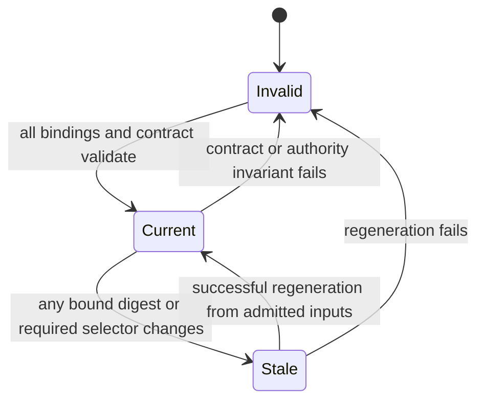

# State Machine: Learner Projection Validity

## ProjectionValidity

## Transition Table

| From | Trigger | To | Guard | Effect |
| --- | --- | --- | --- | --- |
| Invalid | compile passes | Current | every binding and invariant passes | expose projection |
| Current | source drift | Stale | any bound digest/selector differs | suppress derived explanation and suggestion |
| Stale | regenerate passes | Current | new inputs are explicitly bound | replace generated snapshot |
| Current/Stale | contract failure | Invalid | unknown class, illegal relation, or authority collapse | show diagnostic only |

## Invariants

- Only `Current` may expose a route suggestion.
- `Stale` and `Invalid` never reuse a previous suggestion.
- State describes projection validity, not semantic truth or learner state.
