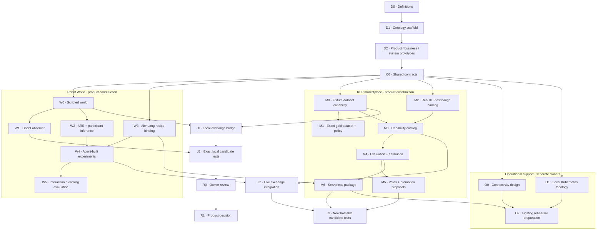
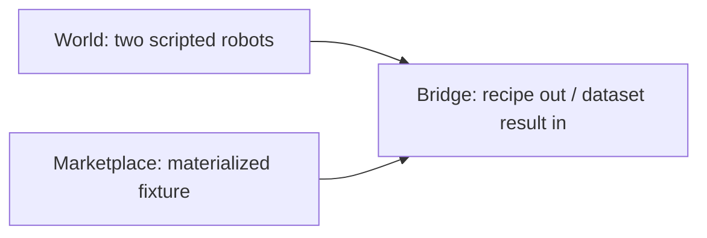

# Development DAG

Robot World and the KEP capability marketplace advance in parallel. Shared contracts let them exchange artifacts and evidence without sharing a database or granting each other authority over their histories. The complete machine-readable plan is `dag/development.json`; only `dag/epoch-001.json` is executable by the current allowlisted host.

The executable first epoch is smaller:

RWO issues W0 and M0 together with `max_parallelism = 2`. The Python host launches separate local processes. J0 requires both successful, content-identified outputs. The development DAG is planning data: loading it cannot execute its future tasks, approve a product, enroll a machine or deploy a workload.

## Construction frontier

An additive [interaction-v1 successor](interaction-dynamics/REPORT.md) now implements
and tests the bounded dynamics portion of W0 and supplies controlled evidence for
future W5 work. Its 19 focused tests and 70 repeated comparison cases are complete.
D5 full regression remains blocked by missing legacy RWO source/binaries; the
dependency/environment owner owns that prerequisite. The original candidate and
UI checkpoints remain intact. W2/W3/W4/W5/M2 are not completed by this local work.
The [reviewed interaction plan](interaction-dynamics/PLAN.md) is historical planning;
the implementation report owns its current stage state and open questions.

The first candidate covers D0–D2, C0, W0–W1, M0, J0–J1. Its exact test state and digest are in `evidence/epoch-001/verification.json` and `evidence/epoch-001/candidate.json`; owner review and approval remain distinct R0/R1 nodes. A local candidate decision never authorizes later live exchange or hosting scope.

Runnable next construction work:

| Node | Owner | Exact next result | Causal dependency |
|---|---|---|---|
| W2 | ARE runtime owner + world implementer | Participant connector delivers bounded contexts to one inference endpoint; proposals pass the existing action checks | W0 and selection of an inference adapter; begin adapter contract with a stub immediately |
| W3 | AlchLang owner | One recipe validates, lowers and executes through a selected world profile | C0; local carrier exists, admitted runtime profile does not |
| M2 | KEP owner | Map current identity/envelope/acknowledgement contracts into one artifact delivery test | C0; inspect and bind exact implementation before claiming protocol conformance |
| M1 | Dataset owner | Exact dataset version with provenance, license and selected access policy | M0; real gold dataset identity and rights remain Q1/Q2 |

W2, W3 and M2 can proceed independently. M1's unresolved real data selection does not block fixture construction. R0/R1 review of the current candidate does not block unrelated next prototypes; changed acceptance-bound bytes need a new candidate epoch.

## Operational support and deferred residue

| Node / task | Owner | Affected stage | State and dependency |
|---|---|---|---|
| O0 connectivity design | Network owner | No product stage | Runnable design; compare mesh and direct P2P using a measurable connectivity plan |
| O1 Kubernetes topology | Infrastructure owner | No product stage | Runnable design; local control plane, separate tenant sandboxes and outbound provider connectors |
| O2 hosting preparation | Infrastructure owner | Hosting preparation | Depends on O0, O1 and the exact M6 package; not a prerequisite for W0/M0 or live inference contract work |
| Network enrollment / VPN credentials | Network owner | Future operational activation | Deferred; requires exact selected participants, nodes and authorization |
| Cluster installation / external hosting | Infrastructure owner | Future operational activation | Deferred; requires a tested candidate and separately scoped operational decision |
| Public marketplace, financial settlement and publishing | Product / protocol owners | Future release and external effects | Deferred; no scope for these effects in the first epoch |

No operational-support node is on the current prototype's dependency path. The first causal construction gaps are real inference binding (W2), language compilation profile (W3), and real KEP exchange binding (M2). The large ontology graph remains a future bounded context adapter; the first fixture supplies a tiny local context projection rather than representing an integration that has not happened.

## Product checks

The first candidate must demonstrate independent branch execution, resource conservation, deterministic replay, intent ownership and revision checks, idempotency, immutable artifact validation, bounded version-specific dataset consumption, quarantine without catalog publication, native RWO cycle rejection and joins, plus a Godot replay of the generated events. Evidence only supports this local scope.

Open questions: [OPEN-QUESTIONS.md](OPEN-QUESTIONS.md).
