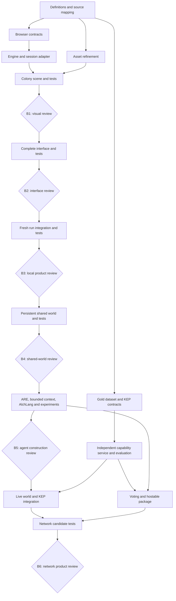
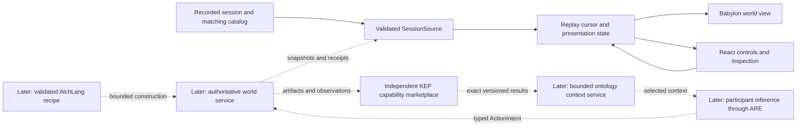

# Robot World in the browser

Status: planning candidate, 2026-09-06. Route: `CA2-ROUTE-PLAN`. This package describes a Babylon.js browser implementation and its review stops. It does not implement that world, register an executable RWO graph, or record product approval. The current request authorizes these planning artifacts.

Build a detailed, interactive robot colony that opens directly in a browser. First make the existing simulation visible and usable; then connect a persistent world, participant inference, AlchLang construction, and KEP capabilities. Robot World supplies experiments and artifacts to a marketplace that can also operate independently.

## Selected direction

Use **Babylon.js + TypeScript** for the world, **React + HTML/CSS** for the interface, and a **Vite** application build. Begin with WebGL2. Evaluate WebGPU as an optional backend after the browser scene works and the actual target device is measured. Babylon supports the scene, glTF, material, animation, picking, and rendering features this prototype needs; those features do not establish the performance of our assets. [Babylon specifications](https://www.babylonjs.com/specifications/), [engine repository](https://github.com/BabylonJS/Babylon.js).

The browser uses the visitor's graphics hardware. It does not need the Unity editor or a streamed cloud desktop. Persistent simulation and remote inference will still need services in later milestones. A browser renderer alone cannot keep a shared world running after everyone closes the page.

Keep these defaults for the first build:

| Choice | Initial scope |
|---|---|
| Entry experience | One island, two robots, one workshop, recorded session |
| Art direction | The existing cream, teal, and ochre colony reference |
| Interaction | Orbit, zoom, reset, select robot, inspect, play, pause, scrub |
| First supported browsers | Desktop Chrome and Edge; record exact tested versions |
| Reference viewport | 1440 × 900; also check 1280 × 800 and 1920 × 1080 |
| Runtime state | Existing scripted-policy replay; clearly labeled “Recorded session” |
| Build location | New `browser-world/app/` package, with its own dependency lock |
| Serving | Verified loopback preview for review; public hosting is separate |

Select and record actual package versions during implementation. Do not fabricate a lockfile or infer compatibility from this plan. Babylon's engine uses Apache-2.0; dependencies, models, and textures need their own provenance records. [Engine repository](https://github.com/BabylonJS/Babylon.js).

## Starting evidence and reuse

The [parent prototype](../README.md) already separates world, marketplace, and bridge. Its local world is driven by scripted policies. Its dataset is a synthetic fixture, its exchange is a local contract fixture, and its AlchLang carrier has a handwritten execution mapping. Live ARE models, the real trusted gold dataset, a general AlchLang execution path, persistent multiplayer, and network KEP exchange remain future construction.

Reuse these exact inputs:

- Seven prepared ColonyV2 GLBs: island environment, explorer, builder, workshop, market terminal, charging dock, and cargo crate.
- Thirty-three material textures and the editable Blender source. Preserve originals; put optimized browser derivatives under new paths with a source-to-output manifest.
- The selected `session.json` and its manifest: **82 frames**, including **tick 80/revision 240** and **tick 80/revision 241**. Keep both frames.
- The existing action and artifact contracts, session invariants, and the exact paired catalog.

The prepared input ZIP is 111,430,638 bytes; its manifest lists 117,097,616 uncompressed payload bytes. That is an input bundle, not a suitable browser delivery budget. Inventory geometry, embedded images, external texture duplication, and material assignments before generating derivatives. Load only assets the scene uses.

The [checkpoint-1 decision](../unity-ui/checkpoints/01/decision-v1.json) records the user's accepted visual direction in the earlier Unity scope. It does not validate a Babylon render. The [preparation review](../unity-ui/checkpoints/02/README.md) identifies unresolved fidelity gaps: box-shaped robots, sparse workshop contents, terrain facets, repeated textures, and lighting/material response. Carry these gaps into the browser art pass.

The Unity plans, frozen checkpoint-1 package, prepared source assets, retained Godot observer, and existing fixture exporter remain unchanged. Historical environment and test reports are not current browser evidence. Exact selected sources and digests are in [SOURCE-REGISTER.json](SOURCE-REGISTER.json).

## Product construction frontier

The next construction action is **D0: define the browser journey and observable state**, followed by its navigation scaffold and implementation mapping. These source and contract tasks can start without a GPU VM, Unity activation, Kubernetes, networking, or dataset selection.

Use the CAV2-D65 sequence inside each product milestone: prototype definitions → agent-facing ontology scaffold → product, business, DomainSpec, compiled-system, and implementation prototypes → one exact testable candidate → current tests → product approval. These local scaffolds aid navigation; they do not admit an ontology or runtime. Visual checkpoint decisions cover the presented scene/interface only. B3 is the first proposed complete local browser product candidate.

| Node | Construction work | Done evidence |
|---|---|---|
| D0 | Define observe, inspect, replay, and discover journeys; state current fixture limits | Browser journey and acceptance matrix |
| D1 | Map browser terms to source fields and existing prototype concepts | Source-linked local navigation scaffold |
| D2 | Map journeys, participant value, typed intent, component boundaries, and build outputs | Product/business/DomainSpec/compiled-system prototype mapping; no new commercial claims |
| C0 | Specify session loading, presentation, selection, and catalog contracts | Bounded input rules and meaningful positive/negative cases |
| E1 | Create the browser package and owned engine lifecycle | Locked build; canvas mounts, resizes, and disposes correctly |
| A1 | Import, optimize, and refine prepared models/materials against the reference | Derivative manifest, asset budgets, art comparison |
| L1 | Implement a validated session adapter and frame-index replay controller | Every retained frame survives; source identities remain visible |
| S1 | Assemble the lit colony, cameras, recorded robot motion, and selection | Actual browser scene and inspection panel |
| T1 → B1 | Test and capture the scene, then stop for visual review | Full view, close-ups, movement clip, scoped report, candidate digest |
| U1 → T2 → B2 | Complete the interface, verify interactions, then stop | Real browser interaction evidence and interface candidate |
| X1 → I1 → T3 → B3 | Add fresh-run export, integrate a new local run, and test the complete candidate | Reproducible run-to-browser evidence and product decision package |

The dependency graph is [dag.json](dag.json). Work can proceed independently where its edges allow it, but this graph does not itself dispatch helpers or authorize concurrent writers.

The main construction dependencies are shown below. B1–B6 are user review stops; marketplace work is a separately selectable branch. The JSON also includes the operational prerequisites and detailed test nodes.

## Architecture and data boundaries

One Babylon engine owns the scene and render loop. React owns panels, controls, loading states, and selection intent; React component renders must not drive each animation frame. Dispose engine resources, subscriptions, and input handlers on teardown. Keep scene state separate from validated session data.

Local prototype terms:

| Term | Meaning and boundary |
|---|---|
| `SessionSource` | A validated recorded session now; a separately validated live source later |
| `ReplayCursor` | Frame index, playback speed, and interpolation fraction; never the authoritative world clock |
| `BrowserWorldView` | Scene objects projected from source state; animation adds no world events |
| `AgentSelection` | Stable robot identifier shared between canvas selection and accessible DOM controls |
| `CapabilityView` | Exact catalog metadata and versions, including explicit unresolved knowledge links |
| `LiveWorldSource` | Future revisioned snapshots/deltas with reconnect and resynchronization rules |
| `ActionIntent` | Existing prototype command shape; future authenticated submission wraps and validates it |

These are local design terms and mappings, not canonical definitions. Resolve exact owner sources before any future cross-runtime binding. In particular, the user's ontology architecture at `/home/vrondelli/projects/CyberAlchemy-lab/ontology-lifecycle/runtime-candidates/cal-ontology-graph-read-model/v1/ARCHITECTURE.md` is a future integration target, not an API proven compatible by this browser plan.

### Session contract

Preserve the existing [session contract](../unity-ui/SESSION-CONTRACT.md) while replacing the Unity-specific loader with TypeScript:

- Validate bounded bytes, supported schema, manifest content hash, frame count, finite numeric fields, counters, identities, and vector dimensions before publishing a session to the view. Hash the response bytes before parsing; integrity metadata alone does not authenticate a producer.
- Use **frame index** as the playback cursor. Ticks are non-decreasing and revisions strictly increase. The final same-tick revision is not a duplicate to discard.
- Keep world, robot, and owner identities stable through a session. Map two physical coordinates onto the scene's X/Z plane. Memory/prior vectors remain semantic state.
- Interpolate presentation positions between frames without modifying frames, revision, energy, resources, or memory. Pause and scrub restore exact selected state. Switching tabs must not invent missed simulation events.
- Join knowledge to the paired catalog by exact identifiers and versions. Mark unknown links as unresolved. Do not substitute assets or metadata from another run silently.
- Display actual recorded values. Missing values appear as unavailable; illustrative numbers in the reference image are not source data.
- Handle malformed sessions, missing assets, failed fetches, unsupported rendering, and graphics-context loss with a recoverable visible state.

Keep boids-style steering, interaction vectors, and temporal decay in simulation code. Their update uses simulation time, for example `memory[k] = memory[k] * exp(-decay[k] * dt) + interaction[k]`; rendering frame rate cannot alter the experiment. Spatial coordinates and semantic dimensions have different meanings. The current fixture uses four semantic dimensions; support for arbitrary dimensions or large populations requires separate tests and measured neighbor-selection costs.

### Future execution boundary

Participant agents receive structured observations and propose structured actions; they do not need to operate the visual canvas. The world service owns state transitions and checks agent ownership, action eligibility, expected revision, request identity, and repeated submissions. The existing prototype action vocabulary is `move`, `gather`, `deposit`, `build`, and `wait`.

ARE will mediate inference and budgets. The large ontology graph stays behind a bounded context interface that returns selected facts, relationships, source revisions, and provenance. A small model can choose among eligible actions while local rules handle movement; compare it with the scripted baseline before claiming learning gains. Timeouts have a defined fallback action and cannot stall the world tick indefinitely.

AlchLang recipes become validated, resource-bounded construction requests. Arbitrary participant JavaScript is not a recipe execution mechanism. RWO schedules experiment and capability jobs; it is not assumed to be the browser render loop or the authoritative realtime simulation clock.

## Three immediate review checkpoints

### B1 — The browser world looks and feels right

Deliver the island, detailed workshop, explorer and builder, charging dock, cargo, and terminal. Match composition, robot silhouette and surface detail, warm lighting, cream panels, teal/ochre accents, and readable spacing against the approved image. Orbit, zoom, reset, recorded movement, and robot selection must work.

Present an actual browser full view, explorer/builder/workshop close-ups, a short motion clip, and a comparison that names remaining visual gaps. Record browser, viewport, device/GPU where observable, render backend, asset bytes, and frame timings. Preparation renders do not satisfy this checkpoint. Placeholder geometry does not satisfy the requested quality.

**Stop here for the user's visual validation.** Capture a manifest-bound decision. If changes are requested, revise and recapture B1; do not advance to B2 on silence.

### B2 — The interface is complete and usable

Deliver the crew panel, selected-robot inspector, timeline, play/pause, frame stepping, speed, reset, and capability catalog/details. Show recorded mode and distinguish fixture contributors/consumers from authenticated network participants. Preserve the catalog facets: `kind` (tool/workflow), `artifact_type` (dataset/recipe), and `domain` (such as research/construction/ecommerce). They are independent fields.

Camera input applies over the world canvas; interacting with controls cannot move the camera. Proposed keyboard controls are Space for play/pause, arrows for frame stepping, 1/2 for robot selection, R for reset, and Escape for closing an inspector. Do not intercept typing in editable controls. Provide labeled DOM alternatives to canvas-only selection, visible focus, and usable loading, empty, error, and reconnect-placeholder states.

Check text contrast against 4.5:1 for normal text and 3:1 for large text; these targeted checks are not a claim of full accessibility conformance. [W3C contrast guidance](https://www.w3.org/WAI/WCAG22/Understanding/contrast-minimum.html).

Use Playwright to operate actual controls, assert state changes, capture the required viewports, and inspect console/network failures. Read-only scene projection can locate a robot for a canvas click; it must not replace the interaction under test. **Stop for interface validation on the exact B2 candidate.**

### B3 — A fresh local simulation reaches the browser correctly

The current Unity exporter deliberately supports one frozen fixture. Implement a new browser exporter/import path for an explicitly selected fresh run; do not make the old fixture exporter appear general by refreshing its pinned digests.

Run the existing local RWO epoch into a new unique output directory, obtain that run's replay and catalog, create a paired session manifest, and load it into the built browser application. Reject mismatched run inputs. Verify both the old 82-frame fixture and the fresh session; the fresh run's frame count comes from its output and is not assumed to equal 82.

Capture the exact source/code/lockfile/asset/session hashes, build output identity, run receipts, automated checks, actual browser screenshots, and performance results. Verify the world and marketplace can still run as independent prototype branches, and that the browser consumes their joined output without changing it. **Stop for local product-candidate review and approval.** Any changed acceptance-bound bytes require a new candidate and current tests.

B3 establishes only the local browser prototype described here. Public release, persistent multiuser service, real KEP, and hosting are later scopes.

## Quality and verification targets

At 1440 × 900 on a named tested device, use median frame time ≤16.7 ms and p95 ≤33.3 ms as initial targets after warmup. Report measured results, sampling conditions, and any agreed target change; these figures are not existing measurements or device-wide guarantees. Headless/software rendering can provide smoke-test evidence, not acceptance of GPU performance or visual fidelity.

Use provisional delivery targets of ≤15 MiB transferred to first interactive scene and ≤40 MiB for all required scene assets. Record compressed transfer and decoded GPU texture/geometry costs separately. Tune texture resolution, mipmaps, shared materials, mesh detail, and lazy loading against the reference. If quality cannot meet these targets, present the measured tradeoff at B1 instead of silently degrading the scene. Do not download the original 111 MB bundle at application startup.

Instance repeated static props where useful. Keep animated or selected robots individually addressable. Replay needs no new physics engine: later interactive collision and navigation requirements get their own evaluation.

Meaningful automated checks cover malformed/bounded inputs, same-tick revisions, identity changes, mismatched manifests/catalogs, exact scrub state, deterministic playback across elapsed render time, and production-build browser interactions. Verify resize/disposal and a context-loss recovery path. Do not add tests that merely repeat property assignments or screenshot every trivial style edit.

## Later product milestones and parallel marketplace work

These are roadmap contracts requiring their own exact construction scope. B3 completion does not start them automatically. Within each, repeat the definition-to-test sequence before asking for product approval.

| Milestone | Product work and decisive demonstration | Parent alignment |
|---|---|---|
| F1 → B4: persistent shared world | Authoritative server state; two browsers see the same revision; the world advances when both close; reconnect and process restart recover committed history without duplicate actions | Extends world W0 and bridge J2 |
| F2, F3 → F4 → B5: participant agents build | ARE adapter with identity/budgets and bounded ontology context; one participant-provided inference endpoint; one validated AlchLang recipe; timeout, stale/repeated action, and ownership rejection; compare scripted and model policies on fixed seeds | W2, W3, W4, W5 |
| M1–M4: independent capability service | Select exact gold dataset/version/provenance/access policy; bind KEP identities and exchange; discover/invoke exact versions; reproduce outcomes and attribute contributions | M1, M2, M3, M4 |
| M5, M6, J2 → J3 → B6: hostable network candidate | Reviewed promotion proposals and voting; immutable sandboxed function package; live world/KEP receipts reconcile; independent consumer invokes a contributed capability | M5, M6, J2, J3 |

Marketplace definition and contract work can advance independently of browser art and replay. M1/M2 do not depend on B1–B3. Evaluation also accepts contributions produced outside Robot World. The world becomes one useful producer and consumer, not a prerequisite for every marketplace operation.

Contribution attribution, access entitlement, vote outcome, and hosting authorization are separate records. A vote creates a promotion decision/proposal for a specific tested artifact; it does not automatically deploy code or give every contributor unrestricted access. Begin economic experiments with simulated credits. Money movement and settlement from other initiatives are outside this game plan.

## Operational support and deferred residue

| Node | Owner role | Affected stage / exact dependency | Treatment |
|---|---|---|---|
| O1 | Environment owner | E1/A1/L1 build/import and T1 render checks | Verify local Node/package paths, disk/cache location, and real browser/GPU; source/contract work can proceed independently |
| O2 | Build maintainer | T1/T2/T3 browser inspection | Bind a loopback preview and document build/start commands; no public publishing |
| O3 | User / VM owner | No browser product stage | Existing Vast VM retention, backup, billing, and repair are separate residue; no resource change authorized by this plan |
| O4 | Network and infrastructure owners | Future hosting preparation after F1/M6 | Measure Tailscale/Headscale and direct-P2P needs; design local Kubernetes/control-plane/provider boundaries |
| O5 | Infrastructure owner | Future hosting rehearsal after O4 and B6 | Prepare exact deployment/rollback files; deployment remains a separate explicit effect |

Only O1/O2 are immediate environment prerequisites for executing browser checks. A failed environment probe makes the affected rendering check not evaluable; it does not block definitions, adapter contracts, or other independent source work. Kubernetes and VPN/P2P choice do not gate B1–B3.

No external hosting is provisioned by this plan. Hosting operators must not obtain control of the whole local cluster merely by providing function capacity; define isolated provider/invocation boundaries in the future hosting product.

## Execution and evidence contract

Follow [ONE-SHOT.md](ONE-SHOT.md) for uninterrupted work between review stops. The graph describes prerequisites, lanes, owners, and completion evidence. It is not accepted by the existing `runtime/run.py` host, whose executable scope remains the selected local fixture epoch.

Future implementation writes belong under `browser-world/app/`, `browser-world/contracts/`, `browser-world/tools/`, and new versioned `browser-world/checkpoints/` evidence. Announce exact affected files before each mutation batch. Exported fresh sessions belong under a selected new run directory or checkpoint package, never over the retained fixture. Existing sources and frozen decisions are read-only inputs to this plan.

Before each review, save a versioned manifest of the exact candidate and a readable report with passed, failed, and not-evaluable checks. Save any subsequent explicit user decision in a separate receipt bound to that manifest; do not edit an old manifest's status. The final report states only what the candidate proves.

## Open questions

Defaults above allow D0 through B1 preparation without an interview. Resolve later questions when their exact dependent work begins:

| ID | Question | Owner and first affected work |
|---|---|---|
| BQ1 | Which actual local GPU/device is the reference for performance acceptance? | Environment owner, O1/T1; record observed hardware |
| BQ2 | Do final optimized assets meet the visual reference within the provisional delivery budget? | Art owner + user, A1/B1; present measured tradeoffs |
| BQ3 | Are mobile/touch, Safari, or Firefox required in the first supported set? | Product owner; default desktop Chrome/Edge through B3 |
| BQ4 | Which exact ARE, ontology context, and AlchLang interfaces and versions will be bound? | Runtime owners, F2/F3; resolve source locations and inspect selected contracts |
| BQ5 | Which gold dataset, contribution entitlement, KEP identity/key custody, and promotion criteria apply? | Dataset/KEP/product owners, M1–M5; see parent Q1–Q6 |
| BQ6 | What concurrency, restart durability, and experiment sizes must the first live world support? | World owner, F1; measure a bounded candidate before scale claims |
| BQ7 | What isolation, metering, and connectivity do community hosts need? | Hosting/network owners, M6/O4; see parent Q7–Q9 |

The parent [OPEN-QUESTIONS.md](../OPEN-QUESTIONS.md) owns unresolved ecosystem questions. None grants authority through an assumed answer.
