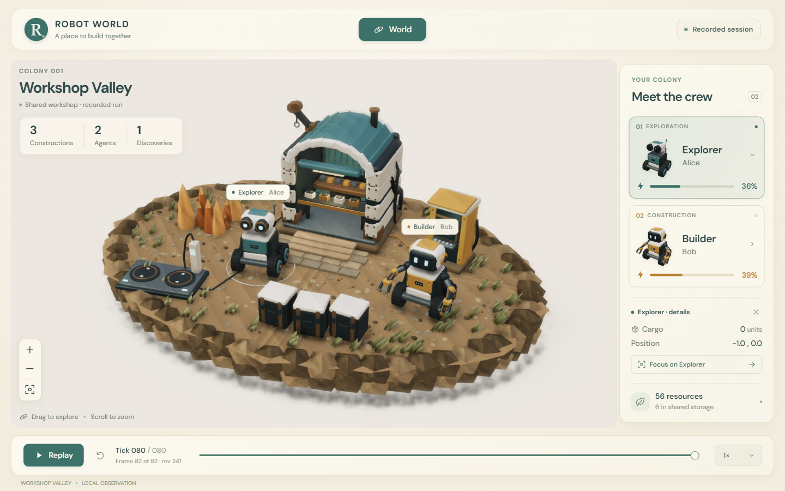

# B1 v1 — browser world visual review

2026-09-06. **Ready for visual review, with a performance target miss and visible fidelity gaps. No B1 decision has been recorded.**

[Open the running local scene](http://127.0.0.1:16340/?review=B1-v1). [Reproduce the local build and launch](../../../app/README.md). This checkpoint presents the recorded fixture in Babylon.js 9.25.0, TypeScript and React. The browser opens at frame 82: tick 80, revision 241.

## Try the scene

Drag to orbit, scroll to zoom, select a robot in the scene or crew panel, and use Focus/Reset. Replay runs the recorded sequence; the timeline preserves both tick-80 revisions. The camera can move while playback continues. The crew values are source values, and the world interpolates movement between frames.

[Movement recording — 74 seconds](movement.webm) · [Explorer close-up](explorer-close.png) · [Builder close-up](builder-close.png) · [Workshop detail](workshop-detail.png)

[1280 × 800](full-1280x800.png) · [1920 × 1080](full-1920x1080.png) · [Edge at 1440 × 900](edge-1440x900.png)

The clip includes setup and a 2× replay through frame index 45, followed by pause and restoration of the final frame. It records actual UI interaction. Close-ups and full views are actual browser captures; the workshop image is a viewport crop.

## Compare with the reference

[Approved visual-direction reference](../../../../unity-ui/checkpoints/01/art-direction-v1.png). The browser retains its warm cream interface, teal Explorer, ochre Builder, workshop, charging dock, terminal and island composition. PBR materials, environment lighting, shadows, ambient occlusion, small gravel, apron paving, cables and workshop details are present. Portraits render the same robot meshes used in the scene.

The candidate still differs materially: the terrain edge is coarser and more faceted, robot silhouettes are boxier, material weathering and scene dressing are less rich, and ground/contact shadows can look soft or blotchy at the lower render resolution. Wheels and arms do not articulate independently; robots translate and turn with recorded motion. The prepared meshes retain their topology. Visual equivalence is **not established** by the passing functional checks or the prior Unity direction decision.

## Verification and measured limits

| Check | Current result | Evidence |
|---|---|---|
| Locked production build and TypeScript | PASS | [build.log](build.log) |
| Loader and playback verification | PASS — 5 test groups, including malformed/tampered data and time partition invariance | [unit-tests.log](unit-tests.log) |
| Import, same-tick revisions, panel/canvas picking, orbit, focus/reset, replay, portraits | PASS — 8 browser checks | [interactions.json](interactions.json) |
| Three required viewports | PASS — no horizontal overflow, correct resize and portraits | [viewports.json](viewports.json) |
| Context loss, missing asset and retry lifecycle | PASS — visible errors, successful retry, one retained engine | [recovery.json](recovery.json) |
| Fresh Edge scene and robot selection | PASS | [edge.json](edge.json) |
| Movement recording and dimensions | PASS — VP8, 1440 × 900, 73.76 seconds | [movement.json](movement.json), [metadata](video-metadata.json) |
| Original inputs and browser derivatives | PASS — 24 selected sources, 45 prepared inputs, 8 frozen references, 3 plan artifacts and 40 derivatives | [integrity.json](integrity.json) |
| Steady frame-time target | **TARGET NOT MET** — median 17.2 ms versus ≤16.7; p95 25.1 ms versus ≤33.3 | [performance.json](performance.json) |
| Optional WebMCP browser API | not_evaluable — unsupported in the tested browser; normal UI remains available | [performance.json](performance.json) |
| B1 visual validation | Pending user decision | No decision receipt exists |
| B2 interface completion and B3 fresh-run integration | Not started | [one-shot scope](../../../ONE-SHOT.md) |

The steady sample used foreground headed Chrome 152 on Windows with AMD Radeon Graphics through ANGLE Direct3D11, WebGL2, a 1440 × 900 browser viewport, a 1112 × 675 world buffer and DPR approximately 1. After a three-second warmup, 901 render-loop intervals were collected with the final frame and default camera. Recording was stopped. Hidden-page samples and intervals ≥500 ms are excluded by the implementation, so these figures do not bound every stall. Background machine activity was uncontrolled; this is not a GPU-only timer or a guarantee of 60 fps. The clean measurement reload had zero captured console errors and failed requests.

A fresh Edge profile transferred 12,537,318 local resource bytes (11.96 MiB), plus 1,169 navigation bytes, under the provisional 15 MiB local delivery target. Google Fonts CSS is an external request; this local byte figure is not a complete network trace or an offline-font claim. The site has a system-font fallback. Repeated cache-backed resource entries are not counted again as transferred bytes.

Seven prepared source GLBs total 85,447,168 bytes. Browser model derivatives total 8,503,416 bytes; deduplicated textures add 2,879,970 bytes and the local environment map adds 273,974 bytes. Required scene asset storage totals about 11.12 MiB, below the 40 MiB target. Geometry buffer views total 8,192,424 bytes. Decoded shared RGBA8 textures with full mip chains are estimated at 46,137,333 bytes; this excludes render targets, depth, shadows, SSAO, IBL and driver overhead and is **not measured GPU allocation**. [Asset accounting](asset-budget.json).

## Construction frontier and operational support

Product construction: D0/D1/D2/C0 have local prototype definitions and source mappings. E1/L1/S1 have implementation and current checks. A1 has a source-mapped derivative candidate, with quality and the median-time target unresolved at review. T1 has current captures and measurement evidence, not an overall acceptance PASS. The frontier is **B1 visual review**. Visual revisions can remain in B1; B2 and B3 require the explicit preceding checkpoint decision.

Operational support: O1 local package/browser setup is complete; the implementation agent owns the recorded environment and installed tooling affecting E1/T1. O2 loopback preview is running for user review and directly supports T1/B1. No operational task currently blocks the browser construction frontier. The environment owner retains deferred O3 Vast/Unity cleanup with no browser stage dependency. Future network and hosting work remains in its separately scoped lane.

No live inference, ontology graph query, ARE invocation, AlchLang execution, KEP exchange, real-money economy or fresh RWO export was executed by this browser batch. Its graph references are navigation scaffolds, and its data is the selected recorded fixture. The original Unity package and frozen checkpoint bytes remain unchanged. No commit, push, public hosting or cloud change was performed.

## Candidate identity and next decision

[manifest.json](manifest.json) binds this B1 revision's contracts, source, lockfile, tools, local assets/session, production output, review and evidence. The manifest excludes itself to avoid a circular hash; a subsequent explicit decision must name its SHA-256. No status field substitutes for that response. Changes after review create another B1 revision.

The next user decision is whether this exact visual candidate is acceptable to continue to B2, or which visual revisions should remain in B1. The recorded performance target has not been silently changed. B1 validation is separate from the B3 product decision.

Open questions remain in [the browser plan](../../../PLAN.md#open-questions).
