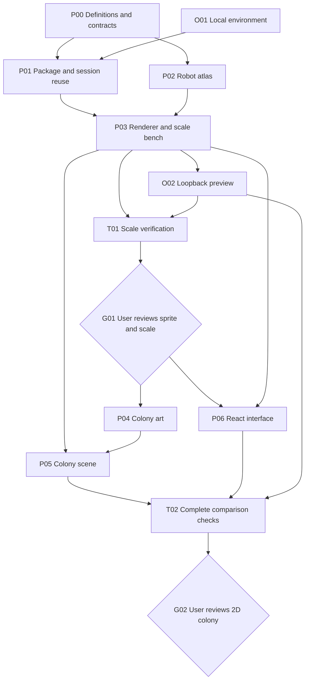

# Smaller sprite Robot World: detailed construction plan

Planning candidate, 2026-09-06. Selected route: CA2-ROUTE-PLAN. This is a bounded implementation handoff, not a registered execution graph, product approval or instruction to start agents now.

## Outcome and scope

Create a separate Phaser application in this package's future `app/`. Render two small animated robots, several coherent buildings, a shared plaza and routes with a fixed camera, pan and zoom. Reuse the existing React interaction pattern and exact recorded session. Show a real running comparison against the Babylon B1 candidate.

Normal robots should occupy approximately 48–64 CSS pixels in height, with a 64-world-pixel nominal height before camera zoom. The colony should occupy the world panel without making a single robot its dominant object. A user can select either robot, understand its recorded state and replay the same session.

The current fixture has two robots, 82 frames and final tick 80/revision 241. It is not a many-agent simulation. A separately labeled render-load view may duplicate sprites to measure graphics cost, but those objects never become crew, agents, contributions or discoveries.

This scope ends at G02 visual comparison. ARE, ontology queries, AlchLang, KEP, fresh RWO export, economic execution, cloud infrastructure and renderer cutover remain outside it. The existing graph architecture is not a dependency of this rendering experiment.

## Decisions for Luna

| Choice | Planning default | Reason |
|---|---|---|
| Engine | Phaser 3.90.0, pinned | Bounded 3.x API surface and an official versioned release; avoid mixing major-version examples |
| UI/build | React 19.2.8, Vite 8.2.2, TypeScript 7.0.2; other exact pins from current package | Preserve the already inspected frontend pattern |
| Renderer | WebGL; explicit error if unavailable | Keep a named, testable backend; no silent fallback benchmark |
| Camera | Fixed, near-frontal 2D scene with ground-plane depth; pan/zoom, no rotation | Supplied sheet mainly provides front/side views |
| Data reuse | Exact copies of session.ts, playback.ts, their test, fixture and manifest | Preserve validated behavior without changing the frozen Babylon package |
| Asset handling | Original sheet retained byte-for-byte; separate transparent derivative and atlas metadata | Source is RGB with a baked background and printed labels |
| UI density | Labels on selection/hover, always-accessible crew list | Smaller robots stay readable without filling the world with labels |
| Implementation order | One ready packet at a time | Keep context and ownership bounded for Luna |
| Approval stops | G01 then G02 | Resolve art/scale before spending on the full colony |

Phaser 3.90.0 is an intentional comparison pin, not a claim that it is the latest version. The current official stable page points to 4.2.1. Do not upgrade or combine 4.x rendering tutorials into this packet without a concrete compatibility decision. The versioned release and npm package were verified while planning. [3.90.0 release](https://phaser.io/download/release/v3.90.0), [current release page](https://phaser.io/download/stable).

## Source baseline

[Source register](SOURCE-REGISTER.json) records current hashes. The Babylon B1 manifest SHA-256 is `4804f1ba40d7dadb9cf71fa098acbaa9b06edcc058afd62ceaf32dc14768131c`. All 749 bound files matched during planning; no B1 decision receipt existed.

The supplied file is a 1536×1024 RGB PNG, 515,827 bytes, SHA-256 `f8519e7e83bcfed909cff7f15cf47d48773eda1c9d68754a8eb22e43f95780d6`. It is a single image, despite having no extension and a name that looks like a folder.

The source reference establishes a desired style and visible poses. It is not a ready transparent atlas, a 3D model, or a complete directional animation set. This plan has not prepared or browser-tested its frames.

## Product construction frontier

Current frontier: a ready planning package for a new B1 comparison. P00 can start when implementation is selected and authorized. P00 establishes local prototype definitions and source scaffolds before implementation-bearing work. No canonical ontology or goal registry changes are needed.

The D65 progression is explicit:

1. P00: define view, atlas frame, visual actor, selected robot, simulation cursor and comparison checkpoint.
2. P00: map those prototype terms to exact source fields and local presentation fields.
3. P00: record product, business, typed intent, compiled-system and implementation prototypes.
4. P01–P06: build the bounded comparison through those contracts.
5. T01/G01: tested sprite/scale candidate and user visual decision.
6. T02/G02: exact complete visual candidate, current evidence and user comparison decision.

G02 is a B1 visual decision. The parent B3 remains the later product-candidate/approval stage. No visual receipt grants operation or deployment authority.

## DAG

[dag.json](dag.json) is the dependency and packet index. It is descriptive planning data, not input to the existing RWO runner. Do not pass it to the runtime validator or manufacture admission by adding a status field.

## Operational support lane

| Node | Owner | Affected construction stage | Role / current state |
|---|---|---|---|
| O01 | Environment Luna / coordinator | P01 and browser checks | Verify Linux Node/npm pair, package cache, disk, browser and image tooling; not run yet |
| O02 | Preview owner / coordinator | T01/G01 and T02/G02 | Serve only the new app on a free loopback port; refresh built output for T02; not run yet |
| O03 | User's environment owner | None | Deferred Vast/Unity resource administration; excluded from this execution scope |

O01 can be pending while P00 and asset inspection in P02 progress. O03 never blocks these product tasks. O02 blocks browser capture only if the selected app cannot be served. A missing raster-editing tool blocks the affected art deliverable; it does not block contracts, fixture reuse or scene structure that can be verified with explicitly labeled test placeholders.

Do not treat a placeholder-only render as the completed art checkpoint. Dependency-ready work can continue, but the affected visual checks remain not_evaluable.

## Checkpoints

**G01 — Sprite and scale.** Present the supplied reference, transparent derivative, idle/walk animation, foot alignment and 48/64/80-pixel scale comparisons on light and dark backgrounds. Include a small representative building and ground tile. Recommend 64 nominal world pixels, but show actual measured on-screen height. Stop for an explicit visual decision bound to the candidate manifest.

**G02 — Colony comparison.** Present the final scene at the required viewports, moving replay, selection/inspection, measured transfer/frame timings, limitations and links to the old Babylon scene. Stop for the user's visual choice or revision request. Do not silently replace the original renderer.

At either gate: requested changes create a new revision; previous evidence and decisions stay unchanged. Test failures and target misses remain visible. A visual decision does not turn failed checks into passing checks.

## Execution rules

Each Luna reads LUNA-START.md, its one packet, the selected contract sections and exact dependencies. Do not load the whole repository or assign “build the entire game” to a single helper. Each packet produces a result receipt and names the next dependency-ready node.

Use the requested Luna model, `gpt-5.6-luna`, when an actual native helper is dispatched. Start with high reasoning effort for the contracts/renderer/integration packets and medium for bounded asset/accounting work; the coordinator may use the user's configured effort. This is a dispatch recommendation, not a tool call.

The current task only asks for a plan. No helpers were launched. Future native delegation must pass through CA2-ROUTE-DELEGATE. Default to serial bounded helpers, one open at a time, with the parent joining every result. Concurrent multi-helper work requires the repository's explicit user-approved fan-out sheet. Do not invent approval from this document.

## Completion boundary

The plan is ready when its links, selected-source hashes, DAG closure, write ownership, gates and packet fields are checked. Implementation is complete for this comparison only when G02 has a current rendered candidate and the user's explicit visual response. Current measurements cannot be inferred from planning targets.

Open questions: [OPEN-QUESTIONS.md](OPEN-QUESTIONS.md).
