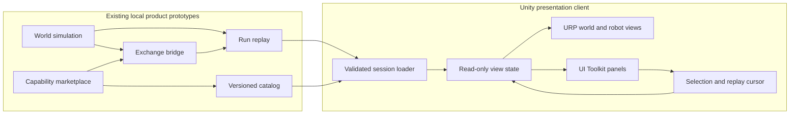
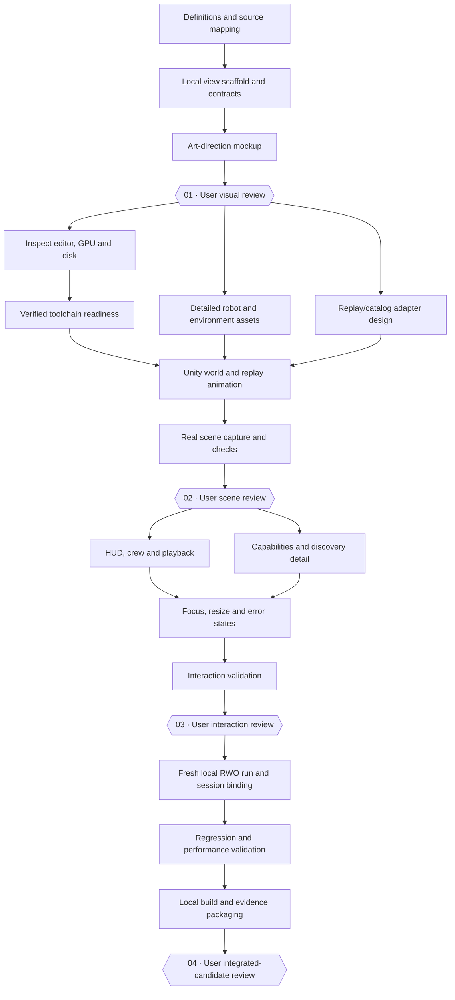

# Robot World — Unity UI in one continuous run

Build a polished Unity 6 / URP desktop client for Workshop Valley, using the original robot concept as the visual target and the existing world replay and capability catalog as the data source. Work continuously between four user review checkpoints. At each checkpoint, show the actual artifact, state what works, and wait for the user's validation before beginning the next dependent batch.

This is a planning candidate dated 2026-09-06. Checkpoint 01 contains an AI-generated art-direction mockup. Unity availability, editor licensing, GPU access, compilation, rendering and executable delivery have not been verified. No Unity implementation is claimed by this package.

## The four checkpoints

| Checkpoint | What the user sees | Required evidence before stopping | Decision scope |
|---|---|---|---|
| **01 — Visual direction** | A complete colony screen mockup, based on the original detailed robot art | Saved image, exact generation prompt, source identities and visual review criteria | Validate palette, world detail, composition and UI hierarchy; request revisions if needed |
| **02 — Real Unity world** | The running island, two detailed robots, workshop, exchange station, crystals and construction props | Actual Unity full-screen capture, robot/workshop close-ups and a short replay/camera clip; pinned toolchain and import/render logs | Validate real asset quality, lighting, scale, camera and animation against 01 |
| **03 — Working interface** | Select robots, scrub the replay, inspect discoveries and browse capabilities | Actual interactive build and walkthrough; data-binding, keyboard, pointer and resize checks | Validate the complete interaction flow and readable states |
| **04 — Integrated local build** | Launch the packaged client and inspect a fresh local RWO world/marketplace run | Exact build and input hashes, fresh integration results, regression results and measured performance on named hardware | Review the tested UI product candidate; any product approval must bind those exact bytes |

Checkpoint validation is explicit user input. A timeout, screenshot, automated PASS or edited status field cannot provide it. A requested revision produces a new version of that checkpoint; present it again before advancing. At 04, visual acceptance alone is not automatically a product approval. None of these decisions grants publication, deployment, network enrollment or hosting authority.

## Experience and visual target

The world occupies roughly three quarters of the useful screen. Use a warm ivory canvas, cream panels, dark teal text, muted teal for the explorer and ochre for the builder. Rich soil, layered rock edges, readable plant clusters, soft grounded shadows and worn manufactured materials give the colony substance. Robots need recognizable silhouettes, beveled ivory panels, dark mechanisms, expressive lights and purposeful movement. The workshop needs real depth, tools, cables and layered construction. A palette change alone cannot satisfy checkpoint 02.

Proposed starting tokens: background `#E9E4D8`, panel `#FAF7EE`, text `#294747`, active teal `#477C73`, ochre `#BB9042`, spacing units 4/8/12/16/24/32 pixels. These are implementation starting values, subject to checkpoint 01 review. Validate rendered text contrast; the token list is not an accessibility test.

| Surface | Behavior in this UI candidate | Data and honesty requirements |
|---|---|---|
| World | Isometric orbit, zoom, reset; select either robot in the world or crew panel | Positions and counts come from the selected replay frame; animation interpolation never writes simulation state |
| Crew inspector | Name, owner, energy, cargo and available activity; optional expanded interaction-memory values | Distinguish recorded facts from inferred activity labels; missing fields are unavailable, never invented |
| Playback | Play/pause, frame step, scrub, speed, current tick | Use frame index internally: multiple states may have the same tick but different revisions |
| Capabilities | Search/filter the two fixture offers; inspect type, domain, effect, contributors, consumers and exact version | Tool/workflow, dataset/recipe and research/construction are separate facets; display only supplied values |
| Discovery detail | Show the recorded knowledge result and linked contribution when a matching artifact exists | Follow exact run/version references; an unlinked result remains visibly unlinked |
| Session state | Persistent “Demo replay” label; loading, empty, invalid input and missing catalog views | No live-inference or connected-network badge for fixture data; a missing catalog cannot fall back to a different run |

Desktop baseline: 1440×900, plus 1280×800 and 1920×1080. At the smaller size, compact or collapse the inspector so the world and playback stay usable. Keyboard: Space for playback, arrows for stepping when focus is outside editable controls, 1/2 for robots, R for view reset, Escape to close a panel. Click selects; right-drag orbits; wheel zooms only over the world. UI interaction must not also move the camera. Modal focus returns to its opener; information must remain understandable without color alone.

## Architecture and construction sequence

Use **Unity 6 + URP**, C# presentation code and **UI Toolkit** for the screen interface. Use glTFast for importing the existing GLBs after checking compatibility with the selected editor. Pin the exact editor, URP, input, importer and test package versions together during setup. Unity's [rendering strategy](https://unity.com/topics/render-pipelines-strategy-for-2026) supports choosing URP for a new project. Its [UI Toolkit documentation update](https://unity.com/blog/unity-6-ui-toolkit-updates) covers runtime data binding; [glTFast editor documentation](https://docs.unity3d.com/Packages/com.unity.cloud.gltfast@6.0/manual/ImportEditor.html) establishes the GLB-to-prefab import path, not the compatibility of an untested package combination.

Keep ARE inference, the world simulation, ontology context, AlchLang execution, RWO and KEP outside the renderer. This UI consumes snapshots and artifact metadata. The current local simulation uses scripted policies and a fixture exchange bridge. The engine change does not turn those into neural agents or real KEP transport.

The construction stages stay explicit under CAV2-D65:

1. **Prototype definitions:** a session is an identified replay plus its matching catalog; a visual checkpoint validates one presentation candidate; a robot view represents a recorded agent.
2. **Agent-facing ontology scaffold:** local navigation concepts `WorldView`, `AgentSelection`, `ReplayCursor`, `SessionSource`, `CapabilityView`, `CheckpointReview`. They point to concrete source fields and owners, with no ontology admission or changes to the shared ontology.
3. **Product/business/system prototypes:** the journey is observe → inspect → discover → reuse knowledge metadata. The proposed business value is clearer inspection of contributed work; this UI does not measure marketplace demand or revenue. DomainSpec/compiled-system mapping is a local prototype mapping to the existing carrier and JSON inputs, not a claim of a newly admitted profile or compiler.
4. **Implementation prototype:** the Unity client, authored assets and read-only adapters, validated at 02 and 03.
5. **Exact product candidate and tests:** freeze source, build, package locks and selected inputs; validate fresh integration at 04. Any subsequent change to those bytes requires a new candidate/test epoch.
6. **Product decision:** ask the user to review the concrete tested scope at 04. Any later operational action has its own scope and owner.

## Dependency graph

`dag.json` is an RWO-schema planning graph. It is not executable by the current allowlisted fixture host. Checkpoint nodes require user decisions; the JSON has no mechanism that manufactures those decisions. Its required deadline value is a schema placeholder, not an estimate or a clock running while the user reviews. Any future executor must compile separately bounded work batches and preserve the human stops.

A single agent may process independent ready tasks serially. The graph does not authorize additional agents. Existing RWO fixture processes can still run world and marketplace concurrently during the integration batch.

## Batches and verification

**Batch 1 → checkpoint 01:** preserve source identities, establish the view contract and produce the mockup. Review whether the image captures the original concept's detailed material/geometry character, keeps the world prominent and leaves clear space for controls. A generated image establishes direction only.

**Batch 2 → checkpoint 02:** inspect the local editor/GPU/disk setup, pin compatible packages, import the seven existing GLBs into a new Unity project and create versioned asset upgrades. Author real geometry and material detail for the two robots and workshop; add terrain, rock, plants, lights and camera. Validate units, axes, normals, material import and selection colliders. Load and animate the recorded session. Capture actual Unity output at matched camera angles, including robot and workshop close-ups. No concept image or another engine's screenshot can substitute for this evidence. If only simple blockout assets are available, 02 is not ready.

**Batch 3 → checkpoint 03:** implement the full surface table above. Validate beginning, midpoint and final replay frames against source values, both robots, duplicate-tick frame stepping, seeking while playing, speed changes, catalog filters and exact artifact versions. Exercise malformed/truncated replay, missing catalog, unknown robot and empty results. Confirm pointer hit-testing, modal focus, keyboard actions and all three viewport sizes in the actual Unity runtime. Automated signal tests and manually exercised OS input must be reported separately.

**Batch 4 → checkpoint 04:** create a fresh run in a new package `runs/unity-ui-<run-id>/` child using the existing local runner. Import its replay and catalog as one identified session. Verify independent world/marketplace execution, their bridge join and Unity's displayed outcome. Re-run the existing backend regression suite for the integrated candidate, plus the Unity adapter/UI tests. Never overwrite retained epoch runs. Profile a packaged build after warmup over the full replay loop; record OS, CPU, GPU, resolution, render settings, frame-time distribution and memory. Proposed target: median frame time at or below 16.7 ms and p95 at or below 33.3 ms at 1440×900 on the selected local GPU; these are targets, not measured performance. Report failures or unavailable hardware explicitly.

Package the local desktop build with source/lock/input hashes, screenshots, a short interaction recording, launch instructions and known limitations. Attach the exact candidate identity before the user reviews it.

## Intended files for later implementation

All paths in this table are relative to `unity-ui/`. They are a proposed write envelope for a future implementation route, not files already created. Reconcile any existing or concurrently edited files before writing. Unity-generated `.meta` files accompany owned assets.

| Planned paths | Intended effect |
|---|---|
| `unity/ProjectSettings/ProjectVersion.txt`, `ProjectSettings.asset`, `GraphicsSettings.asset`, `QualitySettings.asset`, `EditorBuildSettings.asset`, `InputManager.asset`; `unity/Packages/manifest.json`, `packages-lock.json` | Pin toolchain and project defaults; record any additional editor-generated settings before including them in the candidate |
| `unity/Assets/RobotWorld/Scenes/WorkshopValley.unity`; `Settings/WorldPipeline.asset`, `WorldRenderer.asset`, `WorldVolume.asset`, `PanelSettings.asset` | Real URP scene and runtime UI settings |
| `unity/Assets/RobotWorld/Models/`, `Materials/`, `Textures/`, `Prefabs/`, `Animations/` | Imported originals and versioned hero-asset upgrades; no edits to source GLBs |
| `unity/Assets/RobotWorld/Scripts/SessionLoader.cs`, `SessionModels.cs`, `ReplayController.cs`, `WorldPresenter.cs`, `RobotView.cs`, `CameraRig.cs`, `ColonyPresenter.cs`, `CatalogPresenter.cs` | Input validation, presentation state, animation, camera and UI bindings |
| `unity/Assets/RobotWorld/UI/Colony.uxml`, `Colony.uss`, `CrewCard.uxml`, `Catalog.uxml`, `CapabilityDetail.uxml` | Reusable UI documents and shared styling |
| `unity/Assets/StreamingAssets/RobotWorld/demo-session/`; `tools/export_session.py` | Paired fixture inputs and reproducible import of a fresh identified run |
| `unity/Assets/RobotWorld/Tests/EditMode/SessionLoaderTests.cs`, `ReplayControllerTests.cs`; `Tests/PlayMode/ColonyInteractionTests.cs`; assembly definitions | Meaningful boundary and interaction checks, not tests of decorative constants |
| `unity/Assets/RobotWorld/Editor/BuildRobotWorld.cs`; `.gitignore`; `checkpoints/02/`, `03/`, `04/` | Repeatable local build, cache exclusions and versioned review evidence |

The original Godot client, prior candidate receipts, original GLBs and simulation/marketplace implementation are preserved. Changes to those source files would require a newly stated exact implementation scope. Build caches and executables belong to a verified local output location, excluded from version control; its exact path is recorded during setup.

## Current construction frontier and operations

Current frontier: definitions, local view mapping and visual planning. The next reviewable construction artifact is checkpoint 01. The Unity implementation has not started. Runnable now: prepare and inspect the mockup, validate this planning graph, and capture source identities. After explicit 01 validation, detailed asset work and adapter design can proceed independently of Unity toolchain setup when their authoring tools are available. A missing Unity editor blocks compiling/rendering S1, not those independent prototypes.

| Operational task | Owner | Affected stage | Exact dependency / current state |
|---|---|---|---|
| O1 local environment inspection | Environment owner, assisted by Codex | No product stage; supplies S1 prerequisites | Read-only editor/GPU/disk assessment after 01; availability currently unverified |
| O2 toolchain readiness | Environment owner | Unity implementation execution S1 | Pin and smoke-test the editor/packages. Use an existing usable installation where possible. Any needed installer/license action is bounded at this step; user credentials or license acceptance cannot be invented |
| O3 local packaging | Build owner, assisted by Codex | Delivery of tested candidate after T3 | Reproducible local executable and evidence; no publication or deployment |
| Tailscale/P2P, Kubernetes, provider hosting | Network/infrastructure owners | No stage in this UI candidate | Deferred operational residue; not a prerequisite for any UI checkpoint |
| Live inference, real KEP transport, canonical AlchLang execution, real dataset selection | Respective product/runtime owners | Separate future product construction | Existing W2/W3/M1/M2 work remains visible in the parent plan; no causal dependency for this recorded-session UI |
| Public release, settlement and function activation | Product and operational owners | Future release/activation | Deferred; require their own exact scope and decisions |

A real setup failure must be reported with its cause. Continue independent permitted construction where possible; do not mislabel an image as a running Unity result or bypass a user checkpoint to hide the failure.

## Open questions

- **Q-UI1:** Does the checkpoint 01 image match the desired visual direction? This is the current user checkpoint.
- **Q-UI2:** Which exact existing Unity installation, GPU and disk location are usable? Resolve by read-only inspection at O1, then record the toolchain; ask only for information or account actions unavailable to the agent.
- **Q-UI3:** Does the user accept the actual real-time asset fidelity at 02? The mockup cannot establish that outcome in advance.
- **Q-UI4:** Does the user explicitly approve the exact tested product candidate at 04, or only validate its visual flow? Preserve the distinction in the decision record.
- Broader product questions remain in [the parent question register](../OPEN-QUESTIONS.md).

Resume instructions: [ONE-SHOT.md](ONE-SHOT.md). Machine plan: [dag.json](dag.json). Checkpoint state: [CHECKPOINTS.json](CHECKPOINTS.json).
