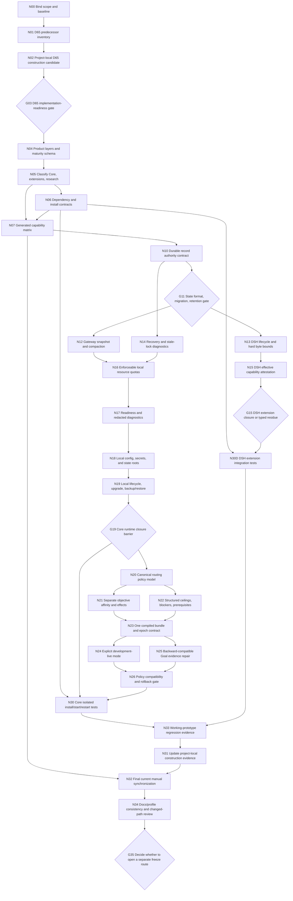

# ARE vNext coherence implementation DAG

Status: revision 3 reviewed execution plan; implementation reached N34 with typed residue  
Task: `ARE-VNEXT-COHERENCE-FOUNDATION`  
Route: `CA2-ROUTE-IMPLEMENT`  
Authority effect: none

## Outcome

Turn ARE from one flat, mixed-maturity source closure into a coherent local
product with explicit layers, bounded durable state, recoverable operation,
closed diagnostics, executable policy boundaries, and one truthful current
capability view.

Candidate 020 remains immutable historical evidence. This DAG produces successor
working bytes and test evidence only. It does not freeze, approve, publish,
deploy, or activate a release.

## Selected product boundary

- Product form: installable single-user local CLI/daemon.
- Core: intent, routing, context, policy/consequence decisions, Reasoning State,
  runtime journal, and conversation contracts.
- Extensions: host wrappers, MCP, coding agent, and backend adapters.
- Research/evaluation: evolution runtime and benchmarks.
- DSH: optional experimental extension, not a minimum-runtime dependency.
- Hosted website and iframe work: superseded and outside this DAG.

## Delegation sheet

| Role | Scope | Dependency | Gate | Join rule | Close condition |
| --- | --- | --- | --- | --- | --- |
| Plan reviewer | Challenge DAG completeness, order, safety, testability, and D65 separation; no edits | Draft DAG | Report blocking defects and required revisions | Primary agent incorporates or explicitly rejects every blocking point | Reviewed DAG has no unresolved safety or scope blocker |
| Implementation analyst | Map reviewed nodes to exact symbols, files, migrations, and tests; no edits | Reviewed DAG | Identify hidden coupling and smallest safe sequence | Primary agent converts analysis into the execution checklist | Every ready node has write scope and validation |
| Primary implementer | Apply reviewed changes and synchronize evidence | Both reports | Focused tests before downstream nodes | A node unlocks dependents only after its checks pass | All ready nodes pass or retain explicit residue |

## DAG

`G35` is not authorized by this task and remains closed.

## Node contracts

### N00 — Bind scope and baseline

- Inputs: coherence audit, current dirty-tree inventory, Candidate 020 immutable
  history, route receipt.
- Output: reviewed revision identity and session context pack.
- Gate: no unrelated dirty file may be overwritten.

### N01–G03 — D65 predecessor chain

- Inventory exact definitions, capability-local business ontology and prototype,
  Product Capability, Project, Goal, prior construction, product profile,
  authored DomainSpec project/source, selected compiler, compiled graph,
  system-ontology projection, and implementation identities with digests.
- Refresh and validate any stale or missing project-local product/business
  prototype, DomainSpec source, compiled graph, or system-ontology projection
  before G03. These are distinct predecessors and cannot be implied by one
  generic ontology or construction reference.
- Create or update only a project-local, unregistered D65 construction-binding
  candidate that names the current stage frontier, predecessor bindings, write
  scope, rollback, validation, and the no-freeze boundary.
- Do not mutate central construction registries or advance Project/Goal lifecycle.
- Gate: every implementation-bearing node traces to the exact candidate; missing
  or contradictory predecessor classes, identities, digests, compiler output, or
  projection validations block code mutation.

### N04–N07 — Product structure

- Add explicit component `layer`, `maturity`, `default_enabled`, and install
  posture to the product profile and validator, with a versioned compatibility
  rule and rollback to the prior parser.
- Classify each declared component and integration.
- Make closure and test-plan selection distinguish minimum Core from optional
  extensions and research/evaluation without hiding selected tests.
- Generate one machine-readable and reader-facing capability matrix from the
  product profile only after install contracts are bound.
- Gate: the product profile has unique IDs, valid paths, supported enums, and no
  required experimental dependency in the minimum Core.

### N10–G19 — Runtime, security, and operations

- Record gateway orchestration, Reasoning State semantic truth, and backend
  transcript/cache authority explicitly.
- Before changing existing persisted state, detect and version formats, export a
  backup, prove restore, test interrupted migration, default migration and expiry
  to off, and refuse unknown formats. The local product owner owns default local
  retention; broader erasure remains a privacy-owner decision.
- Add crash-safe gateway snapshot/compaction with bounded disk and replay work.
- Add DSH close/expiry/reclamation, explicit durable/ephemeral mode, and hard
  history-byte failure rather than silently unreadable persistence.
- Add evidence-bound stale-lock inspection; do not auto-break unknown locks.
- Parse and attest effective DSH capabilities; fail closed on undeclared tools.
- Enforce disk, replay, queue, process, provider-budget, and supported-platform
  ceilings during attached work, with explicit fail/stop/degrade semantics.
- Expose readiness, storage, recovery, and limit state separately from liveness;
  route backend diagnostics through a structured redaction/digest boundary.
- Define local secret-reference handling, child environment allowlisting,
  private state-root ownership and modes, dependency provenance/offline install,
  daemon start/stop/status, version compatibility, backup/restore, and rollback.
- Credentialed provider execution remains excluded.
- Gate: restart, corruption, compaction interruption, quota, and redaction tests
  pass without changing external authority. G19 blocks governance mutation until
  the Core runtime lane closes. DSH follows the independent G15 extension gate;
  a failed optional extension becomes typed residue and never blocks minimum-Core
  construction, governance, or qualification.

### N20–N26 — Architecture and governance

- Establish one canonical structured routing-policy source and generated runtime
  projection.
- Separate objective affinity, requested effects, and route-permitted effects.
- Replace prose-only enforcement with structured ceilings, prerequisites,
  blockers, and owner-evidence requirements while retaining explanatory prose.
- Give CLI and gateway one policy/context bundle and source-epoch contract.
- Retain live mutable reads only under explicit `development-live` mode.
- Repair the Goal evidence schema/validator contradiction with a versioned,
  backward-compatible change and corpus-wide before/after validation. Do not
  suppress unrelated failures. Emit only project-local unregistered construction
  evidence until global validation passes; central registry or Project-ref
  mutation requires a separate explicit gate.
- Add compatibility and rollback tests for policy-schema changes. Negative tests
  must prove no route or effect widening.
- Gate: route selection is not broadened by generic effects; bundle/live drift is
  explicit; Goal validation accepts the selected evidence shape.

### N30–N34 — Integration, truth, and working-prototype evidence

- Prove minimum Core materialization and each selected extension independently;
  Core tests do not depend on DSH installation or success.
- Exercise install, doctor, route, context, start, restart, crash recovery,
  backup/restore, rollback, and uninstall of newly materialized test fixtures.
- Update the project-local construction candidate with exact test evidence; do
  not change central registries or advance lifecycle automatically.
- After full working-prototype regression evidence exists, generate the current
  capability matrix and synchronize current manuals; candidate-specific numbers
  remain only in release history.
- Mark hosted DSH/browser plans superseded through metadata/status only; do not
  delete history.
- Run focused suites, product suite, isolated distribution suite, and exact
  changed-path review. The final N34 gate checks docs/profile consistency and the
  exact changed paths after documentation synchronization.
- Emit working-prototype regression evidence only. Do not run candidate prepare,
  freeze, inspect, publish, deploy, or activation commands.
- Gate: successor working tree is testable and internally coherent; current
  documentation consumes regression evidence before claiming a passed behavior.

## Product construction lane

Current frontier: N34 evidence and documentation join completed.  
Runnable successor: none under this route; G35 remains closed.  
Completion boundary: N34 reached with the residue listed below.  
Blocked effect: G35 may only open a separately routed successor-freeze task.

## Operational support lane

| Task | Owner | Affected nodes | Blocking now? |
| --- | --- | --- | --- |
| Select signing identity and delivery channel | Product owner | G35 and later release | no |
| Select deployed service manager/container | Operations owner | future deployment | no; local product selected |
| Select production secret backend | Security/operations owner | future live provider use | no; tests use references/fixtures |
| Select local retention defaults | Local product owner | G11 | yes; conservative migration/expiry remains disabled until selected |
| Select multi-tenant threat model and SLO | Product/security owner | future service topology | no; excluded topology |
| Define physical-erasure policy for backups and research | Privacy owner | later operated deployment | no; local retention controls still required |

## Causal blockers

- Any destructive state migration requires G11: format/version detection,
  backup/export, restore proof, interrupted-migration recovery, opt-in enablement,
  and refusal of unknown formats.
- Any credentialed provider call requires explicit credential and cost authority.
- Any candidate freeze, publication, deployment, or activation requires its own
  route and owner decision.

## Deferred residue

- Hosted website/iframe integration.
- Multi-user and hostile multi-tenant operation.
- Public SDK compatibility and semantic-version commitment.
- Remote service SLOs, incident rotation, and regulatory posture.
- Candidate signing, tagging, publication, deployment, and activation.

## Validation matrix

| Area | Required evidence |
| --- | --- |
| Product structure | profile validation, generated capability matrix, Core-only and extension closure tests |
| Durability | crash-safe snapshot/compaction, replay bound, corrupt-tail and interrupted-compaction tests |
| DSH | lifecycle reclamation, explicit persistence mode, hard history bounds, truthful effective-tool attestation or typed not-evaluable residue |
| Recovery | stale-lock inspection, unknown-outcome preservation, composed restart test |
| Diagnostics | redaction fixtures, structured failure codes, readiness and quota observations |
| Routing | objective/effect separation, structured policy generation, drift and negative tests |
| Goals | schema and validator agreement, ARE evidence references accepted without lifecycle promotion |
| Local configuration | secret references, environment allowlist, private state roots, dependency provenance/offline install |
| Local lifecycle | start/stop/status, backup/restore, upgrade compatibility, rollback, fixture-only uninstall |
| Integration | isolated materialization, install/start/restart/rollback, working-prototype regression suite |

## Review disposition

The first independent review returned `BLOCK`. Revision 2 incorporated every
blocking item: early D65 binding, strict runtime-before-governance ordering,
state-migration safety, missing local operational contracts, backward-compatible
Goals repair, and a working-prototype evidence boundary. It also incorporates
the required graph corrections for install-dependent capability generation,
schema rollback, separated quota/readiness semantics, evidence-before-current
documentation, metadata-only supersession, and fixture-only uninstall. The
revision 3 independent review returned `PASS`. Implementation evidence is bound
by `ARE-VNEXT-COHERENCE-CONSTRUCTION-BINDING.v1-candidate.json` and
`ARE-VNEXT-COHERENCE-REGRESSION.v1.json`; neither record grants release status.

## Open Questions

- Whether an accepted future release includes any extension by default remains an
  owner decision at G35.
- Physical erasure across immutable evidence and backups remains a separately
  owned privacy decision.
- Production multi-user topology remains outside this local-product DAG.

