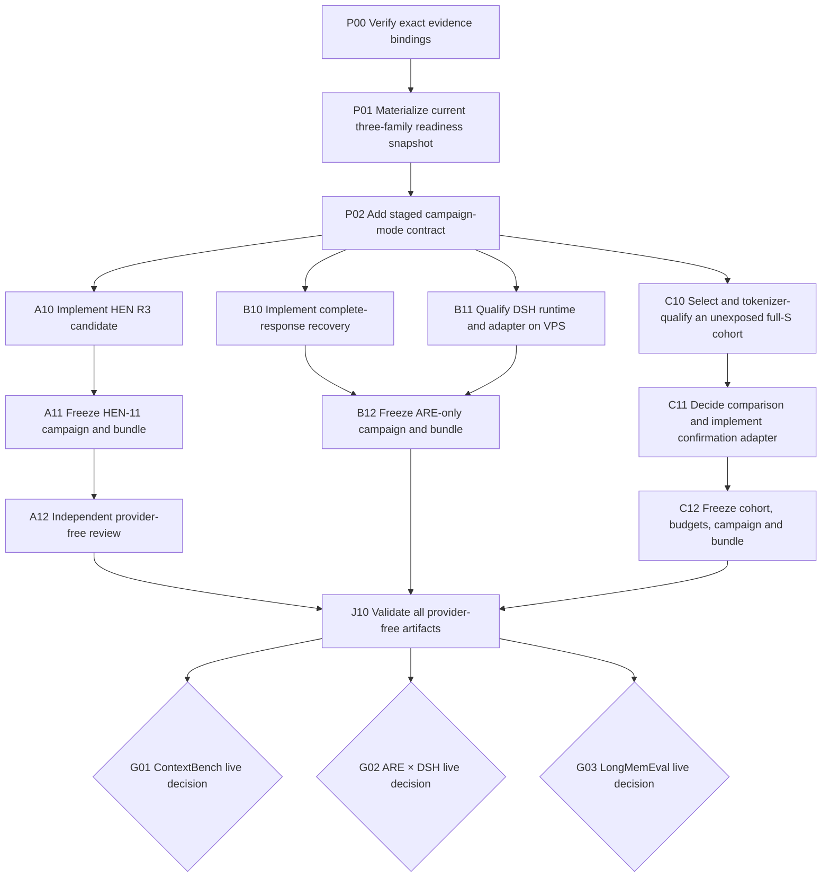

# G01–G03 prelaunch preparation

Status: candidate construction plan; G00 and provider-free P01–P02 complete; no family is launch-ready  
Plan ID: `ARE-G01-G03-PRELAUNCH-PREPARATION-v1`  
Execution host: `187.77.163.194`  
Model: `glm-5.3-flash`  
Authority effect: none  

## Objective

Advance the three benchmark families concurrently from the shared G00 runtime
boundary to exact, provider-free campaign and execution-bundle candidates. Each
family keeps its own scientific question, runner, budget, evidence, readiness
state and eventual launch decision. This plan authorizes no deployment, cycle
registry change, credential-byte access, dispatch, GLM call or benchmark run.

## Current readiness

| Gate | Family | Satisfied | Missing | Current disposition |
| --- | --- | ---: | --- | --- |
| G01 | ContextBench HEN-11 | 2/4 | candidate tests; independent review | blocked |
| G02 | ARE × DSH | 0/6 | response-recovery candidate; native subprocess; GLM profile; token boundary; durable accounting; benchmark adapter | blocked |
| G03 | LongMemEval | 2/7 | genuinely unexposed cohort; current-tokenizer binding; confirmation adapter; comparison decision; cohort and budget freeze | blocked |

G00 is common evidence only. Its preflight digest is
`4e2efbbf5a1b8988adadfa92c0c8bc736c17b54818767add93e6a4191463d663`.
It cannot make any family ready or authorize a live effect.

## Corrected evidence bindings

### G01 — ContextBench HEN-11

- Selected hypothesis: `hypothesis:H-EN-R3-intent-anchor-convergence`.
- Tasks: exposed development tasks 1 and 4; no new control arm.
- Selection artifact SHA-256:
  `0a0ac6f13449118046e4601c171144f509401f42627adc61d869a425ca846df0`.
- Historical bindings are satisfied by the frozen HEN-10 result and review
  hashes inside that selection artifact.
- The R3 implementation, focused tests and independent prelaunch review do not
  exist yet.

Candidate budget to freeze during construction: two workers, 192 calls,
192,000 model tokens, USD 100 maximum cost, and 14,400 seconds campaign elapsed
time. Each task retains the existing 96-call/96,000-token ceiling, 120-second
request timeout and zero automatic retries. These are candidate ceilings until
the generated campaign and independent review bind them.

### G02 — ARE × DSH

- Rounds 73–78 are mixed continuation evidence, not six DSH rounds.
- Round-78 result SHA-256:
  `734bc41eb210ef6e9f3f909ba0223dcf03f01ae2a86c1ef971fb660dcfdd9b76`.
- Round-78 report SHA-256:
  `9e669f2f4b413a7cc54542027f1087742c8c1f34626033e2532e5750b00dfc50`.
- DSH installation receipt SHA-256:
  `cfc3df95c683c295a1a19aa0d0b2811b924501a1cbd6a41dd44e94644e787925`;
  it explicitly records `benchmark_ready:false`.
- The next scientific step is ARE-only response-recovery qualification. A
  matched ARE/DSH confirmation is a successor, not the same campaign.

The current family validator incorrectly requires `matched_comparison:true`
for every ARE × DSH campaign. Construction must add an explicit campaign mode
and validate `are-only-qualification` separately from `matched-confirmation`.
The initial ARE-only ceiling remains one worker, 96 calls, 4,000,000 tokens,
USD 100 maximum cost, 1,800 seconds arm elapsed time, 300-second nominal request
deadline, zero automatic retries and at most eight executed tool calls from one
response.

### G03 — LongMemEval

- The exposed development IDs are `01493427`, `2e6d26dc`, `32260d93`, and
  `eeda8a6d_abs`.
- The four source-S IDs `09ba9854_abs`, `06db6396`, `cc06de0d`, and
  `54026fce` were subsequently used by the live Note-v5 generation and native
  judge. They are exposed development evidence, not untouched candidates.
- Note-v5 result SHA-256:
  `e590eba4cb9aa5b8f96803b39a1d0010961c2734350705816b24cb76d4d7140a`.
- Note-v5 freeze SHA-256:
  `3870e7a343381a229c6b1716e976bc91d39f076547ff097d19b6f0b99c2f3c1a`.
- Note-v5 native-score result SHA-256:
  `e2e0e29a3ed8089a54b8526eb4ae6fb36026b2187b7a8a08b3553fa1de3160e9`.
- Candidate cohort SHA-256:
  `b59715c4257ccc0d3d8ae2aff6c2a975253dcb2fce68bf379b70a7b8a3b20158`.
- Full-S source-only acquisition SHA-256:
  `94d8c5820b97ef6d00bff34beae8f9ce178cd8a57c65de3c78fd5dcaed0ee71c`.
  It binds revision `98d7416c24c778c2fee6e6f3006e7a073259d48f`, four
  source-only histories, no evaluator references and zero provider calls.
- Full-history acquisition is satisfied. Historical tokenizer evidence proves
  these four exposed histories are 112,269–113,639 tokens and produced an
  admitted exact-8K plan, but it does not establish a current tokenizer service
  identity. Exposure exclusion is not satisfied. A genuinely unexposed cohort
  must be selected before any untouched-confirmation claim; reuse of these four
  must be labeled exposed-cohort replication.

## Construction DAG

P00–P02 and A10/B10/C10 may proceed independently where their source sets do
not overlap. J10 joins only provider-free artifacts. G01, G02 and G03 remain
three separate effect boundaries; one passing lane never blocks construction
in another and never authorizes another lane.

## Completed preparation slice

P01–P02 completed on 2026-09-25:

1. The family policy validator now distinguishes `are-only-qualification` from
   `matched-confirmation` while preserving matched-comparison requirements for
   the successor campaign.
2. The closed preparation snapshot is
   `implementation/agent-reasoning-engine/packages/evolution-runtime/evidence/VPS-G01-G03-PREPARATION.v1.json`,
   digest
   `df858eb11e87dfe0d1ef426e3358ecf9b874c0aad171a9f741f05b03b11cd2ee`.
   It binds 13 exact evidence files plus G00 and retains no duplicated source
   histories.
3. Tests prove exact evidence-hash rejection, corrected LongMemEval identities,
   staged DSH validation, deterministic replay and
   `live_dispatch_admitted:false`. The complete evolution-runtime suite passes
   144/144 tests.
4. The seven frozen N26/G00 source bindings still match their recorded hashes;
   this additive preparation did not mutate or redeploy the G00 closure.

This slice does not implement HEN R3, response recovery, tokenizer execution or
any benchmark runner. It makes the three next construction frontiers explicit
and machine-checkable.

## Next construction frontiers

The next provider-free nodes can advance independently:

- A10: implement and test the HEN R3 intent-anchor-convergence candidate.
- B10: implement and test complete-response recovery for the ARE-only DSH
  qualification lane.
- C10: select a genuinely unexposed full-S cohort and bind its current-tokenizer
  qualification. The four Note-v5 histories remain historical development
  evidence only.

They do not authorize A11/B11/C11, a VPS mutation, credential access, dispatch,
or any GLM request. Each family remains behind its own G01, G02 or G03 live
decision.

## Operational residue

- B11 requires bounded VPS runtime checks and may install no package without a
  separately routed effect.
- G01–G03 require separate family decisions after provider-free review.
- Credential use, model/judge calls and paid execution remain live effects.
- Large source histories remain content-addressed inputs; preparation snapshots
  retain hashes and locations, not duplicate history bytes.

## Open Questions

- Should the DSH native qualification use its installed Node image directly or
  a new pinned runner image containing both DSH and the ARE adapter?
- Which exact tokenizer endpoint/version will qualify the four full-S histories?
- For LongMemEval, should the first confirmation isolate whole-history notes
  versus retrieval, or first isolate scope policy on identical evidence?
- Are the proposed USD 100 ceilings for HEN-11 and the ARE-only DSH trial
  sufficiently conservative after current provider pricing is checked?
