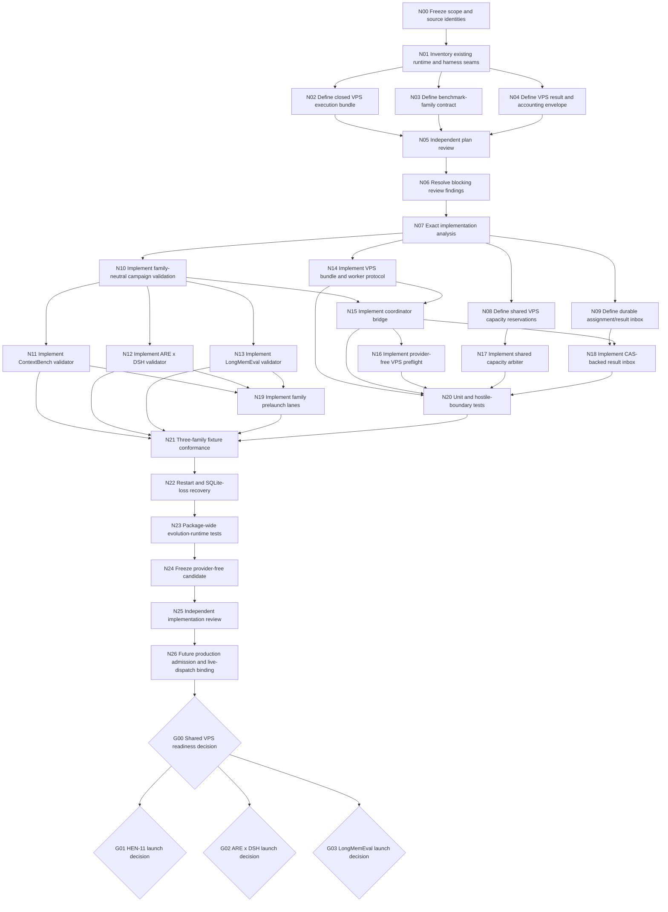
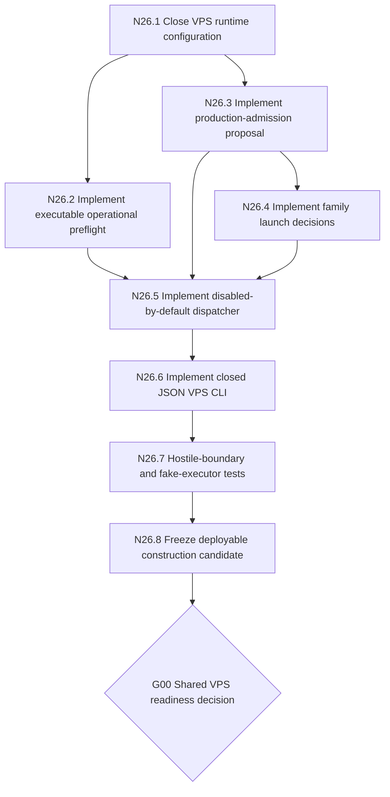

# VPS three-benchmark integration DAG

Status: provider-free prototype and N26 construction boundary implemented; G00 versioned VPS deployment and real preflight complete; production admission and three live launch decisions remain open  
Plan ID: `ARE-VPS-THREE-BENCHMARK-INTEGRATION-v1`  
Authority effect: none  
Execution host: `187.77.163.194`  
Model: `glm-5.3-flash`  

## Objective

Reuse the existing ARE evolution runtime as the control and evidence authority
for three benchmark families, while making the VPS the sole host for eventual
benchmark execution, GLM access, task workspaces, tokenizer admission, scoring,
judging, and primary run evidence.

This DAG does not rebuild the durable kernel, coordinator, scheduler, object
store, recovery path, or handoff protocol. It adds only the missing integration
surface. The construction slice stopped before remote effects; the separately
authorized G00 operation has now deployed its frozen candidate and executed a
metadata-only preflight. Live model dispatch, credential-byte access, and
benchmark execution remain outside G00.

## Existing components to reuse

- P2 durable kernel and content-addressed object store.
- P3 coordinator, work plans, leases, fencing, settlement, recovery, budgets,
  and typed handoffs.
- Existing ContextBench, ARE large-context, DSH, and LongMemEval harnesses.
- Existing HEN remote GLM binding and tokenizer qualification patterns.
- Existing VPS GLM gateway container and VPS-local secret.
- Existing DSH installation evidence.

## DAG



## Node contracts

### N00 — Freeze scope and source identities

Bind the current evolution-runtime sources, three benchmark plans, HEN-11
selection, ARE–DSH rounds 73–78 evidence, LongMemEval note-v5 evidence, VPS
installation receipt, and remote GLM binding. Record the dirty-worktree posture
without treating unrelated changes as implementation inputs.

Completion: an exact source list exists and no historical artifact is an edit
target.

### N01 — Inventory existing seams

Classify every requirement as `reuse`, `thin-adapter`, `validator`, `test`, or
`future-live-effect`. Confirm that the kernel and coordinator remain unchanged
unless a demonstrated integration defect requires a minimal compatible patch.

Completion: no planned module duplicates leases, accounting, recovery, object
storage, scheduling, or handoffs.

### N02 — Closed VPS execution bundle

Define a canonical manifest containing:

- runtime and adapter source hashes;
- benchmark family and campaign identity;
- model, tokenizer, harness, scorer, source and task bindings;
- allowed executable entrypoint and argument vector;
- fixed VPS host and trusted storage-root binding;
- GLM gateway identity and a credential reference, never credential bytes;
- resource envelope and expiration; and
- output/evidence contract.

The bundle is data and source identity, not a shell command supplied by an
agent. Unknown fields and paths outside declared roots fail closed.

### N03 — Benchmark-family contract

Define one closed family-neutral campaign descriptor and three domain
validators. Family policy remains separate; the common contract carries only
identity, work-item enumeration, resource limits, artifact references,
accounting, outcome, and settlement fields.

### N04 — VPS result and accounting envelope

Define the structured result returned by a VPS worker:

- assignment, lease and fencing identities;
- terminal disposition;
- content-addressed artifacts;
- known and unknown usage;
- calls, tokens, cost and elapsed time;
- tokenizer/window admission;
- scorer or judge result references; and
- bounded public diagnostics.

Credentials, private reasoning, raw environment dumps, and unbounded tool
transcripts are prohibited.

### N05–N07 — Review and implementation analysis

An independent plan reviewer checks architecture, authority, recovery,
scientific validity, and VPS boundaries. After findings are joined and resolved,
a different implementation analyst maps every accepted node to exact existing
files, APIs, tests, and the smallest additive change set.

No implementation begins before N07 closes.

The independent plan review returned `REVISE`. N08, N09, N17–N19, N26, and
the split launch gates below incorporate its blocking findings. The second
analyst must verify these corrections against exact implementation seams.

### N08 — Shared VPS capacity reservations

Define a global VPS capacity envelope above the three phase-local envelopes.
It reserves in-flight workers, tokens, cost and elapsed-time allowance before a
campaign receives a worker slot. Phase accounting remains authoritative for the
cycle; the shared arbiter prevents the sum of concurrent cycles from exceeding
host/provider capacity.

The reservation must be reconstructible or conservatively reacquired after a
crash. It cannot create a second cycle journal or silently redistribute one
campaign's budget to another.

### N09 — Durable assignment and result inbox

Define a content-addressed assignment and worker-result inbox inside the same
VPS runtime root. A result binds the exact bundle digest, cycle, phase, task,
lease, fencing token, worker identity, artifacts, accounting and terminal
disposition. Identical replay is idempotent; divergent replay fails closed.

Settlement validators resolve and verify stored bytes. An artifact reference
alone is insufficient. A crash after worker completion but before settlement
must recover the result without rerunning completed model work.

### N10 — Family-neutral campaign validation

Implement deterministic materialization and verification for the VPS bundle,
campaign descriptor, worker result, and accounting envelope. Verification has
no network, process, Docker, SSH, provider, or credential effects.

### N11 — ContextBench validator

Validate HEN-11 task identity, source/base-commit bindings, 8K admission,
candidate-only posture, call/token ceilings, native Span-F1/File-F1 artifacts,
complete attempt accounting, and frozen HEN-10 comparison references. It must
encode task 1 Span-F1 greater than zero, two-task mean Span-F1 greater than
`0.07327183777122158`, and task 4 Span-F1 no lower than
`0.12654367554244316`, bound to the exact historical result/review hashes.

HEN-11 itself does not freeze call or token ceilings. The prelaunch lane must
therefore require newly declared explicit budgets; it may not silently inherit
HEN-10 ceilings.

### N12 — ARE × DSH validator

Validate arm/harness identity, common GLM binding, task/source/scorer identity,
configured large context, 8,192 output cap, eight executed-tool-call ceiling,
response-batch diagnostics, timer-scope declaration, matched-comparison posture,
and total accounting.

The DSH installation currently reports `benchmark_ready:false`. Prelaunch must
fail closed until native subprocess execution, GLM profile compatibility,
common token boundaries, durable accounting, and the benchmark adapter are
qualified on the VPS.

### N13 — LongMemEval validator

Validate source-only and exposure manifests, original-history tokenizer length,
sealed evaluator references, paired task denominator, per-request 8K admission,
answer/judgment completeness, quality, and all-model token accounting.

LongMemEval also has a blocked source-preparation lane: acquire or project the
pinned full-history S source without generator-visible gold, exclude every
exposed ID, tokenizer-qualify the original histories above 8K, implement a new
confirmation adapter, decide the causal comparison, and freeze the cohort and
budgets. Its current hard-coded development runner cannot be relabeled as the
confirmation runner.

### N14 — VPS bundle and worker protocol

Implement provider-free bundle construction and worker request/result protocols.
The worker entrypoint accepts only a verified bundle from a trusted launcher.
This slice includes a fake executor for tests; it does not SSH, mutate the VPS,
read the GLM secret, or call a model.

The existing HEN remote binding is evidence for gateway and secret-reference
handling only. It is a WSL-to-SSH bridge and retains no remote artifacts. The
new operational topology requires a VPS-local provider adapter and VPS-local
runtime, workspace and evidence-root bindings.

### N15 — Coordinator bridge

Translate a live coordinator lease into one verified VPS worker assignment and
translate a verified worker result into proposed settlement evidence. The
bridge cannot issue leases, mutate projections, accept its own evidence, or
bypass the existing prohibition on external dispatch.

### N16 — Provider-free VPS preflight

Define a read-only preflight result covering exact host/container identity,
runtime and harness versions, available memory/disk, source presence, writable
evidence root, GLM gateway presence, secret-reference presence without reading
the secret, and zero active conflicting workers. Construction tests consume
fixtures only. A later operational step may execute the preflight on the VPS.
Testing writability uses a bounded disposable probe only in that later
operational step.

### N17 — Shared capacity arbiter

Implement the smallest kernel-compatible shared reservation layer needed to
bound cross-cycle concurrency and in-flight token/cost reservations. It reuses
the existing coordinator for cycle work and does not create a competing DAG or
accepted-history owner.

### N18 — CAS-backed result inbox

Implement put, inspect, idempotent replay, divergent-replay rejection and
recovery for worker assignments and terminal results. Result validation resolves
all evidence objects before settlement is proposed.

### N19 — Family prelaunch lanes

Implement provider-free state machines that expose why each family is or is not
launch-ready:

- HEN-11: candidate tests, exact new budgets, historical bindings and review;
- ARE × DSH: response-recovery candidate plus all DSH readiness prerequisites;
- LongMemEval: full-history source, exposure, tokenizer, adapter, comparison and
  freeze prerequisites.

No family can borrow another family's readiness result.

### N20–N23 — Verification

Tests must cover:

- canonical materialization and replay;
- unknown fields, path escape, host substitution and digest drift;
- secret-shaped data rejection;
- invalid or incomplete accounting;
- wrong family, model, task, scorer or harness;
- stale lease and fencing substitution;
- budget, concurrency and context-window overflow;
- crash after worker completion but before settlement;
- simultaneous cross-cycle reservations that would oversubscribe workers,
  tokens or cost;
- duplicate result versus divergent replay;
- SQLite deletion and deterministic recovery; and
- one valid provider-free fixture per family.

The complete evolution-runtime suite must remain green.

### N24–N25 — Freeze and review

Freeze exact implementation and test evidence. A reviewer independent of the
implementer verifies that the candidate reuses the existing engine and remains
incapable of live dispatch without a later explicit effect boundary.

### N26 — Future production admission and live-dispatch binding

This is a separately routed successor, not part of the current provider-free
implementation. It must replace construction-only overrides with an exact owner
decision for any production cycle-definition admission/enablement and implement
or activate the reviewed VPS-local dispatch boundary. The current coordinator
hard-rejects `external-dispatch`; a decision record alone cannot toggle that
code path.

N26 is decomposed into the following construction DAG:



`N26.1` fixes host `187.77.163.194`, VPS-local runtime/workspace/evidence
roots, the GLM gateway and credential-reference identities, allowed launcher
entrypoints, capacity limits, archive classes and maximum diagnostics. The
configuration contains references only, never credential bytes.

`N26.2` executes bounded read-only host/runtime/container/storage checks and a
disposable evidence-root writability probe. It returns the existing closed
preflight document and removes its probe in a `finally` boundary. Tests use an
injected fixture probe; construction does not contact the VPS.

`N26.3` materializes a no-effect proposal binding exact cycle-definition,
runtime configuration, dispatcher source and preflight digests. It cannot edit
the cycle registry or represent an owner decision.

`N26.4` materializes one closed launch-decision envelope per family. Each binds
one admitted proposal, verified preflight, campaign, bundle, capacity/spending
envelope and expiration. A decision for one family is invalid for another.

`N26.5` accepts only verified assignments produced by the existing coordinator
bridge. Dispatch remains disabled unless both the runtime configuration and the
exact family launch decision explicitly enable it. Entrypoints come from a
fixed registry and execute through an injected executor; agent-supplied shell
commands, arguments outside the frozen bundle, host substitution and secret
bytes are rejected.

`N26.6` exposes `inspect`, `verify`, `preflight` and `dispatch` as closed JSON
stdin/stdout operations. `dispatch` stays blocked in the construction profile.
No CLI operation admits a cycle or creates its own scheduler, journal or state.

`N26.7` proves disabled-by-default behavior, exact family isolation, stale or
substituted decision rejection, preflight cleanup, entrypoint allowlisting,
argument freezing, bounded diagnostics and one fake successful dispatch. The
complete evolution-runtime suite must remain green.

`N26.8` freezes source and test identities only. Deployment, registry mutation,
real preflight, credential use and GLM calls remain operational effects owned by
G00 and G01–G03.

N26 construction result on 2026-09-25: N26.1–N26.7 are implemented as a
candidate. The runtime now has closed configuration, admission-proposal and
family launch-decision envelopes; an injectable operational preflight; a
disabled-by-default dispatcher; and a closed JSON CLI. Tests prove fixed-host
binding, secret-shaped input rejection, host substitution rejection, family
isolation, owner-decision verification, frozen entrypoint/arguments, successful
fake dispatch and default live-dispatch denial. After the container-reference
probe repair, the focused N26 suite passed 7/7 and the complete
evolution-runtime suite passed 141/141.

N26.8 now freezes the seven exact construction source/test identities and the
6/6 plus 140/140 test evidence in
`evidence/VPS-N26-CONSTRUCTION-MANIFEST.v1.json`. The construction result grants
no production admission or live effect; G00 is recorded separately below.

### G00–G03 — Live VPS decisions

These are outside the current construction slice. `G00` binds the shared VPS
runtime, production admission/dispatch implementation, capacity envelope,
storage root and preflight. It authorizes no campaign calls. `G01`, `G02`, and
`G03` separately bind the exact frozen campaign, resource/spending envelope,
credential reference and launch command for HEN-11, ARE × DSH, and LongMemEval.
One decision cannot authorize all three scientific envelopes.

G00 result on 2026-09-25: the 25-file, 177,872-byte executable closure was
deployed without replacing prior state at
`/opt/are/runtime/releases/n26-20260925`. Runtime, workspace, evidence and
archive roots now exist under `/opt/are`; all seven frozen source bindings
verified on the VPS. The pinned `node:26.8.1-bookworm-slim` image executed the
closed CLI with host networking and the Docker socket. Inspection reports no
executor and `live_dispatch_enabled:false`. Real preflight digest
`4e2efbbf5a1b8988adadfa92c0c8bc736c17b54818767add93e6a4191463d663`
passed host, source, storage, gateway, reference-existence, memory, disk and
worker-conflict checks. Credential bytes were never opened or returned; no GLM
or benchmark call occurred. Receipts are stored in `evidence/` locally and in
the VPS evidence root. This closes readiness only, not production admission or
G01–G03.

## Implemented prototype result

The N07 implementation analysis closed with an additive design. The provider-free
prototype now implements N10 and the reusable portions of N11–N19:

- closed execution-bundle, campaign, assignment, result and preflight documents;
- independent ContextBench, ARE × DSH and LongMemEval validators;
- independent fail-closed family prelaunch states;
- shared capacity reservations serialized through the existing coordination
  commit chain and writer lock;
- CAS-backed assignments and worker results reconstructed by the existing
  kernel recovery path;
- a coordinator bridge that proposes, but cannot execute, settlements;
- terminal-result protection that prevents recovery from clearing an expired
  lease when paid work completed before expiry; and
- a separate `vps-benchmark-v1.mjs` entrypoint so evidence-bound historical
  `index.mjs` bytes remain unchanged.

Verification result on 2026-09-25: the focused prototype tests passed 5/5 and
the complete evolution-runtime suite passed 134/134. The suite covers fixed-host
and closed-shape validation, secret-shaped input rejection, three-family policy,
cross-cycle oversubscription, restart reconstruction, durable result replay and
crash-after-result-before-settlement recovery. Existing tests continue to prove
that `external-dispatch` is rejected.

This result does not complete N24–N26 or G00–G03. It does not admit a production
cycle, install or mutate the VPS, read credentials, call GLM, acquire missing
LongMemEval data, qualify DSH, freeze HEN-11 budgets, or launch a benchmark.

## Intended operational topology

```text
controlling agent
      |
      | closed JSON command / returned receipt
      v
ARE evolution runtime on VPS 187.77.163.194
      |
      +-- ContextBench worker -----------+
      +-- ARE large-context worker ------+--> VPS GLM gateway -> glm-5.3-flash
      +-- DSH harness worker ------------+
      +-- LongMemEval worker and judge --+
      |
      v
VPS content-addressed evidence + append-only receipts + disposable index
```

The local WSL checkout authors and reviews frozen bundles and receives verified
evidence copies. It is not the benchmark execution host. Historical evidence is
never edited; verified copies are imported into the runtime CAS.

## Construction lane and operational residue

Current product frontier: G00 readiness complete; exact G01–G03 campaign,
budget and runner bindings remain the next separately admitted work.

Runnable construction work: family-specific bundle and runner closure for
G01–G03, without launch until each decision is separately admitted.

Operational residue, separately gated:

- admit/enable exact production cycle definitions;
- implement or activate the separately reviewed VPS-local dispatch boundary;
- access the mounted GLM credential;
- enable external dispatch;
- execute paid benchmark or judge calls; and
- synchronize or archive live evidence across hosts.

Large transcripts and task workspaces require explicit hot, warm-compressed and
cold-archive classifications with hash-verified restoration.

Operational residue does not block provider-free implementation or tests.

## Open Questions

- Can the existing benchmark runners consume the worker-assignment protocol
  without wrappers, or is one adapter per family required?
- Should live evidence be copied back incrementally or only after terminal
  settlement?
- Do future family runners need Python or Rust in their own pinned execution
  images? G00 intentionally requires neither runtime in its Node control image.

Resolved at G00: the closed CLI is required; runtime/work/evidence/archive roots
are `/opt/are/runtime`, `/opt/are/work`, `/opt/are/evidence`, and
`/opt/are/archive`. Remaining answers may not silently expand G01–G03.
