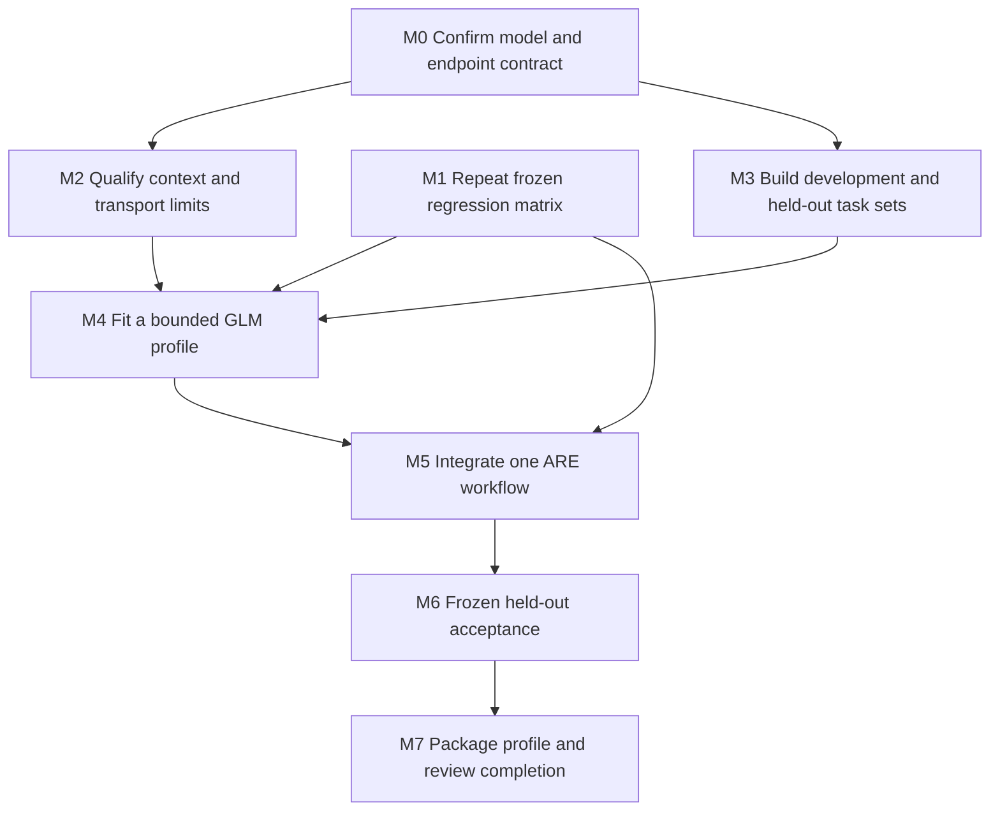

# Finish GLM-5.3-Flash in ARE

Status: candidate finish plan, 2026-09-08, request glm-finish-plan-41. Owner: user/product owner. This consolidates the finish line for the GLM work; component plans and historical evidence remain linked below. Planning does not admit execution, activate a policy or authorize an unbounded benchmark campaign. Thresholds and sample sizes below are proposed product acceptance criteria, not measured performance or previously approved service levels.

## Objective and finish line

Deliver a reproducible, bounded GLM-5.3-Flash integration for repository understanding and coding: inspect authorized repository evidence, answer with source references or propose a scoped patch, manage context deliberately, validate outputs, and use at most one corrective model call. Ship a documented model profile and one supported ARE entry point whose complete behavior has been evaluated on held-out tasks and qualified context ranges.

GLM is the first implementation of the model-fitting process. Finish this model before introducing a second model. The benchmark is a measuring instrument; it is not the product. Completion means passing the acceptance package below and obtaining a product review, not a promise of perfect model answers, automatic patch application, deployment, or support for every advertised model capability.

In scope for v1: text-based repository questions, evidence-backed explanations, bounded single-file and small multi-file coding proposals, context admission/recycling/recovery, schema and public-check feedback, costs/latency/accounting, interruption behavior, profile documentation and explicit ARE invocation. Multimodal/browser control, arbitrary shell access, autonomous publication, unlimited retries, other models and product-wide ontology admission remain separate work. Repository questions are part of the original fitting objective and need an explicit answer contract rather than being forced into a patch-shaped terminal response.

## Where we are

| Area | Existing evidence | Remaining gap |
| --- | --- | --- |
| GLM API adapter | Exact model, native tool messages, tokenizer admission, secret reference bridge and ledgers | Document capability/account limits, larger-payload behavior and supported operational envelope |
| Context management | Small-window reads, recycling and archive recovery | Larger windows, near-capacity behavior, long multi-turn sessions and held-out evidence placement |
| Validation/recovery | Shared patch schema, complete bounded diagnostics and one shared format/semantic correction | Multiple-error live samples, non-patch answer validation and small multi-file integration |
| Latest matrix | 28/36 initial ->36/36 final with all sources frozen;9/9 recycled continuity;44/44 public workers cleaned | Known-fixture small-window gate passed; initial quality and held-out generalization remain open |
| Product workflow | Opt-in benchmark composition | One supported ARE coding/answer entry point with the same validated behavior |

The [latest evidence](benchmarks/glm-episodes-v1/evidence/complete-transport-qualification-2026-09-09/README.md) remains a milestone, not the finish line. Earlier failed runs stay counted in their own reports; do not pool tuned samples into held-out success rates.

## M1 completion update — 2026-09-09

The [complete-transport qualification](benchmarks/glm-episodes-v1/evidence/complete-transport-qualification-2026-09-09/README.md) passed36/36 final checks,9/9 recycled continuity and all delivery/cleanup gates. Initial proposals passed28/36. This closes the small-window chapter for the documented opt-in profile; it does not complete GLM. Four earlier failed36-trial campaigns remain retained.

The accepted candidate explicitly bounds physical transport retries: initial at mosttwo total retries per trial andone per logical request; the single logical correction at mostone retry. Its campaign caps are624 model/1032 tokenizer attempts and72 public workers. The original no-retry caps below describe the original baseline, not this qualified candidate. Retries address recognized transport faults only, never incorrect model responses or failed-trial replacement. No default activation occurred.

The user's subsequent request shifts the next work toward [offline failure analysis](benchmarks/glm-episodes-v1/analysis/README.md) and [GCF comparison](benchmarks/glm-episodes-v1/analysis/GCF-REVIEW.md). Do not start another broad repeat merely to improve the aggregate score. M0 and M2–M7 remain open.

## Model identity and limits: checked versus unverified

The local [transport](packages/coding-agent-runtime/glm-flash-v1/transport.mjs) selects `glm-5.3-flash`, defaults to `https://api.z.ai/api/paas/v4/chat/completions` and pairs it with `/api/paas/v4/tokenizer`. It currently limits output to2048 tokens, request bodies to131072 bytes and response bodies to262144 bytes. The [CLI](packages/coding-agent-runtime/glm-flash-v1/cli.mjs) admits context limits only through32768 tokens. Recent benchmark hard context was16384 with soft thresholds8000/10000/12000. These are implementation/evaluation limits.

Z.ai's current model guide lists **1M context and128K maximum output** for GLM-5.3-Flash. It recommends max reasoning and describes thinking as enabled-only. These are provider documentation claims, not account-specific measurements. [Official model guide, accessed2026-09-08](https://docs.z.ai/guides/vlm/glm-5.3-flash).

The API reference documents low/high/max effort for this model and explains that preserving prior thinking requires forwarding complete historical reasoning blocks. Our adapter requests clear_thinking:false; M0 must trace whether the actual message path satisfies that preservation contract instead of inferring it from the flag. This does not authorize exporting reasoning content. [Official API reference](https://docs.z.ai/api-reference/llm/chat-completion).

The tokenizer reference documents the endpoint used locally, but its displayed model enum lists older models. Existing local GLM receipts establish observed small-request behavior, not a complete published contract at large sizes. Resolve the documentation/observed-capability distinction in M0. [Official tokenizer reference](https://docs.z.ai/api-reference/tools/tokenizer).

Never substitute another endpoint, model, tokenizer estimate or lower context limit silently. Record provider-advertised, account-observed, implementation-admitted and product-qualified limits separately. Confirm whether K/M mean decimal or binary counts and how total input, generated reasoning/output and tool-schema tokens share the limit before deriving near-capacity requests.

## Milestone DAG and status

| ID | Status | Concrete deliverable and exit condition |
| --- | --- | --- |
| M0 | Partly established | Versioned model/endpoint capability record with dated sources, actual identity receipts, precise token/payload limits, thinking/tool behavior, redacted transport observations and unresolved account constraints. No broad live capacity claim from docs alone. |
| M1 | Qualified 2026-09-09 | Three predeclared repeats of the existing12-condition matrix,36 total trials, corrected handoff and all sources frozen before the first trial. Report first-pass, schema, delivery, final semantic, continuity and cost independently. |
| M2 | Needs implementation | A tested profile/config path for larger bounded payloads, output reserves and context limits; staged capacity probes and evidence-retention tests. Audit transport, schema/parser, recovery-prompt, ledger/archive, fixture and validator limits together. |
| M3 | Ready for corpus design |24 authored repository tasks across six families;12 development and12 sealed held-out, with source hashes, rubrics/oracles, allowed effects and explicit public evidence. Non-patch answer and small multi-file contracts are implementation prerequisites. |
| M4 | After M1–M3 | Choose a profile from at most two predeclared development rounds. Compare at most two candidate settings per round on all12 development tasks, at most48 development episodes total. Record trade-offs and reject field/task-specific prompt patches without a general contract. |
| M5 | After profile selection | Explicit ARE command/profile selection for a real authorized repository snapshot, producing an answer or patch proposal plus validation report. It must use the same recovery budget, gates and ledgers as evaluation. |
| M6 | After integrated code freeze |72 held-out episodes:12 tasks ×3 qualified context tiers ×2 repetitions. No tuning after opening held-out outcomes. Add the recovery and fault checks below. |
| M7 | After acceptance | Versioned GLM profile, reproducible commands, complete acceptance report, limits/failure guide and product review. Mark either completed for the declared envelope or not accepted, with exact remaining blockers. |

M0's bounded contract check and M1's frozen repeats are the immediate next work. No new model, unrelated framework rewrite or second-model portability campaign is needed first.

## Task coverage and separation from tuning

Six families, four tasks per family: repository navigation/source attribution; code-flow and dependency explanation; contract/configuration questions; edge-case single-file repair; small multi-file behavioral change; long multi-turn work requiring archive recovery or continuity after interruption. Use actual repository artifacts or explicitly authored snapshots with provenance. Avoid near-duplicates of the four current fixtures; split related variants and shared source families together so an apparent holdout is not a renamed training task.

Allocate two tasks per family to development and two to sealed evaluation. An evaluator-owned process keeps held-out expected answers, assertions and labels outside tuning prompts and public feedback. Repository source remains available within the declared task scope. Once a held-out failure influences a change, that task becomes development evidence; a replacement sealed set and new acceptance run are required. Do not reinterpret scores after inspecting failures.

Answers use source-backed rubrics and structured references; code uses immutable public cases plus separate oracle checks. Human review adjudicates rubric ambiguity before acceptance, with unresolved judgments recorded as indeterminate rather than passes. Public-check coverage and omissions must be visible. For multi-file work, preserve path-to-hash bindings and scope as a set; do not carry the current single src/subject.mjs diagnostic assumption into product claims.

## Context qualification

Use two complementary tests: tasks near a selected window without recycling, and extended interaction that deliberately crosses a local threshold and requires recovery. Merely configuring a large window does not test it. Record actual tokenizer counts, input occupancy, reserved output, margins, request bytes and completion usage for every dispatch.

Keep the8K/10K/12K stress suite. Then stage32K,64K and128K, followed by256K/512K and a near-capacity target only when M0 and the preceding stage support it. These labels are prospective test points, not presently implemented settings. Near-capacity means measured input plus reserved generation and safety margin below the verified endpoint bound; use planned occupancy levels around50%,75% and90%, never knowingly overflow a paid request. Test local rejection of an over-limit request offline.

Start with at most24 live capability/continuity probes, scheduled before execution: six progression points ×two evidence patterns ×two repetitions. Each point has a pinned request/tokenizer cap and a lower-tier readiness prerequisite. Where exact endpoint limits differ, finalize and hash the substituted point list before the first probe. Include evidence at the beginning, middle and end; distractors; tool-schema overhead; Unicode/code-heavy inputs; cross-file constraints; and multi-turn continuity. Do not label simple marker retrieval as proof of coding reliability.

Use the supported range to select three acceptance tiers: small stress, practical working context and near the intended qualified upper bound. Test repository tasks at substantial measured occupancy using meaningful related evidence, not only padding. Finishing the full-context objective requires either qualifying the intended near-provider-limit range or an explicit product-owner decision to ship a narrower declared range. Do not silently rename a small-window integration as full GLM support.

Recycling and provider compaction are separate. Require all local compaction/recycling events and archive reads to be observable; verify required facts survive. Provider-internal context transformations are not observable from our receipts, so the finish claim cannot be “GLM never compacts internally.”

## Proposed acceptance criteria, fixed before qualification

| Check | Proposed pass rule |
| --- | --- |
| Known regression |36/36 final verified across the three M1 repeats; all declared delivery and recycled-continuity requirements met. First-pass rate reported separately. |
| Held-out task quality |At least65/72 final passes and54/72 first-pass passes; at least10/12 final per task family and21/24 final per context tier. Counts include transport and execution failures; report uncertainty intervals and raw denominators. These engineering thresholds are not a statistical SLA. |
| Context correctness |No dispatch exceeding measured/reserved limits; every required local archive recovery succeeds in the deterministic suite and designated live continuity probes. Required recycling is exercised, not merely enabled. No unlogged deletion of visible evidence. |
| Contract/scope correctness |Zero accepted invalid schemas, changed protected payloads, unauthorized paths/effects, hidden-oracle leakage or invented success states. All required deterministic/adversarial tests pass. |
| Recovery |One total corrective dispatch per task, including uncertain failures.12 predeclared live malformed-input probes: four metadata-error families ×three variants, including simultaneous errors. At least11/12 safe schema repairs; zero acceptance after source/scope violations. Ineligible payloads must block without a call. Separate semantic-plus-format failures must stop when the allowance is spent. |
| Reliability/accounting |Every scheduled trial has a terminal report or explicit incomplete/unknown status; incomplete evidence cannot pass acceptance. No retries or failure replacement. All created workers cleaned up and verified absent. |
| Performance |Current M1 deadlines/budgets stay fixed. For larger tiers, M2 proposes numeric per-call/per-task deadlines, output reserves, maximum memory and cost limits; the owner-selected operating envelope and these numbers must be frozen before M4/M6. Report p50/p95, totals and failures; do not use the evaluation results to raise its own pass limits. |
| Product integration |12 additional smoke scenarios, two per family, through the actual supported ARE command/profile; all expected outputs/gates pass. Include pause/resume, malformed output, exhausted budget, provider timeout, source drift and canceled execution in deterministic lifecycle tests. |

Quality acceptance requires all applicable rows; aggregate pass rates cannot hide a contract violation or an unqualified context tier. A failed phase stays failed. Permit at most two development tuning rounds before a product review; do not loop indefinitely or loosen thresholds because a score misses. New acceptance criteria require a new candidate/version and fresh qualifying evidence.

## Budgets and execution boundaries

Only M1 has fully established execution caps now: each12-condition repeat160 initial model/320 tokenizer plus12 correction model/24 tokenizer, at most24 public workers. Three repeats therefore cap516 model and1032 tokenizer attempts, at most72 workers, with existing per-arm580s and subprocess660s limits. Start-order, dataset hashes, repeat identities, stop conditions and complete-batch ceiling must be pinned in a machine-readable schedule before dispatch. Predeclaring repeats is not retrying a failed trial.

Later stages are bounded by the stated sample counts, but their call/token/byte/deadline/currency ceilings are deliberately unresolved until M0–M2 establish a feasible envelope. Cost estimates must use then-current verified pricing and token counts, distinguish documented estimates from billed/observed usage, and be reviewed before provider execution. This planning request authorizes no live campaign. Do not combine all future stages into one unattended run.

Readiness checks are allowed preconditions, not a way to discard failed started trials. Infrastructure faults after dispatch remain in the result. Stop on source drift, invalid report binding, unknown state that prevents safe continuation or unconfirmed cleanup. Repair code outside an active frozen run, assign a new candidate, retain prior results, and rerun the applicable gate. Freeze includes runner/handoff code and data/schema files, not just model prompts.

## Product delivery and evidence collection

The GLM profile must distinguish model identity, provider capabilities, runtime caps and qualified use cases. It records reasoning/thinking policy, token counting, native tool contract, schema version, source/evidence projection, context/recovery policy, shared correction allowance, output budget, byte/time limits, costs and failure semantics. Pin profile identity into the run ledger and result.

Provide one supported ARE invocation for an authorized repository snapshot and goal, selectable explicitly by profile. Keep benchmark fixture IDs out of the user flow. A successful proposal is reviewable code plus evidence; applying it remains a separate existing authorization boundary. Read-only answers must include checked source references and never claim a patch was applied. Do not expose raw provider reasoning or credential material as telemetry.

The original fitting process remains central: keep user-visible model output, tool choices, schema issue vectors, public-check failures, task/window metadata, call/token counts, latency and recovery decisions linked by hashes. Group failures into protocol/schema, evidence delivery/context, semantic, transport and local execution. Changes should address a recurring mechanism; rerun development comparisons before promotion. Significantly different behavior becomes a profile candidate, not another scattered field-specific prompt rule.

Final deliverables: GLM profile and supported command; immutable run manifests/results; held-out task/rubric inventory with controlled answer access; acceptance report; reproducible local/live commands; known-limit and failure-recovery guide; all unresolved questions with owners. The consolidated plan stays the single finish tracker. Component experiment READMEs preserve history rather than competing next-step roadmaps.

## D65 product and operational lanes

Product frontier: M0 identity contract and M1 frozen regression; M2 budget/profile construction and M3 corpus/answer/multi-file contracts follow their exact prerequisites. Native bounded implementation requires a separately selected Implement request. Planning remains candidate-only while Goals admission is blocked; no mandatory ontology selector dependency is introduced.

Operational owners: user owns provider spend envelope, account availability, acceptable working-context range and final product review; implementer owns code, scoped fixtures and deterministic checks; evaluator/operator owns frozen schedules, readiness, ledgers and cleanup. Host reservation is a prerequisite only if measured resource contention prevents the selected stage; it does not block corpus/schema design. Publication, deployment, default activation and other-model extraction remain separately routed residue.

## Open Questions

- What actual account/endpoint limits and precise token units apply, especially near1M and for tokenizer/tool-history payloads? M0 owns verification.
- What working-context range, cost per task and latency are acceptable to the owner? Proposed scope includes large and near-capacity evaluation; any narrower shipment must be explicit.
- Are the proposed quality thresholds and finite sample budgets sufficient for the intended use? They are engineering acceptance proposals, not guaranteed reliability.
- Which repository modules supply the24 diverse tasks without leaking held-out variants into development? M3 owns source selection and evaluation custody.
- What exact answer schema, public source-reference validator and small multi-file public-check contract should the product expose? M3/M5 own construction.
- Does preserved-thinking behavior match the wire request and ledger semantics without exporting private reasoning? M0/M2 own the trace-level audit.
- Which larger-request, parser, archive and output limits need revision together, and what local resource bounds make them safe and reproducible? M2 owns this before any large live probe.

## Evidence and related plans

- [Latest schema-recovery result](benchmarks/glm-episodes-v1/evidence/schema-recovery-2026-09-08/README.md)
- [Schema recovery contract](benchmarks/glm-episodes-v1/SCHEMA-RECOVERY.md)
- [Schema recovery implementation plan](benchmarks/glm-episodes-v1/SCHEMA-RECOVERY-PLAN.md)
- [Audit of narrow fixes](benchmarks/glm-episodes-v1/SCHEMA-RECOVERY-AUDIT.md)
- [Fixed evaluation contract](benchmarks/glm-episodes-v1/FIXED-EVALUATION.md)
- [GLM adapter history](packages/coding-agent-runtime/glm-flash-v1/README.md)
- [ARE entry point](bin/are.mjs)
