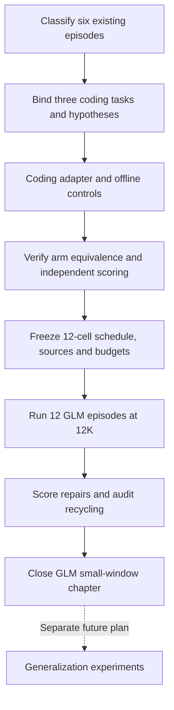

# Feedback timing: finish the GLM small-window benchmark

Status: candidate plan, not executed or frozen. Authority effect: none.
Direction: [ARE project lighthouse](../../LIGHTHOUSE.md).
Machine-readable planning graph: [dag.json](dag.json). This is a planning view,
not a registered ontology record or an admitted execution state.

## Objective and scope

**Current milestone: finish the GLM small-window benchmark chapter.** Complete
one fixed coding comparison, score every outcome, audit context recycling, and
publish a local closeout explaining what passes and what remains unresolved.
The lighthouse guides experimental rigor and the scope of conclusions.

Non-coding tasks, ambiguous-language fixtures, other models, and larger windows
are follow-up work after this closeout. They are not prerequisites or additional
cells in the current cohort. The earlier 32-episode cross-domain proposal is
superseded by the 12-episode GLM-only plan below; no runs from it had started.

Test whether earlier actionable feedback improves GLM repair completion under
the same 12K context threshold and 24-call budget. The research decision may be
retain for further qualification, revise, reject, or inconclusive. Finishing
does not require every repair to pass, but an interrupted or unaudited schedule
is not a completed benchmark. Do not stop after the first passing repair.

This closes a bounded small-window development chapter, not all GLM
qualification or the full external benchmark program. Generalization remains
an explicit future question.

## Evidence and competing hypotheses

The [completed holdout](../../../implementation/agent-reasoning-engine/benchmarks/external-context-v1/holdout-v1/RESULT.md)
is development evidence now. Its frozen files and outcomes remain unchanged.

| ID | Observation or hypothesis | Predicted distinguishing evidence |
| --- | --- | --- |
| O1 | The 16417-32k candidate failed syntax after staging at call 21 and testing at 22. The retained candidate fails a parse-only check. | Earlier detection is demonstrated; successful correction is not. |
| O2 | 16542-12k recorded hypotheses at call 23, never staged a candidate, and reread sources after recycling. | Feedback at staging cannot directly help an episode that never stages. Memory loss remains an explanation, not a proven cause. |
| O3 | 16542-32k suffered a tokenizer transport failure. | This is an infrastructure outcome, not evidence for either model-quality hypothesis. |
| H1 — primary | For objectively checkable candidate violations, delivering the same actionable feedback at staging rather than at the next evaluation step improves final completion within the same budget, on the selected GLM coding tasks. | More paired final successes, corrections before budget exhaustion, and fewer wasted evaluation turns. |
| H0 — null | Timing alone provides no useful improvement. | Detection moves earlier without meaningful final-outcome or cost improvement. |
| H2 — recovery budget | The binding constraint is insufficient opportunity to revise, even with earlier feedback. | Feedback is understood but the remaining workflow cannot finish; late-stage failures persist. Test budget reservation separately later. |
| H3 — knowledge or retained evidence | Missing task understanding or usable evidence dominates failure. | No candidate, repeated investigation, or structurally valid but incorrect candidates persist. No causal memory claim from rereads alone. |
| H4 — evaluator limits | Checks reward a narrow representation or overinterpret ambiguous intent. | Valid alternatives are rejected, unsupported requirements are imposed, or quality declines despite more checks passing. |

H1 is provisional. The observed syntax error motivates a probe; it does not
establish the general mechanism. Review all six old episodes with these labels,
allow multiple labels and unknowns, and link each assignment to exact events.

## Intervention and control

Build a separate experimental adapter; do not edit the old frozen harness.

- **Early:** stage a candidate in an isolated workspace and return the applicable
  contract diagnostics in the staging response.
- **Delayed:** stage identically, compute the same diagnostics, and expose them
  only when the agent next calls candidate evaluation.

Both arms have identical prompts, tool schemas, permitted actions, checker
versions, diagnostic content, candidate limits, evaluation limits, and budget
rules. Both may revise after staging. Invalid candidates cannot be submitted or
executed past the same validity boundary. Delayed feedback is withheld, not
replaced with a false claim of validity. Final evaluation remains independent.
Record the differences from the historical phase contract: this is a new matched
comparison, not a claim that the old harness was rerun unchanged.

This tests feedback timing, not the value of adding a checker. Do not add a
memory policy, budget-reservation policy, model-specific prompt repair, automatic
code rewriting, or a second validator in only one arm. Extra feedback tokens
and downstream behavior are treatment costs and must be measured.

Candidate common-engine responsibility: coordinate check results, their scope,
uncertainty, evidence identities, and recovery transitions. The coding adapter owns
project-native syntax checks. A general interface remains provisional until
subsequent domain comparisons; building a second adapter is outside this round.

## Tasks and independent scoring

Fixed development cohort: **three existing Svelte tasks × two feedback arms ×
two repetitions = 12 episodes / six matched pairs**. Tasks: 16309, 16417, 16542.
Reuse their pinned public statements, repository revisions, images, public
probes and private evaluation contracts. These observed tasks are development
replications, not fresh holdouts. Freeze the exact input digests before dispatch.

Use the listed task order in repetition 1, early then delayed within each task.
Use reverse task order in repetition 2, delayed then early. Both repetitions
start from fresh isolated states. Repetitions are clustered within three tasks,
not six independent task samples.

Project-native parse checks cover every edited supported file. Public probes
remain available in both arms. Final success requires every expected repair
and regression label to pass in a fresh private evaluator; repeat every passing
patch in another fresh evaluator. Missing patches remain non-completions.

Private tests, labels and reference patches never enter model inputs or staging
diagnostics. The final scorer is independent of the staging check. Offline
controls include retained invalid code, retained valid candidates, and
syntactically valid but behaviorally wrong code. Passing syntax alone must never
produce a benchmark success.

Preserve the previous six-run study and its tokenizer failure. New repetitions
have new episode identities and never replace historical outcomes.

## Budgets and measurement

Start with GLM-5.3-flash at the existing low-reasoning setting, recycle threshold
12,000 and hard context limit 16,384, with 2,048 output reservation. These are
experimental limits, not the model's native maximum. Freeze exact transport
settings and accounting margins from the current source before dispatch.

Each episode: at most 24 model attempts, 48 tokenizer attempts, two staged
candidates, four evaluations, 120 seconds per provider request, and 1,800 seconds
total. No retries or replacement episodes. Aggregate maximum: 288 model attempts
and 576 tokenizer attempts. Run one episode at a time. Before a run starts,
freeze a monetary ceiling using verified pricing; do not reuse historical price
estimates as current billing facts. A missing spend ceiling blocks live dispatch.

No synthetic context padding in the main cohort. Record admitted bounds,
recycles, source rereads, archive access, retained evidence and provider usage.
If no episode recycles, context recovery is not exercised and remains untested.
Larger windows and a second model are separate, subsequently frozen replications.

Primary measure: full coding benchmark success fraction for each feedback arm. Also report paired wins/ties/losses per task and
repetition, plus no-candidate and infrastructure outcomes. Report all dispatched
attempts; transport failures count as operational non-completions. Separately
show model-quality comparisons only for complete pairs, with exclusions named.

Secondary measures: turns from staging to actionable feedback, corrected
violations, remaining turns at first candidate, tests spent on invalid candidates,
incorrect rejections, total model/tokenizer/checker cost, and elapsed time.
Conditional correction rates are exploratory because treatment can change which
errors occur. Do not infer a causal mediator effect from that selected subset.

## Decision and stopping rules

- Offline gate: retained invalid code is detected, valid code is accepted, and
  syntactically valid wrong code does not pass the independent final scorer.
  Any false rejection requires a recorded correction and new freeze before live use.
- Finish all 12 scheduled episodes unless integrity, privacy, budget,
  infrastructure, or cleanup problems require a stop. Preserve terminal failures;
  resumption may run only unstarted cells after diagnosis. A stopped schedule
  remains incomplete; do not silently reduce the denominator.
- The provisional threshold for retaining the intervention for further
  qualification is more final paired wins than losses, zero new incorrect
  rejections, and at most 20% increase in mean model-token usage and mean elapsed
  time. Report per-task variation, monetary/checker costs and incomplete pairs.
  These are pilot screening criteria, not statistical proof or production admission.
- Earlier detection without repair gain supports at most a diagnostic benefit.
  No encountered violations means H1 was insufficiently exercised; report
  inconclusive instead of injecting errors or extending the cohort mid-run.
- If valid outcomes are rejected, investigate H4. If revision time is the
  consistent bottleneck, propose H2 separately. If candidate construction remains
  the bottleneck, propose H3 separately. Record this decision in the closeout;
  do not start another tuning loop or add it to the frozen H1 comparison.

## Small-window chapter closeout

The chapter report must contain:

1. All 12 terminal episode identities, six paired comparisons, full benchmark
   scores, repeated verification of passing patches, and explicit infrastructure
   outcomes. Unknown causes remain unknown rather than invented explanations.
2. A per-episode context audit: maximum admitted bound, accounting margins,
   recycling events, preserved/recovered state and continuation afterward.
   Distinguish ARE recycling from provider/host compaction. Record observed
   compaction events and telemetry coverage; absent telemetry cannot prove that
   host compaction never occurred.
3. A recycling verdict of passed, failed, or not exercised, tied to actual
   evidence. If natural history does not exercise recycling, report that limit;
   do not claim recovery works or add synthetic pressure to the frozen cohort.
4. The H1 decision, costs, remaining failure mechanisms, and a scoped conclusion
   about GLM at this configured window. A negative or inconclusive hypothesis
   can close the research round; it cannot be labeled a successful intervention.
5. A separate follow-up backlog. No non-coding or cross-model work is required to
   deliver this report. The broader lighthouse objective remains in force.

An audit failure requires resolution or an explicit incomplete status. Research
completion, successful repairs, context-recovery validation and broad GLM
qualification are separate claims.

## Research DAG and deliverables

Each active node's acceptance conditions and dependencies are in [dag.json](dag.json).
J is deferred and is not part of the active completion criterion.
Planned outputs: trace-linked classification, task bindings, adapter controls,
equivalence report, source/budget freeze, episode receipts, independent scores,
context audit, and the chapter closeout with counterevidence and open questions.
At implementation, bind hypothesis, experiment, observation and learning-decision
records through existing evolution-runtime contracts. This planning graph does
not claim those records already exist.

## Deferred generalization work

After I, prepare a separately scoped plan for requirements revision and
ambiguous requests, then another model and broader context windows as appropriate
to the evidence. Test whether the mechanism transfers before introducing it as a
general engine capability. None of these branches is automatically dispatched.

The existing [requirements research](../../../implementation/agent-reasoning-engine/packages/evolution-runtime/research/requirement-research-v1/README.md)
and [intent corpus](../../../implementation/agent-reasoning-engine/benchmarks/real-reasoning-v1/corpus/intent-understanding.jsonl)
remain candidate sources for that future plan. The historical requirements
manifest references a locally absent fixture; resolving or replacing it belongs
to that future work and does not block GLM.

## Construction and operational lanes

Current product frontier: hypothesis and experiment specification (this plan).
Runnable next work: A, then B; C depends on the task bindings and an
exact implementation route/D65 binding. Agent is the preparation/implementation
owner; product owner retains product approval. No ontology-runtime selector is
required for this planning artifact.

Preserve the D65 sequence for later implementation: current product meaning and
capability -> business ontology -> DomainSpec/compiled graph -> system ontology
-> exact implementation candidate -> product tests -> product approval.
Bind existing applicable stages by path and evidence at the implementation
boundary; missing exact bindings cannot be inferred from this plan.

| Operational task | Owner | Affected stage | Causal prerequisite |
| --- | --- | --- | --- |
| Verify model access, current price and spend ceiling | Executing agent using existing authorized configuration | F/G | Required before live dispatch; secrets remain outside artifacts |
| Verify pinned images, private evaluator separation and cleanup | Executing agent | C/E/G/H | Required for isolated coding runs and trustworthy scores |
| Verify context accounting, recycling and compaction observability | Executing agent | E/H/I | Required for the chapter verdict; unsupported claims remain unproven |
| Non-coding fixtures, second model, wider windows and production integration | Future scoped work; product owner selects | After I | Deferred; no dependency on the current GLM closeout |

Goals validation remains blocked, so this is candidate planning rather than
admitted execution state. No deployment or publication is part of the round.

## Open Questions

- Will natural GLM episodes produce enough relevant violations to exercise H1?
- Does earlier feedback improve full repairs, or only detection latency?
- Does the remaining failure evidence favor recovery budgeting or evidence retention?
- What does observed recycling establish, and what host-compaction telemetry is absent?
- After this chapter, does the mechanism transfer to fresh tasks, domains and models?
