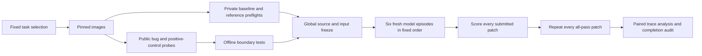

# GLM fixed holdout comparison

This package executes the [preregistered plan](PLAN.md) and [six-cell matrix](matrix.json). The selected tasks were unused in this experiment history; unknown model training exposure and the shared Svelte repository limit generalization.

## Execution DAG



Run commands from the repository root. Paths below abbreviate the package as `implementation/agent-reasoning-engine/benchmarks/external-context-v1/holdout-v1`. The scripts refuse to overwrite model episodes, global freezes and evaluations. Preserve a failed run; do not reuse its identifier to replace its result.

```sh
node --test implementation/agent-reasoning-engine/benchmarks/external-context-v1/holdout-v1/window.test.mjs implementation/agent-reasoning-engine/benchmarks/external-context-v1/holdout-v1/harness.test.mjs
node implementation/agent-reasoning-engine/benchmarks/external-context-v1/holdout-v1/freeze.mjs
python3 implementation/agent-reasoning-engine/benchmarks/external-context-v1/holdout-v1/execute-matrix.py /home/vrondelli/.config/are/glm-flash-credential.json
python3 implementation/agent-reasoning-engine/benchmarks/external-context-v1/holdout-v1/score-matrix.py
```

After all preflights, `pipeline.py CREDENTIAL_REFERENCE` performs the freeze, six model episodes, scoring, reproductions and audits once. It stops on a stage failure and never resumes or retries implicitly.

After evaluation, run `audit.mjs CELL_ID` for each matrix cell and then `closeout.mjs` and `analyze.mjs`. `score-matrix.py` checks that all six model episodes are terminal before it exposes candidate patches to the private evaluator. It runs each passing patch again in a fresh container. Evaluator invocation receipts bind patch bytes, evaluator source, freeze and result.

The evaluator accepts `CACHE MODE OUTPUT TASK_DIRECTORY [PATCH]`, with `MODE` equal to `base`, `gold`, or `candidate`. Only this separate process reads cached evaluator rows. Public task JSON, public issue fixtures and probe output are the runner's task inputs. No private test or reference patch is included in the model's container or prompt.

The transport remains `glm-5.3-flash` with retained reasoning, 24 model calls and 48 tokenizer calls per episode, zero retries and unchanged output/deadline limits. Both arms permit the same request bytes. Context admission thresholds are 12,000 or 32,000 tokens, including output reservation and accounting margins; these are experimental limits, not claims about the provider's native capacity.

Model responses and reasoning are retained locally for accounting and trace analysis. User-facing reports contain findings, aggregate metrics and source evidence, not raw reasoning.

Run `python3 implementation/agent-reasoning-engine/benchmarks/external-context-v1/holdout-v1/status.py` for a read-only progress view. It reports preflights, each episode, evaluation and final audit separately; it never starts or retries work.

## Open Questions

[PLAN.md](PLAN.md#open-questions) owns the unresolved research questions. The full comparison is complete only when all six terminal episodes, required evaluations and `closeout.json` exist; prepared images and passing harness tests alone do not establish a model result.
