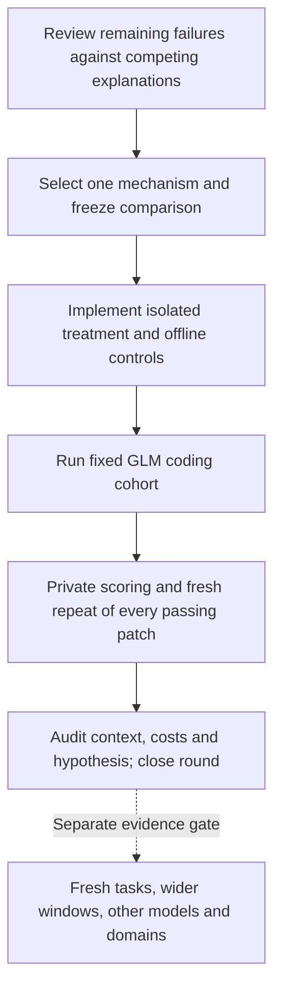

# Benchmark-first follow-up

Status: candidate plan; execution not started. Authority effect: none.

## Objective

Continue qualifying GLM on real coding benchmark tasks. The completed
[small-window round](PLAN.md) remains closed with six repeat-verified repairs
out of twelve episodes and inconclusive feedback-timing evidence. Completing
that experiment does not mean the remaining benchmark failures are solved.

The [lighthouse](../../LIGHTHOUSE.md) guides mechanism design: improvements should
help ARE agents through reusable behavior. Cross-domain proof is a later gate,
not a prerequisite for producing the next verified coding repair.

## Hypothesis and alternatives

Candidate hypothesis: reserving time for candidate construction and recovery
improves full repair completion under the same total model-call and context
budgets. The observed late candidate is motivation, not causal proof.

First distinguish insufficient revision opportunity from missing task knowledge,
lost evidence, output exhaustion, and unclear terminal-tool rules. Review the
existing failed episodes before selecting an intervention. If the evidence does
not support a discriminating experiment, report that gap instead of adding
another task-specific patch. Do not bundle memory, prompts, budgets and validators
into a single treatment.

## DAG and acceptance

| Node | Acceptance |
| --- | --- |
| K | Each failed episode has trace-linked observations, competing explanations and an explicit unknown-cause option. |
| L | Select one intervention; predeclare task IDs, repetitions, control, predicted discriminator, scoring, token/call/time/spend ceilings and stopping rules. Preserve historical outcomes. |
| M | Bind the D65 construction chain to exact sources; verify identical treatment/control conditions except the selected mechanism; keep private scoring outside model context. |
| N | Every scheduled episode has a terminal receipt, including failures; no replacements or tuning during the frozen run. |
| O | Score every outcome; repeat every passing patch in a fresh evaluator against all required repair and regression labels. |
| P | Report paired repair results, recycling and continuation evidence, costs, counterevidence and a retain/revise/reject/inconclusive decision. |
| Q | Separately scope transfer experiments only after P; no general engine claim based solely on this coding cohort. |

Target demonstration: at least one repeat-verified repair on a previously
unresolved task, accompanied by the complete cohort result. One success alone
does not establish a treatment benefit. A fixed round may end without meeting
that target; record failure honestly and require a new hypothesis and freeze
before another round. Do not loop until a favorable sample appears.

## Construction and operational lanes

Current product frontier: K, analysis of existing evidence. Runnable work:
classify failures and prepare the discriminating comparison. Owner: executing
agent. Exact blockers for L: unresolved intervention choice and experiment
bindings. No live dispatch is part of this planning revision.

Preserve the construction chain: product/capability meaning → business ontology
→ DomainSpec and compiled graph → system ontology → implementation candidate
→ product tests → product approval. L/M must bind applicable existing records;
this plan does not supply admission or imply product approval.

| Operational task | Owner | Affected stages | Blocking basis |
| --- | --- | --- | --- |
| Verify provider access, current pricing and spend ceiling | Executing agent | L/N | Exact prerequisite before live dispatch |
| Verify evaluator isolation, pinned inputs and cleanup | Executing agent | M/N/O | Required for trustworthy comparison |
| Verify context accounting and telemetry coverage | Executing agent | M/P | Required for supported continuity claims |
| Broader domain/model fixtures and production integration | Product owner selects future scope | Q | Deferred; does not block K–P |

Goals admission remains unavailable under the routing contract; this is a
candidate planning artifact, not admitted execution state.

## Open Questions

- Does existing evidence support recovery reservation over knowledge or retention explanations?
- Which exact reservation and cohort provide a discriminating test within a fixed budget?
- Can the previously unresolved task pass independently without task-specific hints?
- What semantic continuity remains unmeasured despite mechanical recycling checks?
- Which later evidence would justify promoting a mechanism into the common engine?
