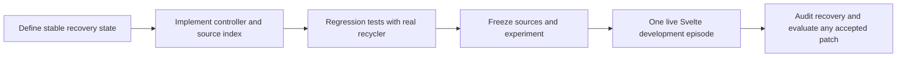

# Stable archive recovery fix

Candidate implementation plan for `glm-archive-fix-93`, owner-directed by “plan and fix”. Authority effect: none. Scope is this isolated recovery candidate; previous frozen code and failed episodes remain unchanged.

## Objective

Fix the external adapter's changing recovery handle and repeated first-page delivery. Preserve retrieval progress and inspected-source navigation through a local context transition. Do not equate this fix with solving every repository task or completing GLM qualification.

Sources: [diagnosis](../diagnosis.json), [previous result](../RESULT.md), [candidate hypothesis](../next-hypothesis.json), [previous runner](../run-reviewed-payload.mjs), and ARE's existing context-recycling and GLM transport contracts.

## DAG and gates

1. Anchor one immutable history digest when the recycler enters a new generation. Ignore changing current-history digests within that generation. Preserve progress for each retained handle.
2. Require archive reads to use the active handle and next unread offset. A repeated/stale request receives a bounded correction with the active handle and cursor; no duplicate source page is silently returned and no request is silently remapped.
3. Validate returned page identity/range before advancing the cursor. Keep EOF stable and reject invalid or inconsistent backend output.
4. Expose a bounded index of actual successful source reads (path, file hash, line range), with explicit omission counts. It adds navigation evidence, not mutation authority or gold annotations.
5. Test repeated renders, stale handles, duplicate/forward offsets, EOF, malformed pages, multiple generations and real-recycler integration. Replay historical read patterns without provider calls.
6. Run one new H23 development episode on the unchanged Svelte task. Keep the same model, 12-turn limit, 2,048 output-token cap, 12K local threshold, isolated tools and scope guard. Preserve all terminal outcomes and full response evidence.

## Acceptance and limitations

Deterministic acceptance: one advertised handle per generation; monotonic validated cursor; no repeated page delivered on stale/duplicate reads; no page skipped implicitly; bounded source index; existing source-scope guard unchanged. Live evidence must separately report whether recycling occurred, cursor progress, duplicate-request corrections, subsequent source reads and patch outcome. A patch is evaluated only if it passes the proposal gate.

The hypothesis is the previously sealed stable-handle/progress candidate. Adding source navigation is part of this recovery-interface treatment, so a live difference cannot isolate the archive handle alone. One development task does not establish generalization. A failed model proposal remains an observed failure; it does not justify retuning the frozen episode.

## Budget and construction boundary

One episode: at most12 model and24 tokenizer attempts, zero automatic retries, 60s per model request, 30s per tokenizer request, 720s episode deadline plus bounded cleanup. Use existing request/response byte limits and a single network-isolated 2CPU/4GB task container. Estimated list-price model ceiling is below USD0.034; reserve USD0.05. No second live candidate is implicit.

D65 chain: diagnosed external-adapter defect → this bounded contract → exact implementation → offline tests → frozen live evidence → product review. Current construction frontier is the recovery controller and tests. Credentials and a fixed budget block only live dispatch; task-image/evaluator availability blocks only sandbox work. Owner: ARE implementer/evaluator. The unchanged, previously checked base/reference task oracles remain reusable; source/image drift blocks their reuse. Deployment, default activation, publication and larger evaluation cohorts are deferred product-owner work.

## Open Questions

Does GLM follow the cursor or use source-index rereads? Is indexed source retrieval sufficient within12 turns? Does useful evidence survive further context transitions? Is broader integration appropriate after this isolated fix? These questions remain separate from deterministic controller correctness.
