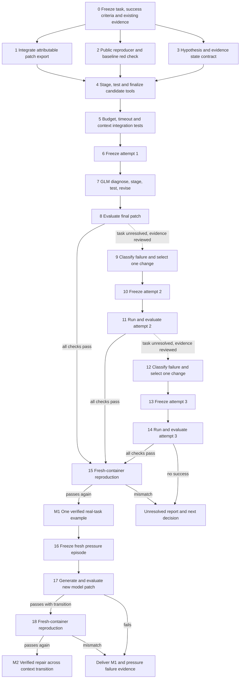

# DAG plan: one verified GLM repair of a real repository task

Status: candidate plan, not admitted execution state. Owner: ARE product owner; construction and evaluation owner: ARE implementer. User request: “so whats next? prepare a detailed DAG plan so we can have at least a sucessfull example at the end”. Authority effect: none. This artifact plans the next implementation; it launches no model calls. Goals registration is outside this plan because the selected PLAN route reports that admission as blocked.

## Objective and exact finish line

**M1: GLM produces a source patch for the existing real Svelte task, and that exact patch resolves the task in two fresh evaluator containers.** The model must generate the patch, not receive an operator-written fix or the reference patch. We keep `sveltejs__svelte-16666`; changing to an easier task is not a success branch in this plan.

The success conjunction is:

1. Attributable source-only patch, exact initial-image and candidate hashes, all source edits generated by GLM, no hidden tests or reference solution in model inputs.
2. A public issue reproducer fails on the initial source for the intended behavior and passes with the exact candidate; the same reproducer bytes are used for both. No baseline-red claim from an unrelated setup failure.
3. Existing isolated benchmark evaluator: **67/67 repair labels and 5,120/5,120 regression labels pass**, zero missing labels, `strict_all_expected_pass=true`, `resolved=true`. Every full-name match must pass where labels are ambiguous.
4. The same patch passes a second fresh evaluator execution. This reproduces the artifact, not an independent model-generation success.
5. Trace includes model requests/responses, every tool effect, candidate revisions, test evidence, accounting and cleanup; no observed input/output budget violation.

**M2, following M1:** one fresh model episode also produces a passing repair after an observed local context transition at the unchanged12K threshold. Use the existing labelled pressure condition if natural pressure does not provide a controlled condition. Do not preload the winning patch into the model. M1 is delivered even if M2 fails; a pressure failure remains visible and means context-qualified success is incomplete. Neither milestone proves a broad model success rate or finishes all GLM qualification.

A stochastic model cannot be guaranteed to solve this task by planning. This plan maximizes useful feedback and provides finite evidence-producing branches. It does not turn an exhausted budget into a success claim.

## What the existing evidence establishes

| Area | State | Consequence |
| --- | --- | --- |
| Retained reasoning |46/46 observed historical requests and12/12 new live responses fit corrected bounds | Reuse candidate accounting; keep its guard and measure conservatism |
| Context recovery | Stable handles tested; last episode completed two transitions | Reuse controller and source index; no new compression technique before M1 |
| Export attribution | Verified post-run exporter exists; live global-diff export includes pre-existing image edits | Integrate attribution before any new model episode |
| Repair behavior | Model changed snippet hoisting; same DOM/hydration failures remain | Test competing explanations and candidate behavior before final submission |
| Tool contract | Reads/search/archive plus one terminal source submission; no candidate testing/revision tool | Add a bounded inspect → stage → test → revise workflow |

Sources: [latest result](../accounting-v1/RESULT.md), [accounting replay](../accounting-v1/replay.json), [evaluation](../accounting-v1/evidence/evaluation-attributed/report.json), [failure comparison](../accounting-v1/evidence/failure-comparison.json), [current tools](../contract.mjs), [current repository helper](../repo-tool.cjs), and [public task statement](../prepared/task.json).

The hypothesis is that insufficient diagnostic and repair feedback is now limiting task success. It is not established that a larger context window, a different margin, or more identical attempts would fix that. The latest totals are the baseline totals:65/67 is not evidence that the model fixed65 failing cases.

## Construction DAG

Dashed edges below are conditional progression, not retries of a failed frozen run. There are no backward edges. A later experiment gets a new identity and freeze.

The success join at node15 accepts the **first passing** completed attempt; it does not wait for unnecessary later model runs. Later attempts are marked skipped on earlier success. Infrastructure failures stop model dispatch until their exact defect is fixed and a revised candidate is tested; they do not trigger a blind retry branch.

The [machine-readable DAG](dag.json) has explicit dependencies, conditional joins, owners, deliverables and gates. It is a local planning representation, not a registered execution DAG. Independent construction nodes can be worked sequentially or concurrently; this plan does not dispatch agents or authorize delegation.

## Node contracts and implementation order

| Node | Work and concrete output | Exit gate |
| --- | --- | --- |
|0| Pin task/image/source baseline, accounting/recovery versions, public/private evidence boundary, all prior attempts and success thresholds in `success-v1/manifest.json` | Initial task identity unchanged; known dirty-image state recorded; existing reference/base oracle evidence reusable only when dependencies match |
|1| Integrate the verified attribution approach into candidate staging and final export; produce before/after file manifests and patch receipt | Fresh image + exported patch recreates exact candidate bytes; unrelated dependency edits omitted; source/test/diagnostic boundaries checked |
|2| Build a minimal executable public reproducer from the issue statement and, if accessible, its public reproduction; freeze its provenance and wrapper | Intended ReferenceError reproduced on unmodified task; no reference-patch or private-test access; both runtime modes represented where feasible |
|3| Define concise hypothesis records and a bounded task-state projection | Competing explanations have source references, discriminating observations and falsifiers; records survive a simulated transition without inventing evidence |
|4| Implement schema-validated staging, public test execution, revision and finalization | Nonterminal candidate can be tested; failed checks return bounded actionable evidence; finalization binds an existing candidate ID and exact bytes |
|5| Integrate24-turn candidate policy, accounting, deadlines, ledgers, context transition and final-turn reservation | Offline boundary tests and deterministic replay pass; no widening of hard context/output limits; unknown reasoning still fails closed |
|6| Freeze complete treatment, tool schemas, public reproducer, state projection, limits and experiment record | No source drift, container cleanup works, baseline red gate and tools verified before provider calls |
|7| Execute the bounded workflow below | Final candidate or a specific terminal failure; no evaluator gold/test metadata in model loop |
|8| Export verification and full private evaluator in a fresh sandbox | Exact candidate scored, not simply successful shell exit; infrastructure errors separate from wrong patch |
|9,12| Review immutable attempt evidence, classify bottleneck, compare hypotheses, select at most one intervention | A falsifiable rationale explains the next attempt; no identical rerun to hunt for luck; task is not silently changed |
|10,13| Freeze a new candidate and new experiment ID | Changed mechanism and preserved constants recorded; required offline checks pass |
|11,14| Same bounded diagnosis/revision/evaluation workflow | Same success criteria and evidence boundaries; stop at first pass |
|15| Reapply the winning patch in another fresh evaluator container and repeat full score | Identical patch digest, both evaluator results all-pass, cleanup verified |
|16–18| Fresh pressure episode followed by evaluation and reproduction | New model patch, observed transition, accounting/recovery correctness, all tests pass twice; earlier winning patch not fed to model |

Start with **node1 (export) and node2 (public reproducer)** after node0, then build the repair loop. Do not spend another model episode on a final-only tool contract.

## Proposed tool and data contracts

Retain list/search/ranged source reads and recovery tools. Reuse whole-object validation with bounded aggregated issues. Add these candidate interfaces; exact JSON schemas are a node4 deliverable, not existing callable capabilities:

| Interface | Semantics |
| --- | --- |
|`record_hypotheses`| Up to3 concise claims with evidence references, predicted observable result and falsifier. These are inspectable conclusions, not a request for private reasoning transcripts. At least2 competing explanations before the first patch. |
|`stage_patch_candidate`| Exact replacement edits against the pinned initial source snapshot, up to6 source files; returns candidate ID, changed-path list, attribution receipt and diff. A later revision supplies the complete replacement proposal against the same initial snapshot, avoiding accumulated hidden edits. |
|`run_public_reproducer`| Takes an existing candidate ID or baseline and a registered public probe ID; runs only the fixed command in a fresh diagnostic sandbox. Returns exit/status, bounded failure excerpt, artifact references and candidate/probe hashes. It never invokes the private benchmark oracle. |
|`submit_patch_candidate`| Finalizes a staged candidate ID after source/export checks. Does not regenerate a patch from global worktree diff. Candidate test status is explicit; a red candidate may be retained as a failed outcome, never labelled verified. |

Source scope must be declarative and validated for all fields/batches. No edits to benchmark tests, dependency manifests/locks, diagnostics or harness files enter the final source patch. Stage operations are atomic after whole-batch validation. Generated diagnostics live in a separate namespace and are excluded from the deliverable.

**Dirty image handling:** compare against the actual initial task filesystem, not only Git HEAD. Keep required image dependency changes. For initially clean model-targeted files, the existing verified scoped diff is reusable. For a dirty target, produce and verify a before/after delta against its actual starting bytes or fail closed before the model episode; never silently reset the image. Apply the exported delta to a fresh identical image and verify every target file hash plus unchanged non-target source hashes.

**Public tests:** node2 may be operator-authored scaffolding derived solely from public issue material; label authorship. The operator must not write the repair. Freeze a probe before comparing baseline/candidate. If a later public probe is added, assign a new version and rerun its baseline check. Model-created diagnostic code executes only in disposable isolated sandboxes with no provider credentials, no hidden evaluator data and no host mounts. Fixed command IDs select execution; no arbitrary host-shell tool is exposed. Detect source/test mutations by diagnostics and discard their sandbox; final scoring always starts fresh. A probe's green result alone is never the success oracle.

The public reproduction URL has not been fetched for this plan. Node2 must record availability and provenance; if inaccessible, derive a minimal case from the supplied public behavior and record that limitation. If no intended baseline failure can be reproduced, stop before new model spending and resolve that diagnostic gap.

## Inside each model episode: finite, unrolled repair workflow

1. **Calls1–6: inspect and discriminate.** Read issue and relevant source, record two candidate explanations, request public baseline evidence. Retrieve only facts needed to distinguish them. A source filename alone is not supporting evidence.
2. **Calls7–12: candidate1.** Select an evidence-backed hypothesis, stage exact edits, run the frozen public reproducer. Record predicted versus actual behavior.
3. **Calls13–20: candidate2 only if useful.** If candidate1 is red, use its bounded public feedback to revise or reject the hypothesis. Stage a complete second proposal from the same initial source snapshot and test it. At most2 staged candidates and4 diagnostic executions per episode, including baseline and optional repeated control. If more coverage is needed, it requires a later frozen experiment, not an unbounded inner loop.
4. **Calls21–24: finalize.** Preserve four calls for targeted recovery, exact patch review and final submission. Do not start an unrelated search or a third candidate here. The controller exposes the actual remaining call budget; early finalization is allowed.
5. **After submission:** private evaluator runs outside the model episode. Preserve its full outcome. No private test body, expected patch, detailed private failure output or operator-crafted source fix is inserted into a subsequent prompt. Any task-level pass/fail feedback used to select a later development attempt is declared as evaluation feedback; this remains a repeatedly used development task.

Call ranges are scheduling caps, not mandatory call consumption. Model/tool phase accounting must be explicit in the new candidate. The existing transport currently caps the standard policy at12 calls; node5 must implement and test a separately identified24-call policy and its ledger limits. Passing24 to the old adapter is not a valid implementation.

Use a bounded state summary containing issue objective, hypothesis IDs/status, relevant source ranges, public probe outcomes, candidate IDs/hashes and next discriminating action. Tool outputs remain untrusted evidence. Keep critical references and current candidate/test status visible after recycling; replay tests must prove the summary does not confuse candidate1 with candidate2 or report stale green results. Source text remains recoverable via indexed reads.

## Research hypotheses and controlled progression

| Hypothesis | Prediction | Falsifier / consequence |
| --- | --- | --- |
|H-feedback| Public failing reproduction plus testable intermediate edits prevents submission of the same non-repair | Model obtains meaningful red feedback but repeats the unsupported change or public-green candidates still fail the private oracle; inspect probe coverage and diagnosis |
|H-state| Persisting hypothesis, candidate identity and test result prevents loss of diagnostic progress at recycling | Trace shows stale candidate/test association or lost falsifier after transition; fix state binding offline before next live attempt |
|H-budget| Reserved diagnosis/revision/finalization turns allow a complete tested proposal | Calls are consumed without new evidence or a tested candidate; do not automatically add more turns |
|H-export| Initial-filesystem delta export eliminates attribution/application failures | Reapplied bytes differ or unrelated image changes enter candidate; exact exporter defect blocks further model runs |

Attempt1 is a **compound workflow treatment**, not a causal estimate for any single component. Later attempts change only the mechanism selected by their recorded failure analysis. Use existing `createResearchHypothesis`, `createResearchExperiment`, observation and learning-decision constructors to seal records at implementation/freeze boundaries. Carry parents to the latest accounting/pressure research records and preserve supporting, counterevidence and inconclusive observations separately. Do not invent global H numbers or register this planning file as an executed experiment.

Failure handling must be explicit: export/schema/provider/accounting defect → repair offline and revise freeze; intended public probe cannot run → fix exact harness issue; public probe red after patch → revise model hypothesis within remaining budget; public green/private red → diagnose public coverage from public evidence before the next attempt; private all-pass → reproduce immediately; budget exhausted → retain failure and select the next bounded decision. Identical restarts and manual final fixes are not success paths.

## Budget and evidence envelope

Proposed campaign, to be frozen at implementation time:

| Resource | Cap |
| --- | --- |
| M1 model episodes | At most3; stop at first success |
| M2 pressure episode | At most1 after M1 |
| Per episode |24 model attempts,48 tokenizer attempts, no automatic retries |
| Whole campaign | At most96 model /192 tokenizer attempts |
| Per request / episode |60s model deadline; existing tokenizer deadline;30-minute total episode ceiling including diagnostic work |
| Public diagnostics | At most4 executions per episode,120s each; qualify the probe against this bound before freezing |
| Private evaluation | One per finalized episode plus one fresh reproduction per passing milestone; at most6 full-suite evaluations for this schedule |
| Context |12,000 local threshold;16,384 hard limit;2,048 output cap;512 base margin plus request-scoped reasoning reservation |
| Containers | Sequential2CPU/4GB jobs; preserve tested evaluator PID allowance; no concurrent rollout/evaluator memory spike |
| Provider reserve | Proposed USD0.10 per episode, USD0.40 campaign reserve; verify current pricing and worst-case reservation before launch, including unknown timeout usage |

These are maxima, not a promise every possible call fits the wall-clock ceiling. Exhaustion ends the episode. Setup/evaluator preflight work has separate logged runtime; existing base/reference evidence is reused only with matching dependencies. Any required oracle re-preflight is identified before the campaign freeze. No provider estimate here claims current pricing. A pricing/budget mismatch requires adjusting the proposed envelope before launch, not silently overrunning it.

Each attempt retains `manifest.json`, source freeze, research records, hypothesis/state events, original responses, dispatch/measurement receipts, tool events, source-read hashes, initial filesystem manifest, candidate manifests/diffs, public red/green evidence, private evaluation, cleanup and terminal classification. A successful example additionally includes a concise walkthrough and a single reproduction command that reapplies the exact model patch and runs the isolated evaluator. The report includes every failed/skipped attempt, not only the winner.

## Reuse and exact operational dependencies

| Existing surface | Reuse | Limitation |
| --- | --- | --- |
| [Accounting candidate](../accounting-v1/accounting.mjs) and adapter | Exact-message accounting/receipt restoration | Candidate only; add explicit new turn policy rather than mutate old freeze |
| [Recovery controller](../recovery-v1/recovery.mjs) | Stable handles, cursor and source index | Add separately tested hypothesis/candidate state projection |
| [Export verifier](../accounting-v1/export-model-patch.mjs) | Replay and attribution checks | Integrate into staging; extend or reject dirty target files |
| [Contract](../contract.mjs) | Closed schemas and aggregated errors | New staged/test/finalize tools need new candidate schemas |
| [Sandbox](../../../packages/coding-agent-runtime/sandbox.mjs) | Command/resource/output-bound patterns | Existing read-only mount profile is not automatically compatible with builds; use tested disposable task-container adaptation |
| [GLM tools](../../../packages/coding-agent-runtime/glm-flash-v1/tools.mjs) | Exact allowlisted verification-command pattern | Does not already implement this external repair workflow |
| [Evaluator](../evaluate.py) and [scorer](../score.py) | Existing pinned oracle and strict matching | Keep custom command/name normalization declared |
| [Evolution runtime](../../../packages/evolution-runtime/index.mjs) | Typed research records and provenance | Research DAG CLI projects registered records; this plan is not automatically registered |

Product frontier: nodes0–5, exact owner-directed candidate construction. Operational owners: implementer owns image/probe/cleanup readiness; provider account owner supplies the existing secret reference and budget only at live boundary; evaluator owner owns oracle isolation and hash continuity. Unrelated Goals registration, ontology admission, deployment, commits, other models, large context sweeps and broader benchmark cohorts are deferred. They do not block local construction or become implicit effects.

## Open Questions

Can the public issue be reproduced reliably in the pinned environment without private tests? Is the fixed diagnostic runtime sufficient? Which observed failure mechanism should select attempts2 or3? How much state must remain visible across transitions? Will GLM diagnose and fix this task even with feedback? What additional evaluation is needed after the first example to claim repeatability across tasks and models? These uncertainties remain visible; none changes the success criteria.
