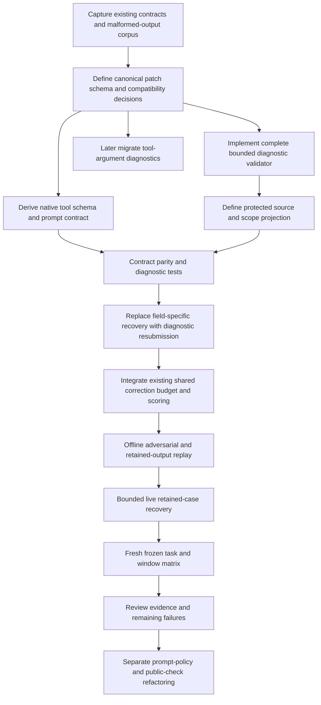

# Full-schema diagnostics and bounded recovery plan

Status: candidate planning, request schema-recovery-plan-39. No runtime change, model call or activation is authorized by this artifact. CAV2-D65 construction chain remains applicable; Goals planning output cannot be registered as admitted execution state. This plan replaces the field-by-field next-step recommendation in the [shared-correction result](evidence/shared-correction-2026-09-08/README.md#open-questions), without changing that experiment or score.

## Objective and audit scope

Replace field-specific repair eligibility and hand-written error reminders with one complete patch contract, structured validation diagnostics and one bounded resubmission. Audit covered the ARE patch parser, native tool schema, GLM tools/completion/recovery, public-check adapters, scoring and linked experiment evidence. It is a source/current-work audit, not an exhaustive repository-wide or committed-history audit. [Findings and source links](SCHEMA-RECOVERY-AUDIT.md).

## Product DAG



The immediate runnable frontier is A–F: schema ownership, diagnostics, protected-payload policy and local tests. Live evaluation follows an explicitly scoped Implement request and passing local tests; this plan makes no provider calls.

## Contract design

1. Add a versioned patch schema under `packages/coding-agent-runtime/schemas/`, consumed by parser and native submission schema generation. Keep base-tree, path-to-file-hash, allowlist, filesystem and source-preservation predicates explicit. A general shape schema cannot independently verify them. Preserve `parsePatchSetCandidate` as a compatibility facade and existing reason codes where they remain meaningful; add structured issues. Do not edit the generated router runtime to obtain a validator.
2. Cover every supported field and constraint: required and optional properties, unknown keys, object/array/string types, constants/enums, item limits, digest format and nested change fields. Optional rationale must be a string when present. No coercion, default insertion, unknown-key stripping or schema selection from model text. An unrecognized schema keyword must cause a configuration error, not be silently ignored.
3. Return deterministic issues with `instance_path`, `schema_path`, `keyword`, stable `code`, and trusted expected constraints. Use JSON Pointer paths, distinguish missing fields from wrong values, and preserve multiple independent errors. Do not descend through a parent of the wrong type; that parent issue is the complete evaluable diagnosis at that location. Bound input bytes, depth, issue count and rendered diagnostic bytes; expose truncation and block recovery when diagnosis cannot be safely completed. Never include credential material, raw provider reasoning or unbounded source values in issue messages.
4. Keep layers explicit: JSON syntax -> native envelope -> schema -> trusted bindings/protected payload -> public semantics -> execution status. Parsing must return a diagnostic result for every bounded JSON input, including `changes: {}`, rather than throwing a TypeError. Duplicate JSON keys must be rejected before a lossy parse can establish a protected payload; do not silently choose the last occurrence. Truncated evidence is ineligible. Prototype/path surprises receive rejection tests.
5. Derive the native schema and minimal prompt contract from the same schema plus trusted run bindings. The provider schema is generation guidance; local validation is authoritative for acceptance. Generic parser limits (currently up to128 changes) and one-file diagnostic-runner scope remain distinct. Explicitly test that runner restrictions narrow the general contract without silently changing executor capability.

Proposed diagnostic example (illustrative, not an implemented schema):

```json
{"ok":false,"issues":[{"instance_path":"/schema_version","schema_path":"/required","keyword":"required","code":"patch-set.required","expected":{"field":"schema_version"}},{"instance_path":"/rationale","schema_path":"/properties/rationale/type","keyword":"type","code":"patch-set.type","expected":{"type":"string"}}],"truncated":false}
```

## Recovery eligibility and shared allowance

Diagnose all schema violations; do not equate every diagnostic with permission to recover. Eligibility is based on independently established source/scope, not a whitelist of whichever missing field failed last.

Before calling the model, capture a protected projection containing each operation, path, base/file hash and exact replacement source bytes from unambiguous original JSON. Require the original complete source strings and exact trusted bindings to be independently valid. Malformed JSON, duplicate keys, missing/non-string source, absent or mismatched scope/hash, conflicting operations, failed delivery/recovery prerequisites and oversized/truncated evidence block this format stage. No source extraction by regular expression, guessed code or reconstructed hashes.

If that protected projection exists and all remaining issues concern unprotected schema structure/metadata, send the rejected proposal plus the full bounded issue list and trusted contract in one native resubmission request. This handles simultaneous missing fields, wrong metadata types/constants and extra metadata keys without adding per-field recovery branches. Compare the protected projection after response validation. Comparing the entire raw change object would incorrectly forbid removing an extra nested metadata key; compare its protected components while validating the entire returned object against the closed schema.

Reuse the existing readiness, source freeze, exclusive evidence, native parser, transport ledger and shared allowance. One dispatch consumes the allowance whether it succeeds, returns invalid output or has uncertain transport accounting. If format repair uses it, semantic validation still runs but semantic repair cannot dispatch. If an originally valid proposal uses semantic repair, malformed output does not get a second format attempt. No recursion or retry-on-error loop.

Preserve the initial rejected response and initial completion gate. Final acceptance requires full schema, bindings, public checks and separate oracle. Final repair success must never retroactively satisfy an unmet original evidence-delivery/continuity gate. Record original submission state, correction kind, dispatch/transport counts, final state and reason separately; derive aggregate counters exhaustively from those states. Keep the [reporting correction](evidence/shared-correction-2026-09-08/corrected-summary.json) as a regression case.

## Work packages and acceptance

| Package | Concrete change | Required evidence |
| --- | --- | --- |
| A. Baseline corpus | Retain both missing-field outputs, earlier multi-error examples, valid candidates and synthetic adversarial mutations | Source hashes, provenance and expected diagnosis; original scores unchanged |
| B–D. Schema and validator | Canonical schema, bounded complete issues, parser facade, generated native schema/guidance | Every property/constraint has negative coverage; valid corpus accepted; rationale mismatch and changes-object exception resolved; declared compatibility changes reviewed |
| E–F. Protection and parity | Independent protected projection, duplicate-key handling, provider/local contract parity | Missing source/scope never triggers recovery; extra metadata can be diagnosed without source changes; multi-file general parsing not accidentally removed |
| G–H. Recovery integration | Diagnostics-driven single native resubmission using shared correction | Several simultaneous errors reported in one prompt; changed source rejected; format plus semantic failure uses one call; malformed semantic reply never retries; unknown accounting retained |
| I. Offline evaluation | Replay retained outputs and mutation corpus without provider calls | No false acceptance, no uncaught input-shape exceptions, stable diagnostics, bounded output, accurate final/unsubmitted counts |
| J. Live retained sample | Predeclare one attempt each for retained missing-authority and missing-schema failures | At most2 model/4 tokenizer attempts; public validation/cleanup and separate oracle; no failure replacement; exact source bytes preserved |
| K. Fresh matrix | Four existing tasks at8K/10K/12K with frozen prompts/schema/sources and one shared correction per trial | First-pass and final acceptance, correction eligibility/use, costs, all recycled continuity, long8K recycling, positive headroom, cleanup and failures retained |

Proposed matrix cap remains160 initial model/320 tokenizer plus12 correction model/24 tokenizer attempts and at most24 public containers. These are proposed future execution bounds, not actions performed by this planning request. Freeze exact thresholds before the run. A clean matrix that uses no correction cannot establish live corrective benefit; retain targeted recovery evidence separately. Provider-internal compaction remains unobservable from these receipts alone.

## Follow-up findings, not prerequisites

After the patch recovery contract is tested, migrate `tools.mjs` boolean argument validation to the same diagnostic vocabulary while retaining prevalidation of the entire batch and exact command/allowlist enforcement. Diagnostics do not authorize reissuing tools or replaying effects.

Separately replace repeated completion-version membership arrays with resolved immutable policy profiles and measure prompt guidance removal through frozen comparisons. Preserve historical experiment identities. Replace defect-specific semantic hints with exact inspected requirements/public checks only after an ablation tests the change. Do not mix this prompt experiment into the schema-recovery matrix.

Public-check adapters should later consume explicit declarative public cases with a coverage/omission inventory rather than hand-selected task branches and first-eight slices. Preserve human-authored semantic expectations and source selectors; do not generate expected behavior from the candidate or expose hidden oracle inputs. This is a benchmark coverage change requiring a new version and separate scores.

## Operational lane and boundaries

Product owner: user; implementation owner: assigned ARE implementer; evaluation owner: benchmark runner/operator. Exact affected stages are schema, generation guidance, candidate parsing, recovery composition and reporting. Local source/schema inconsistency, inability to protect source/scope, failed required tests, incomplete accounting and unconfirmed cleanup are causal blockers. Provider credentials and ready local execution are prerequisites only for J–K. Host capacity reservation, default activation, publication and migration of unrelated schemas remain separately owned operational residue; they do not block offline construction. No mandatory ontology selector dependency is introduced.

## Open Questions

- Which reusable validator implementation should own the full declared schema dialect? Inspect existing dependencies first; the local tool matcher is a starting pattern, not a complete JSON Schema implementation. No new dependency is selected here.
- Should tightening optional rationale validation keep the wire version with an explicit compatibility note, or require a new candidate version? Audit callers and retained accepted outputs before deciding.
- What exact depth/issue/render bounds cover the accepted patch envelope without expensive adversarial traversal? Freeze them with the implementation contract.
- What safe duplicate-key-aware parser can preserve diagnostics and enforce the same byte/depth bounds? Resolve before admitting recovery from raw text.
- How should new general diagnostics preserve legacy reason-code consumers while gaining precise paths? Inventory parser/report consumers before changing codes.
- Are field-level diagnostics sufficient at realistic corrective context limits when source itself is large? Measure admission and report ineligible/truncated inputs explicitly.
