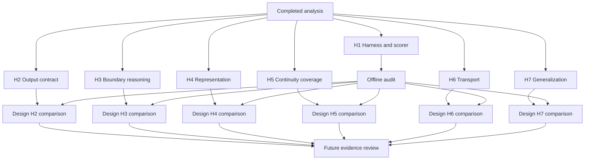

# GLM hypothesis study

Status: candidate, prospective, untested. Owner: ARE research owner.

The objective is to explain why initial GLM proposals fail and identify changes that improve unseen-task correctness under bounded context and cost. The completed analysis found 145/180 initial passes and 172/180 final passes across five frozen campaigns. The latest campaign reached 36/36 finally but 28/36 initially. Recovery success is not an estimate of general initial capability.

Source: [completed findings](../snapshots/2026-09-09-final/FINDINGS.md). [Sources and hashes](sources.json) bind the analysis, canonical hypothesis API, ontology, and selected ZTH sources. [Definitions](hypotheses.json) contain the full evidence, counterevidence, mechanisms, predictions, controls, and falsifiers. [Generated bundle](bundle.json) contains seven canonical ARE ResearchHypothesis records and a prospective dependency projection.

## Competing explanations

| ID | Explanation to investigate | Discriminating comparison |
|---|---|---|
| H1 | Request projection or scorer mismatch | Delivered contract audit and independent, mutation-tested semantic oracle |
| H2 | Invariant output metadata burdens generation | Full contract vs explicit metadata card vs host-owned envelope; raw and normalized validity reported separately |
| H3 | Boundary rules are not applied | Targeted boundary card vs matched-length neutral reminder on unseen cases |
| H4 | Input representation affects useful work per token | Compact JSON/GCF crossed with identical summary presence; whole-request accounting |
| H5 | Current continuity metric misses fact loss | Deliberately corrupted replay plus delayed and revised-fact probes |
| H6 | Timeouts primarily reflect transport conditions | Payload-size groups interleaved in time blocks with identical transport policy |
| H7 | Known-task selection overstates generalization | Same frozen candidate on known and genuinely unseen task families |

These explanations can coexist. Their order is an investigation dependency, not a causal ranking. H1 is first because defective measurement would invalidate treatment comparisons. The 19 schema failures already agree with canonical reanalysis, so a schema-scorer defect has counterevidence. Semantic oracle coverage and delivered request contracts remain distinct questions.

## Prospective DAG



The graph uses the existing prospective pattern in [latency-hypotheses-001](../../../../../../workspace/experiments/control-center/latency-hypotheses-001/hypothesize.mjs). Records use the original [ARE API](../../../../packages/evolution-runtime/index.mjs), not the workspace-owned fork. Exact ontology dependencies are ARE-RL-D01/D03/D07/D08 in [research-learning-v1](../../../../packages/evolution-runtime/ontology/research-learning-v1.json).

Historical `materializeResearchDag` requires verified registrations with real experiments, observations and decisions. Those do not yet exist for this study. This candidate projection deliberately does not claim the historical `are.research-dag/v1` schema, admitted ResearchWorkPlan status, or executable readiness. No observations or LearningDecisions were manufactured.

## Next experiment preparation

First audit: inspect hash-bound delivered request contracts and the 19 omitted-field proposals; independently check archive start/end/progress, empty-history, and paired-tool semantics. Include valid and intentionally invalid candidates to detect scorer false positives and false negatives. Preserve disagreements before considering any scorer change.

After that audit, prioritize H2 and H3 for design because the current corpus has direct, recurring failures in those categories. This prioritizes information gathering; it does not select a winning mechanism. Freeze a common baseline, task-family split, exact treatment bytes, model identity, soft windows, hard limit, output cap, timeout and retry policy. Balance arm order within time blocks. The existing data must not become the held-out set.

Primary endpoint: initial correct proposal, before semantic correction. Report raw and host-normalized schema validity separately, initial semantic success, final success, physical retries, unknown usage, total request tokens and latency. Define metric direction explicitly. Repeated trials of one fixture remain clustered by fixture/family; they are not independent tasks. Missing outputs remain failures for end-to-end success and unknown where a metric is unobservable.

Three repetitions in the hypothesis templates is a provisional minimum. Sample size, meaningful effect threshold, uncertainty method, negative-control acceptance criteria, and total physical-call cap remain unbound. Do not infer statistical power from that placeholder or launch every branch because the graph permits parallel dependencies. Stop at the frozen cap and retain inconclusive outcomes.

## ZTH reuse

See [component decisions](ZTH-REUSE.md). Reuse its correction-card structure and explicit failure-review pattern within ARE. Adapt capability reporting with exact cohort bindings, unknown-value handling and metric directions. Training and context distillation remain separate experiment candidates. No upstream executable was installed or invoked during this study.

## Build and validation

```sh
node implementation/agent-reasoning-engine/benchmarks/glm-episodes-v1/analysis/hypothesis-study-v1/build.mjs --check
node --test implementation/agent-reasoning-engine/benchmarks/glm-episodes-v1/analysis/hypothesis-study-v1/build.test.mjs
```

`--write` creates a new bundle and refuses overwrite. `--check` reconstructs it using current source hashes and compares exact serialized bytes. Tests verify canonical records, tamper rejection, DAG integrity and audit dependencies. External source hashes are capture-time evidence; offline checks do not redownload upstream files. Revising an input requires a successor study snapshot rather than overwriting the retained bundle.

## Construction boundary

CAV2-D65 product frontier: a reproducible candidate hypothesis package and ZTH reuse map, completed by this change. Runnable next product work: the bounded offline request/scorer audit, owned by the ARE evaluator. No operational dependency blocks this completed package. Later live experiments require exact design and budget bindings; experiment preparation is owned by the ARE researcher. Runtime adoption, training, provider setup, deployment and publication are deferred operational work, with selection owned by the project owner. User authorization to reuse ZTH is carried forward; no additional license approval is inferred here.

## Open Questions

- Which mechanisms survive the independent request and scorer audit?
- What new task families and sample sizes can distinguish a useful effect from fixture variance?
- Does correction guidance generalize without adding excessive context or leaking fixture answers?
- How much retention does the existing continuity metric actually test?
- Which ZTH components should be adapted after the corresponding experiment design is bound?
