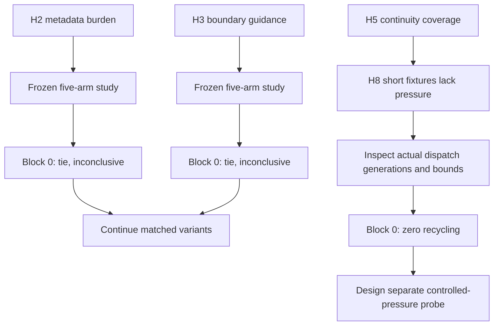

# Live research loop

This successor uses the canonical ARE ResearchHypothesis, ResearchExperiment, HypothesisObservation and LearningDecision constructors. Selected ontology dependencies are ARE-RL-D01/D02/D03/D04/D07 in [research-learning-v1](../../../../../packages/evolution-runtime/ontology/research-learning-v1.json). The original [seven-hypothesis bundle](../../hypothesis-study-v1/bundle.json) stays unchanged.

## First live result

[Block 0 report](block-0/report.json): five of five initial repairs passed all six hidden checks, with 20 physical model calls and 20 tokenizer calls. All three treatment comparisons tied. Host-envelope output correctly omitted host-owned fields, failed the full raw schema as expected, and passed its declared native contract after bounded normalization. This is not a schema failure.

No trial recycled. Maximum projected request bounds are recorded per row. A repair pass therefore supplies no continuity evidence. One block cannot select an H2/H3 treatment under the fixed 24-block screening rule.

[H8](h8.json) proposes that the fixtures finish before the smallest threshold is reached. Its parent is the original H5 continuity-coverage hypothesis. It was written after baseline and metadata results, while the other first-block trials were running. This is an exploratory diagnostic, not a claim of preregistration. The other four rows relative to baseline all remained below 8K without recycling, supporting the narrow exposure prediction. This does not establish behavior for other variants or windows.

[Canonical records and dependency projection](block-0/research.json) preserve that supporting observation alongside inconclusive H2/H3 observations and explicit next actions. The DAG is an explicit study projection, not a registered historical research DAG or authority grant:

## Three completed blocks

[Blocks 0–2](blocks-0-2/report.json): 11/15 initial passes, 60 model and 60 tokenizer calls, zero recycled trials. Both archive variants passed in all arms. On retention-empty, only boundary-card passed; the other four arms preserved the invalid nonempty-history guard. Boundary versus neutral has one win, zero losses and two ties. Metadata and host-envelope each tie baseline in all three blocks. This is a discriminating semantic observation, still below the fixed screening requirement.

## Four completed blocks

[Blocks 0–3](blocks-0-3/report.json): **14/20 initial passes**, 80 model calls and 80 tokenizer calls, no failed transport receipts, and zero recycled trials. Metadata versus baseline has one win; boundary versus neutral has one win; host-envelope ties baseline in end-to-end outcomes. All remain below the 24-block screening requirement.

The retention-order baseline omitted only `schema_version`. A [separate raw-source audit](b3-baseline-audit/result.json) passed all six hidden checks without repairing the original submission; its end-to-end outcome remains failure. Host-envelope passed its native contract on that variant but failed two semantic cases. This is evidence to keep formatting and semantics separate, not to declare host-owned metadata a complete solution. The audit has its own [canonical H2 observation](b3-baseline-audit/research.json).

The original H9 pressure harness failed locally with zero provider requests; its [inconclusive observation](../pressure/evaluation.json) is retained. The [adapter-bound successor](../pressure-v2/README.md) repairs that harness prerequisite without changing the serving engine or the main study.

## Pressure hypothesis revision

[H9-v2 evaluation](../pressure-v2/evaluation.json) is counterevidence: baseline passed at 4,620 projected tokens; the longer inspected inventory reached 6,855, never recycled, and ended with an invalid candidate. It consumed 13 model and 13 tokenizer calls across both trials. The policy masks older observations and keeps one full recent result, so increasing total file length did not increase retained-token pressure enough.

[H10](../pressure-v3/hypothesis.json) is a prospective successor that changes token density inside the retained page, using 4,000 deterministic CJK code points. It preserves the counterevidence and requires actual recycling, archive recovery and semantic success before support can be recorded. Its two trials have a separate 32-model/64-tokenizer cap.

## Measured admission failure and implementation test

[H10 evaluation](../pressure-v3/evaluation.json): baseline passed; dense-page treatment triggered one recycle and then blocked with `recycling.fresh-context-too-large` before dispatching the oversized page. Total five model and seven tokenizer calls. Source inspection found the fallback reuses the same oversized newest observation.

[H11](../pressure-v4/README.md) tests an isolated byte-bounded paging implementation against the original pager on identical dense fixtures. It preserves actual tokenizer admission and exact delivered-byte accounting. This is a candidate implementation test, not a serving-engine change.

## Verified paging improvement, recovery still under test

[H11 evaluation](../pressure-v4/evaluation.json): original pager blocked after one model call; isolated byte-bounded paging completed all dense-file reads and passed all six hidden repair checks in 13 model calls. Peak dispatched projected tokens were 7,300. This verifies a dense-text admission improvement on this fixture, but the stronger hypothesis remains counterevidenced because no recycle occurred. Both outcomes are retained without relabeling the pass criterion.

[H12](../pressure-v5/hypothesis.json) adds identical modest persistent request context to both arms and retests the same pager and dense fixture. It is a declared successor, not a replacement of H11.

## Working live recovery result

[H12 verification](../pressure-v5/verification.json) establishes a working live GLM result: the original pager blocked; byte-bounded paging passed the full candidate schema, all six hidden checks and every required read, with three actual recycles and confirmed archive recovery. Peak dispatched projected tokens were 7,698, below the effective 7,744 admission threshold. The treatment used 14 model and 17 tokenizer calls, with no retries or unknown delivery.

The [joined DAG](dag.json) contains 39 canonical record versions and 48 explicit dependency edges. It retains failed and counterevidential predecessors, verifies canonical records and rejects unresolved lineage or cycles. [assemble.mjs](assemble.mjs) reconstructs it from bound source records. This is a local research projection, not registered authority or proof of broader qualification. The [next frontier](NEXT.md) remains open.

## Controlled instruction results

[H14](../contract-window-v1/review-final/research.json) rejects the general final-review improvement: 7/12 qualified versus baseline 6/12, below its +3 paired-net screen. The complete raw-source audit finds 9/12 versus 10/12 semantic passes. All 24 trials nonetheless demonstrate measured admission and archive recovery for the byte pager.

[H15](../source-instruction-v1/review-final/research.json) isolates the contradictory system sentence about preserving every source byte. Its prospective eight-trial pilot supports the clarified wording: 4/4 complete repairs versus 2/4 baseline; unchanged source falls from two to zero. All eight recover the archive after actual recycling. The [51-record/67-edge DAG](dag-source-62-final.json) retains both results and their distinct candidate identities. Replication at 8K and archive-end remains necessary before adoption.

These successor research candidates do not reopen the original small-window milestone, already closed by the historical 36/36 final qualification. The [single finish tracker](../../../../../GLM-FINISH-PLAN.md) owns product completion; research notes must not silently add new M1 exit criteria.

## Replication closes the instruction test

[H16](../source-replication-v1/review-final/research.json) completed 16/16 trials: baseline 8/8 qualified, clarified instruction 7/8, and raw-source semantics 8/8 in both arms. All 16 actually recycled and recovered. No baseline no-op appeared, so mechanism generalization remains inconclusive; the relative improvement screen was not met. Do not promote H15 on its pilot score alone.

The [current DAG](dag-frontier-63-final.json) has 57 canonical records and 77 edges. A separately bound [H2 anomaly and frontier decision](metadata-frontier-63.json) returns to the existing frozen output-contract comparison. It does not count H16 as an H2 treatment test or replace any earlier failure. Current execution instructions are in [NEXT.md](NEXT.md).

## Reproduction and evidence

`analyze.mjs FROZEN RUN NEW_OUTPUT` creates an immutable snapshot of completed rows. It checks frozen bindings and completed result receipts, preserves missing values, binds raw input files by SHA-256, and emits canonical research records. Snapshots made while a run is active cover completed rows only, not in-flight spending. Use transport ledgers to audit pending requests. Later snapshots must use new directories.

`node --test .../provider-study-v1/research/analyze.test.mjs` checks matched-pair accounting, unknown semantics, retained real results, raw versus normalized contract distinction and canonical research records.

## Construction boundary

Owner-directed candidate experiment under CA2-ROUTE-IMPLEMENT, request `glm-live-hypotheses-59`. Existing frozen limits remain 120 rows, 1,600 model attempts and 3,200 tokenizer attempts, with no retries. Local evidence and hypothesis successors are the write scope; serving code, fixtures and frozen sources remain pinned. Operational owner is the user; local evaluator owns result classification. Runtime adoption and broader qualification remain deferred.

## Open Questions

Will the other variants expose errors hidden by the first fixture? Do later trials actually recycle? If the study remains easy and below threshold, how should a separate pressure-controlled fixture test archive recovery and delayed facts without leaking oracle answers? H2/H3 remain unresolved until their declared evidence requirement is met; H8 supports designing a discriminating follow-up, not expanding a claim from five passes.
