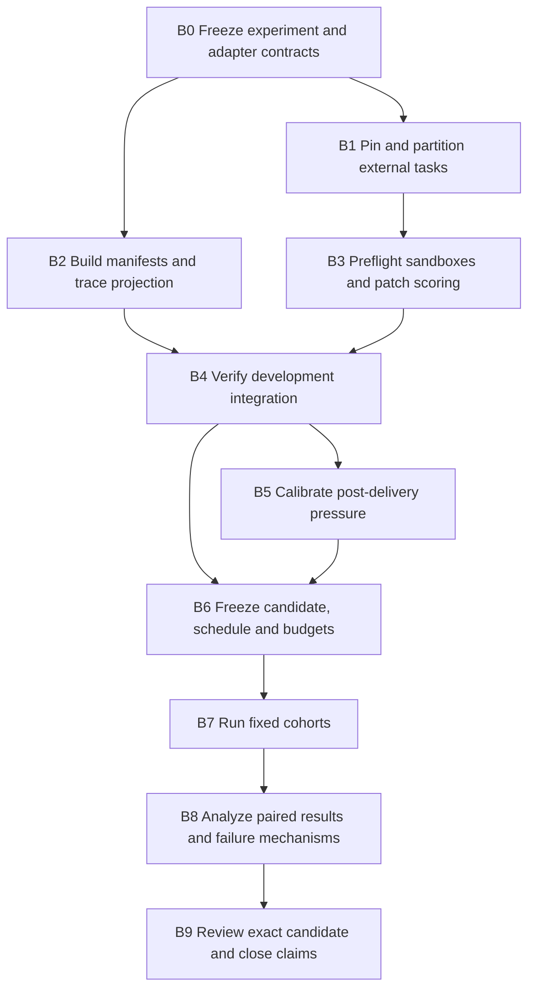

# External benchmark integration and GLM evidence plan

Status: planning candidate. Owner: ARE product owner. Request: `glm-benchmark-plan-91`, September 9, 2026. Authority effect: none. This document is not registered execution state; the PLAN route reports Goals validation blocked. It prepares a bounded implementation handoff without starting provider calls.

## Objective and relationship to existing work

Determine whether H23's source-preserving envelope reduction generalizes to external repository tasks, and independently test recovery after useful evidence has been delivered under genuine context pressure. Produce reproducible measurements and an explicit supported, rejected, or inconclusive conclusion for each claim.

The original small-window qualification remains complete for its documented candidate. Preserve its evidence and the separate H23 controlled result. This plan extends the evidence; it does not reopen those cohorts or replace full GLM acceptance. Larger windows, cross-task memory, other models and the supported product entry point remain in the wider [GLM finish plan](../../../../../../GLM-FINISH-PLAN.md).

Evidence: [benchmark research](REPORT.md), [H23 live result](../../payload-live-v1/RESULT.md), [H23 implementation](../../payload-js-v1/README.md), and [completed research result](../RESEARCH-RESULT.md). The research report owns external-source references; benchmark versions must be frozen again for execution.

## Selected scope

Two external tracks share one model-neutral run manifest and event vocabulary:

- **Outcome track:** SWE-bench-Live MultiLang, initially JS/TS, with unchanged issue statements and evaluation oracles. Measures executable issue resolution.
- **Diagnostic track:** ContextBench tasks with exact matching annotations and repository revisions. Measures native context metrics plus separately named ARE visibility/retention metrics.

These are distinct task pools unless exact instance identity is established. Do not apply ContextBench annotations to unrelated Live tasks. Do not average their scores into one success percentage.

A third, controlled track isolates post-delivery recovery. It is explicitly an ARE custom experiment, not an upstream benchmark score. SWE-ContextBench and RepoReasoner are deferred until this bounded work produces a decision.

## Construction DAG

All stages below are planned. B0 is the next construction frontier once implementation is selected. Dependencies express readiness, not authorization or automatic agent delegation.

| Stage | Work and intended outputs | Exit evidence |
|---|---|---|
| B0 | Define accepted task shapes, agent tool/edit interface, H21/H23 comparison, manifest/event contracts, hypotheses and evaluator isolation | Exact scope table; every unsupported task shape has an explicit disposition; baseline reproduction contract |
| B1 | Record dataset revisions, instance IDs, repository commits, image digests, scorer commits, licenses, partition rule and duplicate/related-issue groups | Immutable source and task manifests; development and sealed evaluation groups disjoint; exclusions retained |
| B2 | Build model-neutral manifest validation and ARE trace exporter; keep GLM identity/tokenizer settings in a provider profile | Offline fixtures establish provenance, exact model-visible content, missing-data handling and upstream metric compatibility |
| B3 | Adapt patch delivery to isolated upstream evaluation; validate base/reference outcomes outside rollout access | Base fails intended checks, reference passes, sandbox cleanup verified, hidden material absent from agent view |
| B4 | Run bounded development smoke cohort, inspect adapter failures, freeze at most one adapter revision | Complete terminal accounting; working traces and patch scores on each selected track; no contract violations |
| B5 | Calibrate two deterministic evidence patterns against local admission rules before model execution | Each pattern permits evidence delivery, then causes full-context rejection and permits a bounded reduced dispatch |
| B6 | Freeze hypotheses, candidate hashes, exact episode IDs, reference budget, numeric resource caps, arm order and stop rules | Schedule validates; every required budget field populated; independent evaluator inputs isolated |
| B7 | Execute development-approved external and controlled schedules with unchanged candidates | Every scheduled episode terminal or explicitly incomplete; actual request accounting and cleanup receipts |
| B8 | Produce per-track paired outcomes, uncertainty, token/latency summaries and failure taxonomy; verify reconstruction | Analysis reproducible from immutable records; disagreements and missing evidence visible |
| B9 | Review claims separately and identify the next bounded construction step | Decision: supporting, counterevidence or inconclusive for each hypothesis; full GLM status remains accurate |

## Adapter and validation contract

Implementation should start in an isolated benchmark package, proposed as `benchmarks/external-context-v1/` under the ARE implementation root. Keep imported upstream repositories and task environments outside canonical source. Link source artifacts and pin their identities rather than copying large documents. Planned package surfaces are task/run manifests, whole-schema validation, trace export, sandbox evaluation adapter, bounded runner, analysis and fixtures. Exact files are frozen at B0 before mutation.

Reuse the existing complete-schema validation and bounded parsing approach. Validate all declared fields in one pass, report bounded errors with paths, reject unknown fields where the contract is closed, and avoid coercion or task-specific patches to validation. Do not reuse a patch schema as the schema for unrelated task metadata.

Both arms must use the same agent executor. First establish compatibility with the existing H21 behavior. If external tasks require multi-file edits or broader tools, specify and test that common extension before comparing H23. Record the resulting baseline as an adapted candidate, not the unchanged historical agent. No silent task simplification or arbitrary shell expansion.

Use the upstream ContextBench evaluator unchanged for its native score. Add ARE metrics alongside it. Test the exporter with known file/span fixtures and upstream expected scores. Missing extraction is an instrumentation error; absent evidence in a valid snapshot is a measured absence. Test both explicitly.

Every event needs episode/step identity, source revision/range, tool correlation, actual dispatched input digest, token count, context budget, reserved generation, projection version and local context-transition reason. Track repository-available evidence, tool-returned evidence and model-visible evidence separately. Claimed/cited evidence is another field, not proof of actual reasoning use. Preserve audit sidecars so H23 input projections can be reconstructed.

Golden cases must cover intact and removed spans, paging/unsupported envelopes, duplicate keys, simultaneous metadata errors, source drift, truncated logs, missing final context, exhausted budget, cancellation, provider failure and cleanup failure. Meaningful integration checks must verify oracle isolation and reference patch scoring; schema-valid data alone cannot establish correctness.

## Hypotheses and fixed conclusions

Register the following as new candidate hypotheses through the existing evolution-runtime constructors before experimentation; do not allocate historical hypothesis IDs by guessing. Bind parent evidence from H23, technique candidates, experiments, observations, counterevidence and decisions using the existing research DAG conventions. No mandatory ontology-runtime enforcement or new ontology authority is introduced.

| Claim | Comparison and evidence | Decision rule |
|---|---|---|
| H-ext: envelope reduction generalizes | Matched baseline/H23 on sealed external tasks; exact-source parity; actual input tokens; final tests | Supporting pilot only if aggregate input tokens fall, outcome-track net wins are positive and no observed per-window net regression occurs; any integrity violation rejects the candidate. Otherwise counterevidence or inconclusive as appropriate. Report paired uncertainty; this is not population-level noninferiority. |
| H-pressure: the selected recovery policy preserves delivered evidence | Two controlled patterns across three windows and both arms | All six candidate cases must demonstrate the required event sequence, retain both independently necessary facts and pass final checks. A missing pressure event is not a pass. Failure leaves this claim open or contradicted, regardless of external task scores. |
| H-mechanism: visible evidence loss explains some failed continuations | Relate valid before/after snapshots to failed and successful outcomes | Report descriptive association and discordant cases. Do not infer causality without a controlled retention intervention. Too few transitions yields inconclusive. |

H23 may avoid recycling by reducing overhead. That can support H-ext, but does not automatically satisfy H-pressure. Freeze which recovery policy H-pressure evaluates. If a new recovery implementation becomes necessary, open a separately bounded candidate and experiment; do not insert it halfway through the H23 comparison.

## Proposed episode schedule

Counts below are maxima for this candidate plan, not an instruction to begin an unattended campaign. Sealed task selections are fixed before model outcomes are observed.

| Cohort | Selection | Episode count |
|---|---|---:|
| Development smoke | 8 tasks: 4 outcome + 4 diagnostic; both arms at one calibrated small-window budget | 16 |
| External outcome stress | 12 sealed Live tasks × 2 arms × 3 budgets (8K/10K/12K) | 72 |
| External diagnostic stress | 4 sealed ContextBench tasks × 2 arms × 3 budgets | 24 |
| External reference-budget comparison | Same 16 sealed tasks × 2 arms × one separately frozen reference budget | 32 |
| Controlled post-delivery pressure | 2 evidence patterns × 3 budgets × 2 arms | 12 |
| **Maximum proposed schedule** | Development plus frozen evaluation; no repetitions or replacements | **156** |

The research sketch's 72 episodes describe the outcome stress cohort only. The separate diagnostic, reference and pressure cohorts account for the additional work here. Reference-budget runs are internal comparisons unless all upstream protocol conditions are satisfied; a selected subset is never a full leaderboard result.

Eight development tasks are for integration, not open-ended engine fitting. Permit one offline adapter correction after development review. If it changes model-visible behavior, any live rerun requires a revised explicit schedule retaining the original rows; the 156-episode plan does not conceal an extra rerun allowance. Do not tune on sealed failures. Once inspected failures influence a change, retire that cohort from acceptance use.

B6 must populate per-call and per-episode limits for model attempts, tokenizer attempts, input/output bytes, generated tokens, elapsed time, worker count, disk/memory and total currency cost. Missing caps block only B7. Price estimates must use then-current provider pricing and measured development usage. The total campaign cap must include development charges already incurred. Episode count alone is not a spending limit.

Default candidate policy: no automatic provider retries and no failed-episode replacement. Any allowed schema correction must consume a declared shared per-episode model budget and remain identical between arms. Public in-container tests may inform work where the protocol permits; hidden evaluation feedback never enters a correction prompt. Transport policies from earlier qualified profiles are not inherited silently.

## Pressure protocol and measurements

Use two patterns: evidence split across files with independently changeable facts, and a source-heavy distractor case where envelope reduction alone is insufficient. Calibrate from development evidence only. Ground-truth annotations stay evaluator-owned; the agent receives ordinary task evidence rather than labels revealing the answer.

A qualifying event sequence is: both facts delivered; full candidate request rejected by local admission; reduced request dispatched within measured limits; both facts present or validly recovered; final result evaluated. Record precisely which step supplied each fact and whether recovery required another source read. Rejection before delivery, no transition, or failure to dispatch is a separate outcome.

For every episode report first-pass and final correctness, schema/scope violations, actual input/output usage, local admission/recycling counts, archived reads, elapsed time, and error categories. For annotated tasks report upstream retrieval metrics and custom visible-evidence retention separately. Never use a union of all historical reads as current visible context.

Report attempted, eligible, completed and passing denominators; retain environment errors and unknowns. Show paired wins/losses/ties at each window and by repository. Four diagnostic tasks and twelve outcome tasks provide an engineering screen only. Repeated windows are correlated measurements of the same task, not independent samples. Broader acceptance still requires the separate GLM finish-plan gates.

## Construction, operational support and causal blockers

Current product frontier: B0, bounded benchmark adapter and experiment contracts. Runnable product work: define schemas, source identities, supported task shapes and offline trace fixtures; then B1/B2 when their inputs are resolved.

Carry D65 forward as: existing GLM product meaning and H23 evidence → candidate benchmark contract → exact implementation candidate → required product tests → review of that exact candidate. No new Project binding, product approval or source authority is claimed by this document. A later implementation request selects its own route and exact mutation scope.

| Operational task | Owner | Affected stage | Causal blocker | Disposition |
|---|---|---|---|---|
| Confirm reuse terms and artifact access | Integration owner | B1/B3 | Missing selected artifacts or unresolved required reuse terms | Resolve for exact selected sources; other artifact uncertainty does not block B0/B2 |
| Container execution resources and cleanup | Evaluation owner | B3/B7 | Cannot reproduce/evaluate or safely reclaim task environment | Offline manifest/export work remains runnable |
| Provider identity, credentials and numeric budget | Provider integration owner | Live B4/B7 | Cannot bind endpoint/account or cap requests | Prepare read-only/offline artifacts first; no secret copying |
| Evaluator/rollout data separation | Evaluation owner | B3–B7 | Gold solution, annotations or hidden tests exposed to agent | Must resolve before any scored rollout |
| Research record constructor compatibility | Research owner | B6 | Cannot bind exact hypotheses/experiments to existing record contract | Adapter work remains independent |
| Goals admission | Repository owner | Formal registration only | PLAN route reports Goals validation blocked | Candidate planning and exact owner-directed construction remain distinct; no claimed admission |
| Deployment, default activation and publication | Product owner | None in this candidate | No current construction dependency | Deferred operational residue |

## Completion and next action

This plan is complete when its scope, dependencies, gates and unresolved budget fields are reviewable. The implementation starts with **B0–B3: a pinned task inventory, explicit adapter contract, offline ContextBench exporter fixtures and isolated patch-scoring preflight**. Those artifacts make the first live development run concrete.

The experiment chapter ends at B9 with a fixed-cohort report and explicit claim decisions, including negative or inconclusive results. It must not loop until a favorable score appears. Cross-task memory, larger windows and deployment are separate follow-on decisions, not requirements for closing this research chapter.

## Open Questions

- **Integration owner, B0:** can the selected external tasks run through a shared bounded agent without changing the task protocol? If not, name the exact common executor extension before implementation.
- **Evaluation owner, B1:** do the selected task pools provide sufficient repository diversity and buildable instances? Freeze substitutions before outcomes; record overlap between benchmark families.
- **Provider integration owner, B4/B6:** what exact context accounting, reference budget and numeric campaign limits are feasible for this endpoint? Values remain unresolved until measured.
- **Research owner, B5:** can the existing recovery policy pass the required post-delivery sequence? Failure triggers a separate hypothesis, not retroactive relaxation.
- **Product owner, B9:** does the pilot justify a confirmatory sample or a recovery-policy change? It does not automatically complete the broader GLM product.
