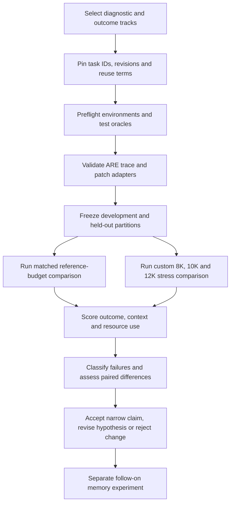

# Public benchmarks for ARE context management

**Recommendation:** use ContextBench for context diagnostics and a frozen SWE-bench-Live MultiLang task selection for executable repository outcomes. Add SWE-ContextBench when evaluating memory across related tasks. RepoReasoner is the most interesting recent addition for read-only, cross-file reasoning. This is a recommendation based on measurement fit and available artifacts; it is not an observed ranking of ARE performance.

The comparison covers public evidence available on September 9, 2026. “Better” means better able to establish whether ARE improves repository work at a controlled model and resource budget. Publication recency, difficulty, dataset size, and leaderboard popularity are secondary. Public code availability is distinguished from successful local reproduction throughout this report.

## Decision context

ARE's latest local result concerns removal of redundant tool-envelope metadata while retaining source payloads. The H23 live comparison passed all three near-pressure candidate cases while the baseline passed none. Unpressured controls passed in both arms. Strong-pressure cases blocked before delivery of the decisive evidence, so they did not establish recovery after useful evidence had entered and subsequently left the model's context. These distinctions are recorded in the [local live result](../../payload-live-v1/RESULT.md) and [completion audit](../completion-audit-89.json).

That result justifies an external generalization experiment. It does not establish general repository competence, successful compaction, or completion of the wider [GLM finish plan](../../../../../../GLM-FINISH-PLAN.md). The next evaluation must distinguish four failure sources: environment failure, failure to find evidence, failure to retain evidence, and failure to reason from available evidence. A final patch score alone cannot distinguish them.

The recommended suite therefore has separate diagnostic and outcome tracks. ContextBench supplies annotations for the former; SWE-bench-Live supplies a current executable issue pool for the latter. They are not automatically the same instances. Context metrics may only be computed where matching annotations exist; unannotated Live tasks must not silently receive invented gold contexts.

## Benchmark comparison

The fit and effort columns below are analytical judgments relative to the current bounded ARE repair candidate. “Public” means an artifact was identified, not that its execution was reproduced.

| Benchmark | Version or recency | Principal measurement | Public artifact | Recommended role / relative effort |
|---|---|---|---|---|
| ContextBench | February 2026, v3 | Context retrieval throughout coding trajectories | Code, annotations, evaluator | First diagnostic; medium adapter effort [1](https://arxiv.org/abs/2602.05892) [2](https://github.com/EuniAI/ContextBench) [3](https://raw.githubusercontent.com/EuniAI/ContextBench/main/contextbench/parsers/trajectory.py) |
| SWE-bench-Live MultiLang | August 2026 expansion | Executable issue resolution across languages | Tasks, containers, evaluator | First external outcome pool; medium/high integration [4](https://github.com/microsoft/SWE-bench-Live) |
| SWE-rebench rolling evaluation | Continuously refreshed; protocol changes in 2026 | Recent issue resolution | Leaderboard dataset, evaluator fork | Alternative fresh Python outcome pool; medium/high [5](https://swe-rebench.com/) [6](https://huggingface.co/datasets/nebius/SWE-rebench-leaderboard) [7](https://github.com/SWE-rebench/SWE-bench-fork) |
| SWE-rebench V2 | February 2026; June revision | Large executable training/task corpus | Dataset and setup artifacts | Development pool, not automatically sealed evaluation [8](https://arxiv.org/abs/2602.23866) |
| SWE-ContextBench | May 2026 v3 | Reuse of previous related issue experience | Repository, dataset, evaluation setup | Next memory chapter; high integration [9](https://arxiv.org/abs/2602.08316) [10](https://github.com/jiayuanz3/SWEContextBench) |
| RepoReasoner | July 2026 | Cross-file output and call-chain prediction | Data and inference scripts | Strong read-only diagnostic candidate; medium [11](https://arxiv.org/abs/2607.25996) [12](https://github.com/DeepSoftwareAnalytics/RepoReasoner) |
| LoCoBench-Agent | November 2025 | Long-context, multi-turn software workflows | Code; externally linked data | Supplementary stress evaluation; high [13](https://arxiv.org/abs/2511.13998) [14](https://raw.githubusercontent.com/SalesforceAIResearch/LoCoBench-Agent/main/README.md) |
| Terminal-Bench 2.1 | Corrected successor to 2.0 | Broad terminal task completion | Dataset and Harbor execution path | Later general agent evaluation; high [15](https://www.tbench.ai/news/terminal-bench-2-1) [16](https://www.harborframework.com/docs/tutorials/running-terminal-bench) |
| LongCLI-Bench | February 2026 | Long-horizon CLI development | Tasks, code, tests | Later continuity stress; high [17](https://arxiv.org/abs/2602.14337) [18](https://github.com/finyorko/longcli-bench) |
| SWE-CI | March 2026 | Repeated maintenance through CI feedback | Dataset and evaluation code | Later maintenance chapter; high [19](https://arxiv.org/abs/2603.03823) [20](https://github.com/SKYLENAGE-AI/SWE-CI) |
| SWE-Together | June 2026 | Interactive software work with user feedback | Repository and benchmark artifacts | Later evolving-requirements chapter; high [21](https://arxiv.org/abs/2606.29957) [22](https://github.com/Togetherbench/SWE-Together) |
| RepoQA | June 2024 | Finding functions from descriptions in code context | Dataset and evaluator | Cheap retrieval smoke test; low/medium [23](https://github.com/evalplus/repoqa) |
| SWE-bench Verified / Pro | Established public issue suites; 2026 audits | Patch success under task tests | Public tasks and harnesses | Secondary historical comparison after task audit [24](https://openai.com/index/why-we-no-longer-evaluate-swe-bench-verified/) [25](https://openai.com/index/separating-signal-from-noise-coding-evaluations/) [26](https://github.com/scaleapi/SWE-bench_Pro-os) |

## The strongest immediate choices

### ContextBench: diagnosing evidence selection

ContextBench contains 1,136 issue-resolution tasks across 66 repositories and eight languages. Human-annotated contexts support process-level precision, recall, and efficiency measurements. Its February 11 paper revision explicitly distinguishes explored context from context used in solving an issue. That makes it a closer diagnostic match to ARE than function retrieval alone. [1](https://arxiv.org/abs/2602.05892)

The repository exposes file, symbol, and span evaluation and existing agent extraction paths. Its generic trajectory parser accepts structured prediction steps, so an ARE exporter need not impersonate another agent's trace format. The evaluator also has explicit handling for missing final context. An exporter that produces no context must be recorded as an instrumentation failure rather than silently interpreted as a model failure. [2](https://github.com/EuniAI/ContextBench) [3](https://raw.githubusercontent.com/EuniAI/ContextBench/main/contextbench/parsers/trajectory.py)

**Judgment:** make this the first diagnostic integration. Preserve the benchmark's native metric definitions and publish additional ARE retention metrics separately. Do not rename an ARE metric “ContextBench recall” unless it actually follows that evaluator's semantics.

A key limit is that this adds annotations to existing issue tasks; it does not independently repair every underlying test oracle. Annotation quality and issue correctness are separate audit dimensions. Context retrieval also does not prove that a model used the evidence successfully. Pair the diagnostic track with patch tests, and inspect failures where recall looks good but the task still fails.

### SWE-bench-Live MultiLang: executable external outcomes

Microsoft's repository reports 1,077 MultiLang instances after its August 21, 2026 update, with TS/JS among the supported languages. It supplies evaluation code and executable task environments. Its protocol permits only the problem statement and task container during the rollout; hidden test patches and ground-truth evaluation feedback must remain outside the solving loop. The historical Python dataset has a separate recommended evaluation branch. [4](https://github.com/microsoft/SWE-bench-Live)

**Judgment:** this is the strongest immediate outcome pool for ARE's JavaScript-oriented implementation. The language match reduces one source of adaptation, while external repositories test whether the local benefit extends beyond the original fixtures. It is not evidence that every Live task is cleaner than every alternative.

A small pinned selection is appropriate first. Existing ARE limits on tools, edits, and supported task shape still need an explicit adapter contract. If a task needs general shell access or multi-file changes, a single-file constrained candidate is not a faithful implementation of the standard task protocol. Report unsupported cases as such; do not rewrite task requirements until they fit and then present the result as official benchmark performance.

### SWE-rebench: distinguish rolling evaluation from V2 training data

The rolling project publishes recent evaluation tasks and an evaluator fork. Its methodology changed in February 2026, including removal of the former step cap and changes to the context budget. Historical and current leaderboard results therefore require protocol matching. [5](https://swe-rebench.com/) [6](https://huggingface.co/datasets/nebius/SWE-rebench-leaderboard) [7](https://github.com/SWE-rebench/SWE-bench-fork)

SWE-rebench V2 is a different offering: the current paper describes 32,079 executable tasks across 20 languages and 3,617 repositories, alongside a larger collection with installation instructions. It is explicitly a training-oriented corpus with automated task construction and quality filtering. Its size does not make it a ready-made untouched acceptance set. [8](https://arxiv.org/abs/2602.23866)

**Judgment:** use rolling evaluation as the alternative if the selected MultiLang tasks do not fit the supported executor or if Python coverage is the immediate priority. Use V2 for integration development only after partitioning. A sealed evaluation selection must be separate from tasks used to tune prompts, validators, retrieval rules, or failure handling.

Freshness reduces some exposure risks but cannot prove that GLM has never encountered an issue. Record task timestamps and known model identity; distinguish “held out from ARE tuning” from “unseen during model training.” An unknown provider training cutoff must remain unknown.

## Strong follow-on candidates

### SWE-ContextBench: experience across tasks

The May 6, 2026 v3 paper describes 1,100 base tasks plus 376 related tasks across 51 repositories and nine languages. Earlier summaries describe a substantially smaller release. Its question is whether previous related issue experience improves subsequent work, including the effects of retrieval and summarization quality. [9](https://arxiv.org/abs/2602.08316)

The public repository links its dataset and related-task environments. However, GitHub's license metadata did not identify a license in the inspected snapshot; exact code and dataset reuse terms remain an integration question. This is an unresolved metadata finding, not a conclusion that all use is prohibited. [10](https://github.com/jiayuanz3/SWEContextBench)

**Judgment:** this is the best next benchmark for persistent memory. It should follow the within-task context chapter because its intervention differs: useful knowledge comes from previous tasks. A success here would not alone prove reliable retention during one overlong episode.

For a fair memory experiment, freeze which previous experiences are allowed and when they become available. No target solution should enter memory. Compare no memory, raw permitted history, generic summary, and typed retrieval at equal budgets only after the current baseline is stable. Otherwise changes in the number of prior examples can masquerade as better memory engineering.

### RepoReasoner: reasoning beyond locating a function

Published on arXiv July 28, 2026, RepoReasoner evaluates output prediction and call-chain prediction across files. Construction uses dynamic pytest traces and rewritten inputs/outputs to probe reasoning while reducing some memorization effects. Longer context is not uniformly beneficial in the reported experiments. [11](https://arxiv.org/abs/2607.25996)

The repository contains data, inference, and construction scripts. Dataset-to-paper alignment and reuse terms still need confirmation before adopting a frozen evaluation slice; the observed repository commit predates the paper's arXiv publication. [12](https://github.com/DeepSoftwareAnalytics/RepoReasoner)

**Judgment:** prefer this over RepoQA when the question is whether an ARE repository answer reflects cross-file dependencies. Keep RepoQA as a cheap retrieval check. RepoReasoner is less directly sensitive to H23 if code arrives entirely in an initial prompt rather than tool envelopes; changing that delivery would be a custom protocol.

### LoCoBench-Agent: close topic, weaker acceptance semantics

LoCoBench-Agent presents 8,000 interactive scenarios with long contexts, multiple languages, and tool-driven workflows. Code is public, while data is linked through an external download. [13](https://arxiv.org/abs/2511.13998)

The implementation documentation describes several proxy measures: execution success includes tool diversity and usage patterns; information coverage compares accessed and modified files; dependency resolution includes read-before-write behavior. These are not interchangeable with a hidden-test repair pass rate. [14](https://raw.githubusercontent.com/SalesforceAIResearch/LoCoBench-Agent/main/README.md)

**Judgment:** retain it as a supplementary stress candidate, not the first acceptance gate. Accessing more files can indicate either useful investigation or wasted context. An agent could improve a proxy while solving no additional tasks. Audit the exact scorer and available task oracles before assigning causal meaning to its aggregate score.

## Broader and newer alternatives

Terminal-Bench 2.1 fixes 28 of the 89 tasks in 2.0, addressing dependency drift, resource mismatches, and specification/test inconsistencies. Its release provides an unusually concrete reminder that hard failures can originate in the benchmark itself. Prefer the corrected version for a new terminal evaluation, while treating version-specific scores separately. [15](https://www.tbench.ai/news/terminal-bench-2-1)

Harbor provides a published execution path for Terminal-Bench. [16](https://www.harborframework.com/docs/tutorials/running-terminal-bench) This is attractive once ARE supports a broad terminal agent, but introducing that executor now would expand the implementation and confound the context intervention. LongCLI-Bench supplies 20 curated long-horizon tasks and regression-oriented tests, making it a plausible later continuity stress set; the small task count limits precision of broad claims. [17](https://arxiv.org/abs/2602.14337) [18](https://github.com/finyorko/longcli-bench)

SWE-CI evaluates iterative maintenance through CI feedback with a more elaborate agent loop. SWE-Together focuses on interactive software work with user feedback. [19](https://arxiv.org/abs/2603.03823) [20](https://github.com/SKYLENAGE-AI/SWE-CI) [21](https://arxiv.org/abs/2606.29957) [22](https://github.com/Togetherbench/SWE-Together) Both expose dimensions absent from static patch tasks, but neither isolates the current envelope projection. Their extra actors, feedback, and execution rounds need separate budgets and controls.

Two even newer papers are useful as hypothesis sources. *Compaction Cliff* examines preserving different classes of information under repeated compaction; *Parsing the Stream* explores structured state derived from a live event trace. [27](https://arxiv.org/abs/2608.22752) [28](https://arxiv.org/abs/2609.01466) These are not established independent acceptance tests for ARE. In particular, evidence from co-designed synthetic tasks or a different application domain should motivate a controlled experiment, not be treated as proof of GLM improvement. Runnable repository alignment for these papers remains unverified here.

## Why the earlier default recommendation changes

RepoQA remains useful for locating relevant functions, but that narrow task does not exercise the complete sequence of finding evidence, retaining it through pressure, and producing a correct repository change. [23](https://github.com/evalplus/repoqa) ContextBench more closely addresses the missing diagnostic layer.

SWE-bench Verified also deserves a more qualified recommendation. OpenAI's February 2026 audit reported test-quality and contamination concerns and explained why it stopped using Verified as a frontier capability measure. Its July audit of SWE-bench Pro subsequently reported substantial task-quality problems and withdrew its earlier recommendation to adopt Pro. These are attributed findings from a model vendor, not universal consensus that every task is unusable. [24](https://openai.com/index/why-we-no-longer-evaluate-swe-bench-verified/) [25](https://openai.com/index/separating-signal-from-noise-coding-evaluations/)

The Pro maintainers also document benchmark updates and evaluation issues in their repository. [26](https://github.com/scaleapi/SWE-bench_Pro-os) Consequently, simply upgrading from Verified to Pro is not a sufficient quality strategy. Retain a validated historical subset when comparison is useful, but audit the exact task revision and report exclusions. The same environment and oracle checks should apply to the newly recommended datasets.

## Proposed experiment and decision DAG

The following is a research proposal, not an admitted implementation plan or a completed benchmark run. The design reuses external datasets and evaluators while keeping the ARE intervention explicit.

**Integration development.** Start with eight development tasks, chosen before observing model success. Validate patch application, repository isolation, token accounting, error classification, and trace extraction. Preflight checks should establish that the base state fails the target checks and the reference solution passes. Keep gold material exclusively in an evaluation environment inaccessible to the rollout. Preserve the inventory of rejected or unbuildable tasks.

**Sealed pilot.** A practical first proposal is twelve new task instances, two arms, and three small-window budgets: 72 custom stress episodes. This is an engineering pilot, not a statistically strong qualification claim. Separate reference-budget runs add to that count. Select across repositories where feasible, keep related issues together when partitioning, and avoid choosing tasks based on which ones favor H23.

**Intervention.** Compare the same agent, model endpoint, model identifier, tool access, prompts, output allowance, timeout, and retry policy. Change only the context projection under study. Do not import a stronger upstream agent and attribute the resulting improvement to ARE. Alternate execution order to reduce temporal provider effects, and record actual settings even if the provider does not expose every source of randomness.

**Protocol separation.** Report the dataset's standard/reference protocol separately from custom 8K/10K/12K stress variants. Specify whether each cap includes reserved output and all message/tool overhead. These are deliberately restricted experimental budgets, not claims about GLM's native maximum context window. Modified tools, stopping rules, or context budgets invalidate casual comparison with an official leaderboard number.

**Failure analysis.** Distinguish environment setup failures, unsupported tasks, provider errors, admission blocks, malformed outputs, wrong patches, and test regressions. Publish both the full attempted-task denominator and any eligible-task analysis. Do not repair a failed test case, silently replace it, and leave the original denominator unchanged.

**Decision.** Report per-task paired outcomes, token and latency distributions, context diagnostics, and uncertainty. Inspect discordant pairs rather than accepting a higher aggregate alone. A larger confirmatory sample should be sized from observed variance and a declared practical improvement threshold. Repeated runs help estimate stochasticity; they do not create additional independent repositories.

## Measuring what actually survives

ARE should record separate states for evidence available in the repository, returned by tools, present in the dispatched model input, and subsequently cited or selected. Their identifiers should resolve to exact file revisions and ranges where possible. A union of every earlier file read overstates the evidence visible after compaction.

For every model call, retain the input digest, measured token count, active budget, tool-message provenance, and the exact projection decision. Offline diagnostics can then compare gold evidence with the model-visible snapshot. Native ContextBench results remain one output; custom retention diagnostics remain another. Neither should equate textual presence with demonstrated reasoning use.

A genuine pressure recovery test needs a stricter event sequence than the earlier strong-pressure controls: decisive evidence is delivered, a subsequent full context exceeds the limit, a smaller context is actually dispatched within budget, and the task is evaluated afterward. If the run blocks before evidence delivery, label it admission failure. If it never reaches pressure, label it an unpressured control. Both are useful observations, but neither qualifies post-compaction continuity.

For a requirement to avoid provider-side compaction, record each submitted request against the local admission contract. Provider-internal behavior may be unobservable; local logs can establish that ARE never submitted an oversized request under its measured policy, not prove an undocumented provider implementation never transformed context.

## Candidate hypotheses

These hypotheses are proposed research content; they are not registered results or promoted authority.

| Hypothesis | Experiment | Evidence against it |
|---|---|---|
| Source-preserving envelope reduction generalizes beyond the original fixtures | Matched baseline/H23 trials on sealed external tasks, with measured dispatch tokens and patch tests | Token overhead is unchanged, source payload differs, or paired task quality degrades |
| Loss of decisive evidence after a context transition explains a material subset of continuity failures | Annotated model-visible snapshots before/after genuine pressure; compare matched outcomes | Failures occur despite intact evidence, or evidence loss does not discriminate failures from successes |
| Typed experience retrieval improves related-task reuse at a fixed budget | Later SWE-ContextBench comparison against raw permitted history and generic summaries | No accuracy/cost benefit, or benefit vanishes after controlling history length and task leakage |

The second hypothesis initially supports an association study. Establishing causality requires an intervention that changes retained evidence while controlling other factors. The third belongs to a separate memory experiment and should not delay completion of the current within-task comparison.

## Open Questions

| Question | Owner / resolution artifact |
|---|---|
| Which external task shapes are supported by the current ARE candidate? | ARE implementation owner; bounded adapter contract before execution |
| Which ContextBench annotations and executable task versions align exactly? | Evaluation owner; task identity and revision manifest |
| Are enough runnable JS/TS tasks available for a repository-diverse sealed pilot? | Evaluation owner; preflight inventory, including exclusions |
| What are exact dataset and code reuse terms for the chosen revisions? | Integration owner; source manifest, especially SWE-ContextBench and RepoReasoner |
| Which GLM deployment/model identity and tokenizer are actually used? | Provider integration owner; run manifest; unknown training cutoff remains explicit |
| What practical outcome difference merits a larger confirmatory run? | Research owner; preregistered comparison and sample-size rationale |
| Can decisive evidence be annotated independently of model success? | Research owner; blinded annotation protocol |
| How will provider-internal context transformations be observed, if at all? | Provider integration owner; documented observability limit |

The accompanying [repository reference snapshot](repository-pins.json) records upstream commits observed during the comparison. It does not freeze datasets, container images, or every linked dependency. Those require their own identifiers in an execution manifest. The [comparison CSV](comparison.csv) is a compact selection aid; this report owns its unresolved questions.

## Sources

All web sources below were consulted for this September 9, 2026 comparison. Publication and revision dates are stated where material; repositories without release dates are rolling sources. Numbered references above resolve to the original sources here.

1. Han Li et al. [ContextBench: A Benchmark for Context Retrieval in Coding Agents](https://arxiv.org/abs/2602.05892), February 5, 2026; v3 February 11.
2. EuniAI. [ContextBench repository](https://github.com/EuniAI/ContextBench), rolling code and dataset links.
3. EuniAI. [Trajectory parser](https://raw.githubusercontent.com/EuniAI/ContextBench/main/contextbench/parsers/trajectory.py) and [evaluator](https://raw.githubusercontent.com/EuniAI/ContextBench/main/contextbench/evaluate.py), implementation semantics.
4. Microsoft. [SWE-bench-Live](https://github.com/microsoft/SWE-bench-Live), MultiLang update August 21, 2026; evaluation protocol and artifacts.
5. SWE-rebench. [Evaluation site](https://swe-rebench.com/) and [methodology](https://swe-rebench.com/about), rolling evaluation and protocol changes.
6. Nebius. [SWE-rebench leaderboard dataset](https://huggingface.co/datasets/nebius/SWE-rebench-leaderboard), rolling evaluation data.
7. SWE-rebench. [SWE-bench evaluator fork](https://github.com/SWE-rebench/SWE-bench-fork), rolling code.
8. SWE-rebench V2 authors. [SWE-rebench V2 paper](https://arxiv.org/abs/2602.23866), February 27, 2026; v2 June 1; [dataset](https://huggingface.co/datasets/nebius/SWE-rebench-V2).
9. Jiayuan Zhu et al. [SWE Context Bench: A Benchmark for Context Learning in Coding](https://arxiv.org/abs/2602.08316), February 9, 2026; v3 May 6.
10. Jiayuan Zhu et al. [SWEContextBench repository](https://github.com/jiayuanz3/SWEContextBench) and [dataset](https://huggingface.co/datasets/jiayuanz3/SWEContextBench), rolling artifacts.
11. Yanlin Wang et al. [RepoReasoner: Evaluating Repository-Level Code Reasoning Ability of Long-Context Language Models](https://arxiv.org/abs/2607.25996), July 28, 2026.
12. DeepSoftwareAnalytics. [RepoReasoner repository](https://github.com/DeepSoftwareAnalytics/RepoReasoner), code and data.
13. Salesforce AI Research. [LoCoBench-Agent](https://arxiv.org/abs/2511.13998), November 2025; [repository](https://github.com/SalesforceAIResearch/LoCoBench-Agent).
14. Salesforce AI Research. [LoCoBench-Agent metric descriptions](https://raw.githubusercontent.com/SalesforceAIResearch/LoCoBench-Agent/main/README.md), rolling documentation.
15. Terminal-Bench maintainers. [Terminal-Bench 2.1 release and task corrections](https://www.tbench.ai/news/terminal-bench-2-1), release date not established from page.
16. Harbor. [Running Terminal-Bench](https://www.harborframework.com/docs/tutorials/running-terminal-bench), rolling documentation.
17. LongCLI-Bench authors. [LongCLI-Bench paper](https://arxiv.org/abs/2602.14337), February 2026.
18. LongCLI-Bench maintainers. [LongCLI-Bench repository](https://github.com/finyorko/longcli-bench), tasks and evaluation code.
19. SWE-CI authors. [SWE-CI paper](https://arxiv.org/abs/2603.03823), March 2026.
20. SKYLENAGE-AI. [SWE-CI repository](https://github.com/SKYLENAGE-AI/SWE-CI), evaluation and dataset links.
21. SWE-Together authors. [SWE-Together paper](https://arxiv.org/abs/2606.29957), June 29, 2026.
22. Togetherbench. [SWE-Together repository](https://github.com/Togetherbench/SWE-Together), benchmark artifacts.
23. EvalPlus. [RepoQA repository](https://github.com/evalplus/repoqa) and [paper](https://arxiv.org/abs/2406.06025), June 2024.
24. OpenAI. [Why we no longer evaluate SWE-bench Verified](https://openai.com/index/why-we-no-longer-evaluate-swe-bench-verified/), February 23, 2026.
25. OpenAI. [Separating signal from noise in coding evaluations](https://openai.com/index/separating-signal-from-noise-coding-evaluations/), July 8, 2026.
26. Scale AI. [SWE-bench Pro public repository](https://github.com/scaleapi/SWE-bench_Pro-os), rolling evaluation updates.
27. *Compaction Cliff* authors. [Paper](https://arxiv.org/abs/2608.22752), August 2026; method watchlist.
28. *Parsing the Stream* authors. [Paper](https://arxiv.org/abs/2609.01466), September 2026; method watchlist.
