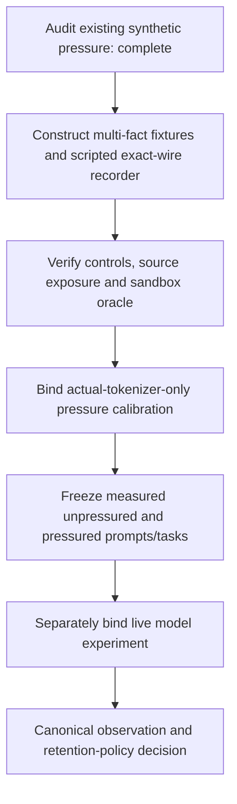

# H22: multiple facts under measured pressure

The completed H21 live pilot preserves one decisive fact at 8K/10K/12K with 12/12 correct proposals and equal model-call counts. Its final screen is inconclusive because of one retained baseline timeout. Existing pressured local cases use a synthetic rule based on tool-message count, not tokenizer-measured capacity. [The audited 18 pressure traces](pressure-audit.json) confirm that limitation. Do not treat them as real-window qualification or change a candidate based on a supposed actual capacity threshold.

## Hypothesis and experiment

H22 predicts that H21 preserves two independently revised facts while full history fits, but the existing one-exchange fallback loses older facts when actual token admission forces a recycle. The diagnostic will test this before designing a new evidence policy. Counterevidence includes preserved correctness/source exposure after genuine pressure, or failure of the unpressured controls. A byte-limit rejection, missing source, unavailable tokenizer or inability to bracket pressure is inconclusive rather than a semantic failure.

Use fresh opaque route/region values; routeCode must combine the independently highest-revision values and preserve stableLabel. Keep oracle and task metadata outside model-observable fixtures. Two evidence placements: co-located in the final read as a control, and split across earlier files followed by neutral reads. Six reads plus submission fit existing call limits. Baseline H15 and H21 source bytes stay unchanged.

Calibration must show the decisive reads were delivered before pressure, complete-history projection is rejected by actual token accounting, and a reduced projection is admitted within unchanged reserves. Use content-derived neutral padding, not a fake tool-count token response. Pin selected request bodies and every tokenizer receipt. Do not dispatch model calls during calibration. Maximum calibration proposal: 96 tokenizer attempts, zero model attempts, zero retries, one worker; require a separate exact execution binding after the local fixture checks. If the bracket cannot be found within that cap, retain the result and redesign offline.

Measure each fact's exact original-source delivery and presence separately, joint patch semantics, fallback/recycle events, call/token/byte/latency costs and every unknown response. A script knowing the fixture must not give its answer to the model; scripted responses are construction evidence only. No proposed output executes on the host. The live schedule and acceptance thresholds must be frozen after feasibility is established and before any live model dispatch; no live model budget is granted by this plan.

## Construction and operational lanes

Current runnable construction: B and C, owned by ARE implementer/evaluator. Exact dependencies: H21 hypothesis and local verification, H21 final live report, pressure-audit.json, existing context-recycling admission and pinned container validator. Planning does not register admitted Goals execution state. User authorization covers continued research construction; provider execution still needs its exact local binding. Owner of account access and product adoption: user. Serving changes, publication and the broader GLM finish milestones remain separate; they do not block local diagnostic construction.

## Open Questions

Can real pressure be bracketed without hitting byte or read-turn limits first? Can both facts be preserved in an admitted representation? What should the engine retain when all original evidence genuinely does not fit? Does the observed behavior transfer to real repository questions and multiple files? H22 diagnoses these boundaries before proposing a new retention implementation.
