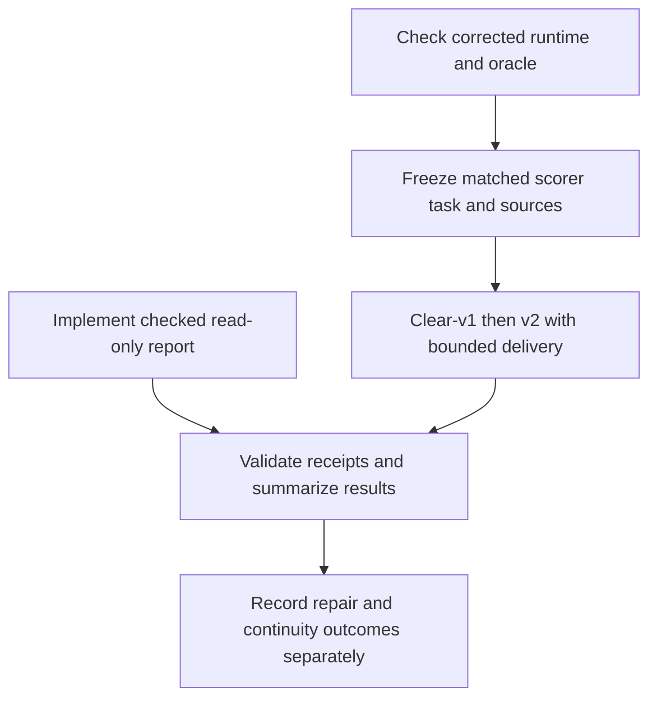

# Corrected-runtime matched repair trial

User-authorized candidate construction under CAV2-D65; authority effect none.
The prior bounded pilot established delivery continuity, then exposed a corrected
EOF issue; its v2 continuation stopped on tokenizer HTTP500. Verified repair
completion remains unproven. Source evidence: [previous report](bounded-delivery-2026-09-07/README.md).

## Product plan and DAG

Run exactly one new scorer pair: identical corrected source version, task,
fixture, limits, and bounded-reads-v1 delivery. Only retention differs. Caps:
24 model and48 tokenizer attempts,1200seconds total,580seconds perarm, existing
request deadlines,8000soft/16384hard window,2048output reservation,256token margin.
No automatic retries, no source changes during the run. Provider uncertainty or
protected archive failure stops the run; do not start replacement arms. A normal
bounded model failure remains evidence. One pair cannot establish general policy
superiority. The provider's internal compaction remains unobservable.

Implement a read-only report with manifest/task/arm integrity checks, explicit
incomplete accounting, unknown usage, endpoint failures, and separate correctness
and continuity. The parent owns source freeze, live calls, evidence, and docs;
one existing helper owns report.mjs/report.test.mjs. Join after focused tests and
receipt validation. The reporting module does not change the model runtime.

## Operational support

The operator owns the existing credential bridge and funded endpoint. Endpoint
availability is an exact prerequisite only for the live stage; local reporting
construction can finish independently. Activation, publication, deployment and
any default changes remain deferred owner decisions. Holdout/dev tasks unused.

## Open Questions

- Can both corrected-runtime arms reach an independently verified patch?
- Does successful archive delivery translate into repair completion?
- If endpoint errors persist, which separately bounded later run is justified?

## Completed boundary

The corrected-source matched pair completed with no provider errors: both arms
passed continuity and exhausted 12 model turns without a candidate. Total 24
model and 29 tokenizer attempts. Checked reporting is implemented; all 272
combined tests pass. See the [result and next DAG](matched-repair-2026-09-07/README.md).
Remaining-budget guidance and delivered archive-page coverage are proposed next
construction, not activated behavior or a measured improvement.
