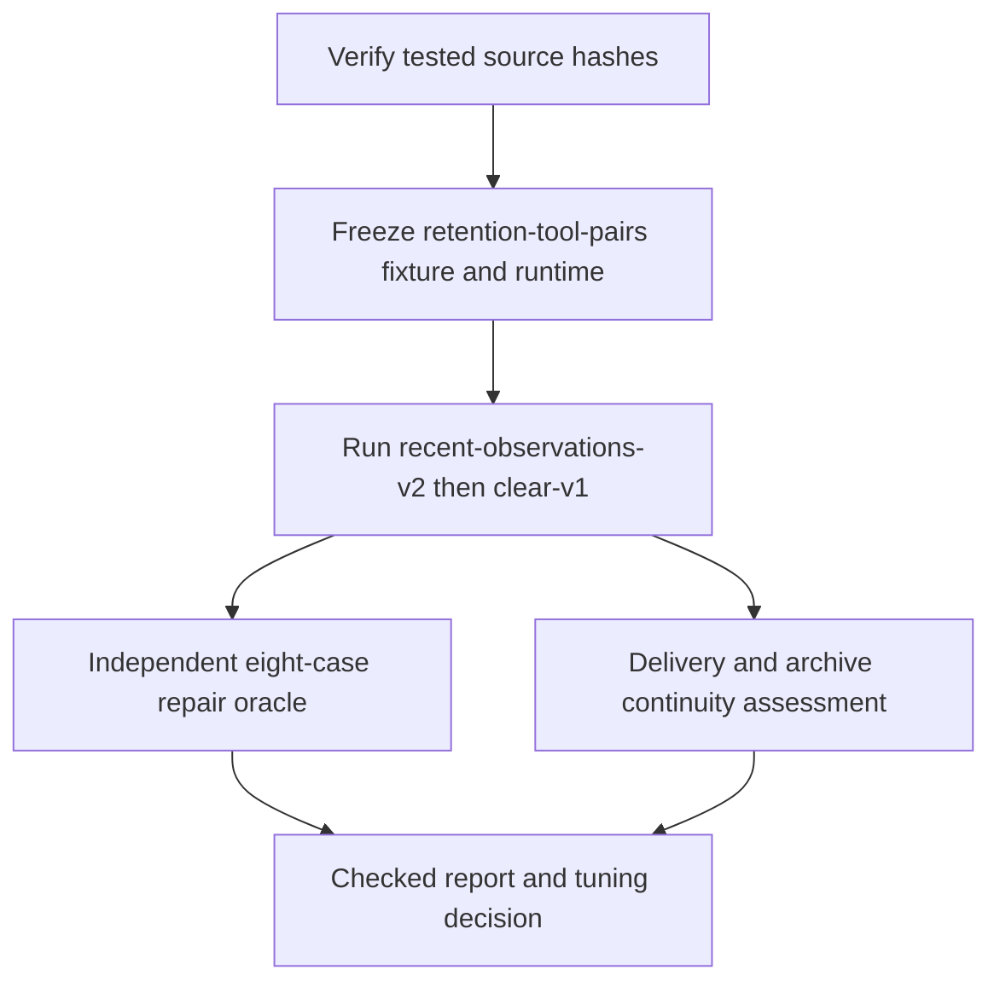

# Retention task coverage plan

Owner-directed bounded construction under CAV2-D65 and the existing
[source preservation construction](../../../packages/coding-agent-runtime/glm-flash-v1/CONSTRUCTION.json).
Authority effect: none. No ontology runtime dependencies.

Product frontier: extend the successful corrected scorer trial to the second
controlled repair task. Runnable work: execute the existing runner, export visible
evidence, and compare separate repair and continuity outcomes. Exact write scope:
this plan, new retention-pair evidence, and benchmark progress documentation.
No runtime change is required to execute this planned experiment.

Both arms use bounded-reads-v1, budget-aware-v1, inspected-mutation-v1 and the same
frozen source snapshot. Per arm: 12 model calls, 24 tokenizer calls, 580 seconds.
Aggregate: 24 model calls, 48 tokenizer calls, 1200 seconds. Context limits remain
8000 soft/16384 hard with 2048 output reserve and 256 margin. No retries. Preserve
failed attempts; stop on protected failures. Verify patches only in isolated
benchmark copies. The previous 316-test receipt applies only if hashes match.

Operational owner: run operator. Existing credentials and endpoint availability
are prerequisites only for live calls. No causal blocker is currently observed.
Default activation, publication and deployment remain deferred.

## Open Questions

- Does the corrected engine repair retention pairing as well as JSON scoring?
- Does either policy omit required archive recovery or repeat whole-file reads?
- Which behavior warrants the next bounded code change after this evidence?

Completed: [results](retention-pair-2026-09-07/README.md). One repair and one continuity pass; neither arm passed both.
