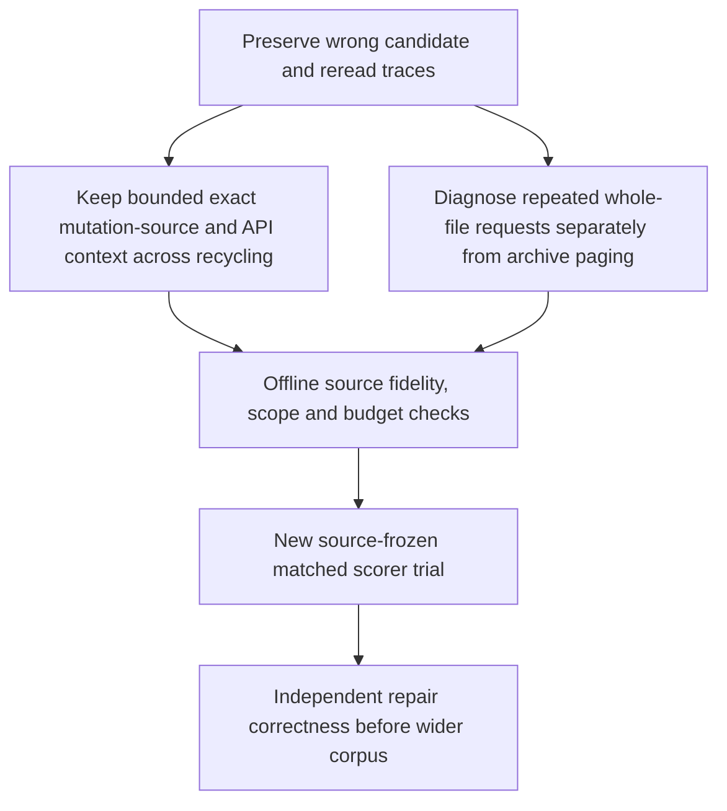

# Completion-control candidate and live trial — 2026-09-07

Candidate construction under CAV2-D65; authority effect none. [Checked report](checked-report.json),
[analysis](analysis.json), [frozen manifest](manifest.json), and [run result](result.json).
The [plan](../../../../packages/coding-agent-runtime/glm-flash-v1/evidence/COMPLETION-CONTROL-PLAN.md)
was implemented as opt-in `completion_policy: budget-aware-v1`.

## Implemented behavior

The engine derives remaining model/tool budgets and inspect/synthesize/finalize
phases from the existing request ledger. It merges confirmed archived ranges
against exact original source bytes and tracks gaps/EOF independently of original
full-file delivery. The model prompt adds exact native bodies present in the
current request to a clearly labelled cumulative seen-or-present view. That view
never claims old content remains in the window or persists a rejected render as
confirmed delivery. Duplicate verbose progress arrays are replaced in this
opt-in prompt; full history and output metrics remain intact. Resume binds the
policy and source; configuration/reporting enforce the same policy for both arms.

All **293 tests passed**, including merged ranges, missing ranges, duplicate
source-call aliases, EOF, unknown/undelivered responses, remaining budgets,
resume, current-page prompt coverage, unchanged caps, and report integrity.
Guidance is advisory: a model may still ignore it, and no extra calls are granted.

## Live results

| Retention | Model / tokenizer attempts | Patch result | Continuity | Recycles |
| --- | --- | --- | --- | --- |
| clear-v1 | 9 / 12 | One candidate; independent checks **0/8** | Passed | 3 |
| recent-observations-v2 | 12 / 16 | No candidate; model-turn limit | Failed | 4 |

Both arms used identical task/fixture inputs and the same frozen new runtime.
No provider errors or automatic retries occurred. Total: **21 model / 28 tokenizer
attempts**, 81,508 input and 1,017 output tokens, 171.038 runner seconds. All
model dispatches stayed below the 8,000 soft threshold with 2,048 output tokens
reserved; minimum soft headroom was 206/230 tokens. Hard window: 16,384.
Provider-internal compaction remains unobservable.

Clearing produced a schema-valid, scope-valid candidate before exhausting its
turn budget. It nevertheless replaced the required `scoreResponse(gold,text)`
export and `{passed,reason}` results with an incompatible `exactJsonMatch` export,
different arguments and `{ok,reason}` results. The independent oracle rejected
all eight cases and rolled back the disposable verification copy. This is a
wrong repair, not evidence of successful completion or approval to apply it.

V2 made twelve successful file reads: README twice, source five times, contract
four times, cases once. Required files were delivered, but it never recovered
archived evidence after recycling and never proposed a patch. Its final read
result remained undelivered when the turn limit was reached.

The [previous matched trial](../matched-repair-2026-09-07/README.md) had no patch
proposals and two continuity passes. This candidate produced one incorrect
proposal and one continuity pass. Lower aggregate calls do not establish a
useful efficiency gain when neither run repaired the task. This single pair
supports **no default promotion or reliable policy-winner claim**. The new
policy remains opt-in; existing default delivery/retention remain unchanged.

## Next construction hypothesis

A bounded exact source view for already-inspected mutation targets could help
preserve the interface while other observations recycle. This is a proposed
experiment, not a proven explanation of the model's mistake or an implemented
new retention rule. Do not expand budgets, weaken oracle checks, or hide failed
trials. Heldout/dev tasks remain unused; Kite is not integrated in this live run.

## Open Questions

- Can exact mutation-source context prevent interface-changing candidates?
- Why does v2 repeat whole-file reads despite cumulative coverage guidance?
- Which minimal completion/retention intervention improves verified repairs?
- Will the result repeat across trials and the second controlled episode?
