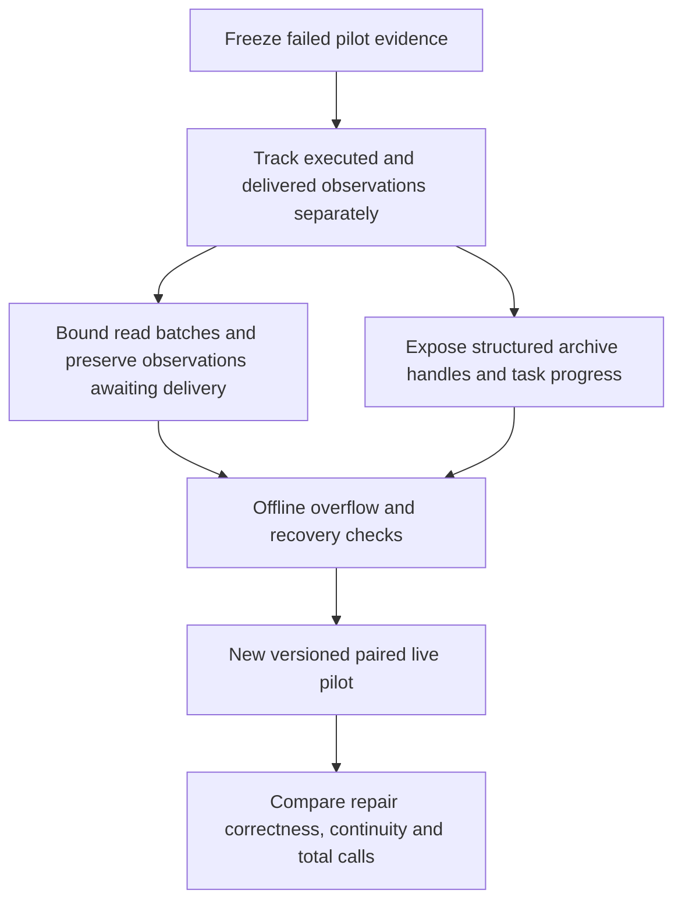

# Live source-derived repair pilot — 2026-09-07

Candidate evidence; authority effect none. [Analysis](analysis.json), frozen
manifests, receipts, and visible tool traces are preserved in this directory.

| Episode | Policy | Result | Model / tokenizer attempts | Recycles |
| --- | --- | --- | --- | --- |
| Exact JSON scoring | clear-v1 | Tool-call limit; no patch | 7 / 13 | 6 |
| Exact JSON scoring | recent-observations-v2 | Non-owned archive reference rejected; no patch | 8 / 13 | 5 |
| Retention tool pairs | recent-observations-v2 | Model request deadline; no response | 1 / 1 | 0 |
| Retention tool pairs | clear-v1 | Unstarted after stop | 0 / 0 | — |

No verified repairs and no passing continuity checks. This incomplete pilot does
not establish a policy winner. The 233 local tests passed, including failing
mutants, passing references, and rejection of candidate-generated fake TAP.

## Run boundaries and accounting

The first manifest planned four arms under 48 model / 96 tokenizer calls and
2,400 seconds. It stopped after the first pair on `recycling.foreign-evidence`.
A separate manifest selected only the untouched second episode, preserving its
v2/clear order, with tighter 24 model / 48 tokenizer calls and 1,200 seconds.
It stopped on `glm.deadline-exceeded`; the remaining clear arm never started.
No failed arm was replayed and no archive check was relaxed. Total: 16 model
attempts, 27 tokenizer attempts, 162.937 seconds inside the two runners.
The timeout's model attempt was dispatched but has unknown token usage and
billing outcome; unknown usage is not zero. Its tokenizer succeeded, then the
model request returned no bytes before its approximately 30-second deadline.

Between runs, the runner gained subset selection and the agent gained bounded
visible last-message capture before tool validation/execution. Exact source
snapshots are in each manifest. These instrumentation changes did not alter
prompts, tools, thresholds, archive ownership checks, or policy behavior. The
second run is a linked continuation, not an unchanged four-arm experiment.
Raw private run directories remain referenced by receipts. Exported traces omit
message arrays containing provider reasoning and retain calls, observations,
transport receipts, context decisions, and bounded visible response evidence.

## What the traces establish

Both scorer arms repeatedly requested all four files together despite the task's
separate-turn instruction. Clear completed 24 reads of four unique paths; v2
completed 19. The first batch measured 8,276 / 8,289 input tokens. Including the
256-token margin and 2,048-token output reservation, projected requests were
10,580 / 10,593 against the 8,000 soft threshold. Recycling removed the tool
observation bodies before the next model dispatch. A successful read-tool result
therefore does not establish that the model received its body.

V2 later requested some files individually, but neither scorer arm successfully
read archived evidence after recycling. The rejected archive call in the first
run was not captured before execution, so its exact digest and the reason the
model selected it cannot be established. The new bounded visible-message field
closes that diagnostic gap for subsequent calls without capturing private
provider reasoning. The second run timed out before producing such a message.

All 16 recorded dispatch projections stayed below the 8,000 soft threshold and
16,384 hard window, with the declared output reservation. ARE's admission and
recycling operated; successful task continuity did not. Provider-internal
compaction is unobservable here, so these results do not prove that it never
happened. The earlier single-turn QA success is not a substitute for this test.

## Proposed next tuning DAG

These are evidence-backed proposals, not implemented scheduling changes. The
next construction should preserve strict request admission, tool pairing,
archive ownership, complete accounting, and independent candidate verification.
A new prompt/policy version needs a new manifest; failed baseline evidence stays.
The default remains clear-v1; v2 remains opt-in. Kite is still an optional adapter
contract, not a live retrieval integration in this experiment.

## Open Questions

- Does enforcing bounded reads eliminate the observed reread/recycle loop?
- Can structured archive handles recover required content without digest errors?
- Can delivery-aware task progress improve completion under the same call caps?
- Will a later healthy endpoint run complete both retention-task arms?
- What provider evidence could independently establish internal compaction behavior?
