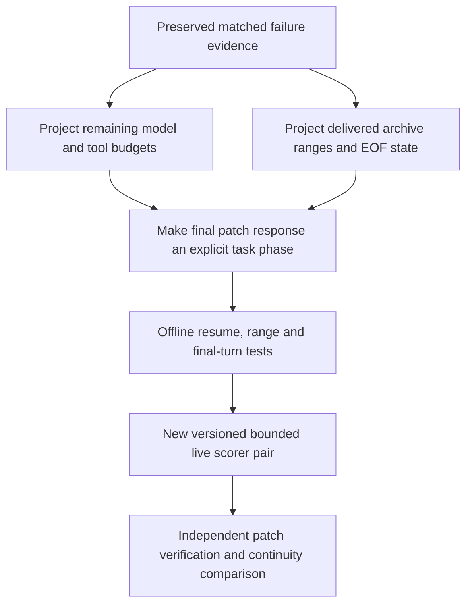

# Matched corrected-runtime scorer trial — 2026-09-07

Candidate evidence; authority effect none. [Plan](../MATCHED-REPAIR-PLAN.md),
[frozen manifest](manifest.json), and [result](result.json), [checked report](checked-report.json), and
[validation](validation.json). Both arms used the
same corrected EOF runtime, task, fixture, output reserve and bounded delivery;
only retention policy differed. All source pins remained unchanged during work.

| Policy | Verified repair | Continuity | Model / tokenizer attempts | Recycles | Original-file reads |
| --- | --- | --- | --- | --- | --- |
| clear-v1 | No candidate | Passed | 12 / 15 | 3 | 7 reads of 4 unique files |
| recent-observations-v2 | No candidate | Passed | 12 / 14 | 2 | 4 reads of 4 unique files |

The runner completed both arms; the model exhausted its request limit in each.
**Completed experiment does not mean completed repair.** No provider error or
automatic retry occurred. Total: 24 model/29 tokenizer attempts, 93,624 input and
1,396 output tokens, 210.640 seconds inside the runner. Paid monetary cost is not
inferred from token counts. Limits remained 24 model/48 tokenizer and 1,200 seconds.

## Findings

Both arms delivered the required file bodies and nonempty archive evidence after
recycling. Each produced one final read result that never reached another model
request because the 12-turn limit was reached. Continuity is therefore distinct
from delivery of every observation and from patch correctness.

Clear reread the source three times and the contract twice. V2 inspected each
required file once, then repeatedly requested the contract archive pages at
offsets 0 and 1024: each of those ranges was requested three times. Its final turn
requested offset 2048, whose result was never delivered. These are observed action
sequences, not evidence about hidden model reasoning or internal compaction.

Every dispatched request remained strictly below the 8,000 soft threshold with
2,048 output tokens reserved. Minimum soft headroom: 99 tokens for clear and 186
for v2. The hard window stayed 16,384. Local request admission and context recovery
worked; autonomous repair completion did not. One pair with zero repairs cannot
establish a policy winner, even though v2 used fewer file reads and one fewer
tokenizer call.

## Implemented reporting

The read-only report module checks stored manifest, task, arm and agent-result
bindings before summarizing attempted/unstarted arms, calls, usage, failures,
continuity and repair outcomes. It exports no provider reasoning or raw message
arrays. These are consistency checks over trusted local run artifacts, not
cryptographic authentication or a fresh execution of the repair oracle.

The full combined suite passed **272/272 tests**, including the real matched
run, corruption rejection, incomplete/unknown accounting, over-cap records,
and recorded independent-verification outcomes.

## Proposed next tuning DAG

The current progress view identifies executed and delivered call IDs, but does
not give the model a persistent merged archive-page coverage view or remaining
model-call budget. Adding those projections is a hypothesis to test, not a
measured fix. Derive them from existing source-bound history and transport
accounting; do not introduce a second mutable state store. Keep all scope,
request, tool-call, ownership and oracle checks. Do not raise caps to hide loops.
No such completion-policy change was activated in this trial. Defaults remain
legacy delivery and clear retention; heldout/dev tasks remain unused.

## Open Questions

- Will explicit delivered-page coverage prevent the repeated 0/1024 page loop?
- Will remaining-turn awareness preserve a final response for a patch?
- Can either policy pass independent repair checks under the existing limits?
- How stable are these outcomes across repeated trials and the second episode?
