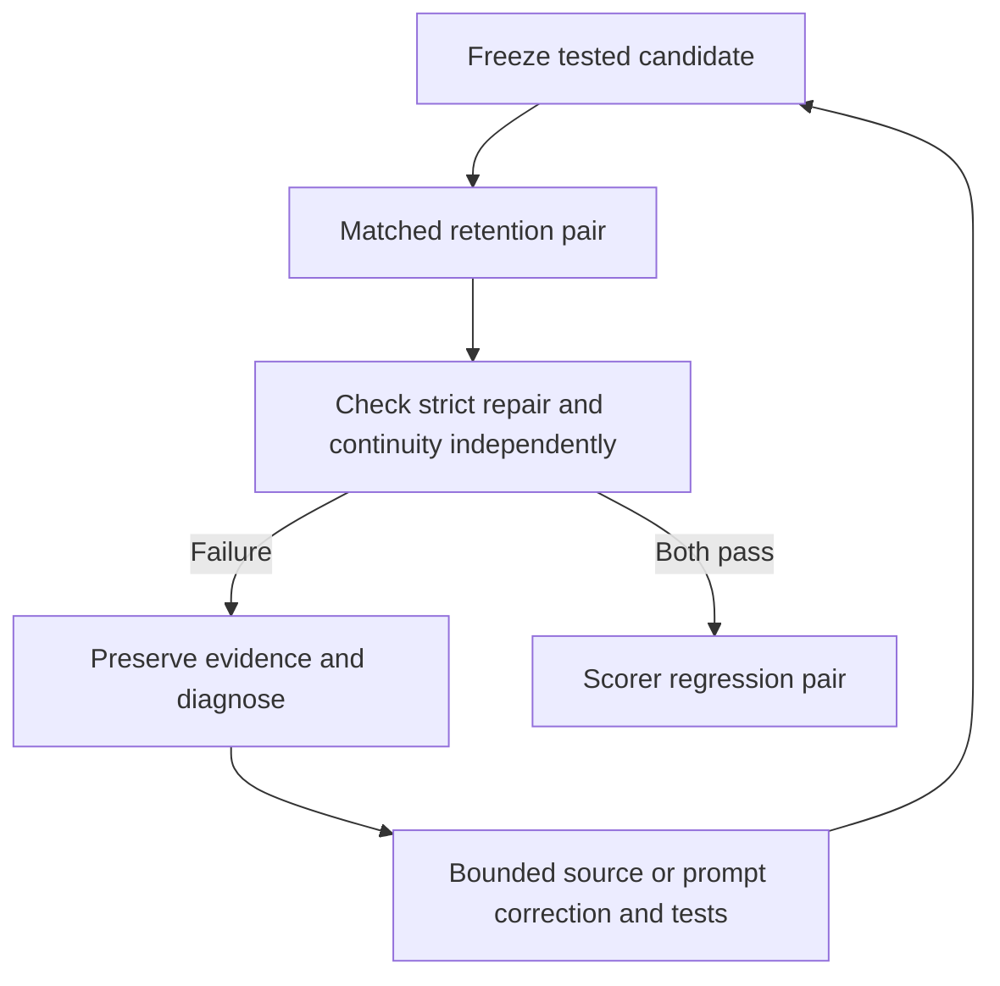

# Working live test iteration plan

Owner-directed construction under CAV2-D65 and the existing explicit-finalization
construction. Authority effect none. No ontology runtime dependencies.

Every new pair retains 24 model/48 tokenizer/1200-second aggregate caps and
12 model/24 tokenizer/580-second arm caps. Context remains 8000 soft/16384 hard,
2048 output reserve,256 margin. No same-run retries or acceptance changes.
User explicitly requested iteration until a working test. Preserve all attempts,
including failed arms; do not select only successes in comparisons.

Product frontier: verify explicit-finalization-v3 live, correct observed mismatches,
and validate a repair with continuity. Iteration 1 already yielded one complete
clearing pass. V2 failed strict JSON parsing. Inspection also found a benchmark
instruction requiring a raw archive tool unavailable under source preservation.
Iteration 2 changes only task wording to prefer the offered typed archive tool
and require JSON-only final output. Required reads, archive recovery, fixture
bytes, oracle, scope and continuity checks remain unchanged. Local tests pass335.

Exact write scope: episodes.mjs and its tests, trial evidence and benchmark docs.
Any later runtime correction must remain inside existing completion/source/delivery
construction boundaries and be tested before a new frozen trial.
Operational owner: run operator; existing credential bridge and endpoint are
necessary for live calls. Publication, deployment and default activation deferred.

## Open Questions

- Do both policies achieve repair and continuity on the corrected task wording?
- Does the same candidate pass the scorer regression?
- How repeatable are results across tasks, runs and context sizes?

Results and remaining limitations are owned by README.md in this directory.

## Completed construction

Later iterations added a prompt-only reference for exact duplicate task text,
a state-derived recovery directive after all reads, and a bounded projection of
exact `/requirements` arrays from verified already-read JSON. Scope extended to
agent.mjs, completion.mjs, source-preservation.mjs and their existing tests.
All 340 tests passed before the final frozen candidate. Iteration 9 and scorer 2
passed both outcomes for both policies. Full costs and failures are in README.md.
No further live work is required for this working-example objective.
