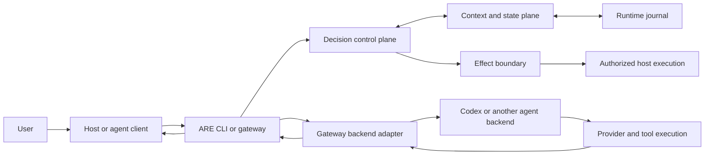
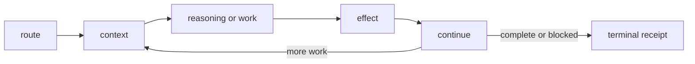

# Architecture

This document describes the architecture frozen by `ARE-PRODUCT-CANDIDATE-018`,
version `0.10.0-self-contained-candidate.7`. ARE surrounds replaceable model and
host implementations with deterministic contracts for intent, context, state,
decisions, effects, continuity, and evidence.

## System context

The CLI is the direct local interface. The gateway exposes the same product to
agent hosts through the model-neutral `are.gateway-backend-adapter/v1`
contract. The current transport is JSON-RPC 2.0 over JSON Lines. A backend can
therefore be replaced without moving route selection, context construction,
state ownership, or effect authorization into the provider adapter. See
[Gateway and agents](GATEWAY-AND-AGENTS.md).

## Decision control plane

Every governed request follows four explicit decisions:

- `route` selects exactly one objective contract from the repository registry.
- `context` binds the sources and prior receipt used for the next operation.
- `effect` checks a consequential action at the host boundary.
- `continue` records completion or names the next bounded objective.

These decisions produce receipts and reason codes. They do not grant filesystem,
network, publication, deployment, or owner authority. The CLI contract is
documented in [CLI](CLI.md).

## Context and state plane

The Context Envelope is the bounded input projected into a model turn. It binds
the selected sources, constraints, lineage, and token-window view. Context
selection remains separate from the model so the same evidence can be measured,
replayed, refreshed, or compacted without making provider memory authoritative.

Reasoning State holds durable task semantics: events, epochs, checkpoints,
branches, corrections, decisions, evidence references, and progress. The
runtime journal records ordered operational events for bounded replay and
eviction. The two have different roles: reasoning state preserves task meaning.
The journal preserves runtime order and recovery evidence.

Content-derived identities, canonical JSON, and SHA-256 bindings connect
requests, profiles, context, decisions, and evidence. Repeating an operation
against changed source must create a different binding or fail with explicit
drift. See [State, learning, and conversation](STATE-LEARNING-AND-CONVERSATION.md).

## Conversation plane

`conversation-runtime` owns conversation identity, ordered user and assistant
turns, capability activity, pending decisions, cancellation, and terminal
conversation state. It projects user-facing progress from product records while
keeping private reasoning, credentials, and provider internals outside the
conversation surface.

Conversation state is distinct from reasoning state. A conversation can present
or resume work while the reasoning ledger remains append-only and independently
verifiable. Disconnect recovery reconstructs the visible session from durable
records instead of treating one process or network connection as the source of
truth.

## Host and agent plane

`codex-app-server-wrapper` adapts a host protocol to ARE context, continuity,
state, and effect boundaries. `coding-agent-runtime` binds a task to a provider,
tools, budgets, workspace rules, patches, and verification commands. The gateway
adapter gives other compatible agents the same boundary through initialize,
submit, event, cancellation, and recovery operations.

Affinity may improve reuse but is not correctness. Session expiry or backend
replacement must not truncate the append-only ledger. Late events are admitted
only when their conversation, request, and generation identities still match.

## Provider and execution plane

Provider transport, secret resolution, tool policy, budget policy, workspace
scope, and verification are separate configuration fields. The coding runtime
supports OpenAI-compatible and native provider transports, including OpenAI,
Anthropic, and Google adapters. A provider choice cannot silently change tool
permissions or effect authority.

Secrets are resolved through explicit secret-provider contracts and injected
only at the provider or tool boundary that needs them. Secret material is not
part of Context Envelopes, reasoning state, receipts, patches, or research
artifacts. Tool results enter the state plane as bounded observations with
identity and provenance. See [Configuration](CONFIGURATION.md) and
[Operations and security](OPERATIONS-AND-SECURITY.md).

## Product layers

| Layer | Responsibility | Main packages |
| --- | --- | --- |
| Meaning and intent | Preserve raw intent and compile request contracts | `request-intent-runtime`, `intent-route-resolver` |
| Routing | Select one repository objective route | `request-decision-router`, `module-port` |
| Context | Select, bind, refresh, and project evidence | `context-basis-runtime`, `semantic-input-runtime` |
| Judgment and policy | Produce bounded decisions and consequence gates | `semantic-judgment-evaluator`, `reasoning-policy-runtime` |
| Durable reasoning | Append, checkpoint, branch, replay, and compare state | `reasoning-state-runtime`, `runtime-journal` |
| Evolution | Convert failures into hypotheses, variants, comparisons, and learning decisions | `evolution-runtime` |
| Host continuity | Keep authenticated sessions across disconnects | `codex-app-server-wrapper` |
| Agent execution | Bind providers, tools, budgets, patches, and verification | `coding-agent-runtime` |
| Conversation | Maintain ordered interaction, activity, and pending decisions | `conversation-runtime` |
| Verification | Package and verify module ports and product evidence | distribution-envelope and release-verification packages |
| Evaluation | Test reasoning behavior and improvement chains | `real-reasoning-benchmark` |

The complete list of 17 required components and two required integrations is in
[Components and integrations](COMPONENTS-AND-INTEGRATIONS.md).

## Evolution and research boundary

`evolution-runtime` records a chain from question to hypothesis, experiment,
observation, comparison, and learning disposition. Research evidence may
support, revise, or reject an improvement candidate. It does not activate the
candidate or rewrite repository authority. Benchmark fixtures and ContextBench
runs remain outside the release closure unless a later product candidate
explicitly declares them.

This separation lets a model-specific study improve a model-neutral context or
state mechanism. For example, the study can examine GLM context retention without
making one provider's behavior part of the core architecture. See
[Evaluation and research](EVALUATION-AND-RESEARCH.md).

## Release architecture

`product.json` declares the product boundary. Release construction resolves the
declared components, integrations, repository profiles, route capability,
ARE-owned semantic adapter, local secret bridge, tests and evidence into a
content-addressed closure. Alch and the DomainSpec compiler are outside its
build-time and runtime dependency boundary.

Candidate 018 currently verifies:

| Property | Frozen value |
| --- | ---: |
| Source files | 907 |
| Required components | 17 |
| Required integrations | 2 |
| Test cases | 1,158 |
| Test files / targets | 146 / 20 |

The frozen closure is a self-contained source distribution. The materializer
copies only its 907 exact paths into an empty destination and verifies every
regular-file digest. A separate deterministic archive drill verifies local
installation, health, reconnect/restart, corruption detection, source rollback
and uninstall. Documentation is descriptive and remains outside the sealed
Candidate 018 closure. See
[Release and evidence](RELEASE-AND-EVIDENCE.md).

## Authority boundary

Architecture layers may evaluate, propose, record, verify, and request an
effect. Composition does not create authority. The host performs authorized
effects. Repository governance admits implementation. And owner decisions remain
outside deterministic receipt generation. Generated mirrors, inventories,
ontologies, research outputs, and runtime journals are evidence or projections,
not canonical repository definitions.

## Current exclusions

- The gateway adapter is a supported protocol boundary, not a hosted public
  gateway service.
- Candidate verification is not publication, deployment, activation, or product
  approval.
- A remote Git repository changes distribution and collaboration, not the
  product's runtime topology.
- Provider cache telemetry and context retention claims require observed
  provider evidence. Architecture alone cannot establish them.

## Open Questions

- Which trusted signing identity and delivery channel should carry an accepted
  source archive?
- Which gateway deployment profile should become the first supported reference
  host beyond the local Unix transport?
- Which conversation projection should be the stable public API shared by CLI,
  desktop, and third-party agent clients?
