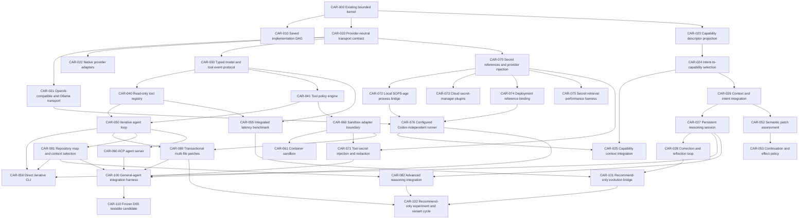

# ARE General Coding-Agent Runtime Implementation DAG

This plan evolves the existing one-turn, one-file verified patch candidate into
a Codex-independent coding agent. It preserves the existing rule that models
and tools may propose effects but cannot authorize them.

The machine-readable companion is `implementation-dag.json`. A node marked
complete means only that its local done criteria passed; it does not imply
product approval, conformance acceptance, publication, deployment, or external
effect authority.

## Current Boundary

- Existing proof: one immutable observation set, one injected model turn, one
  closed candidate, explicit approval, one allowlisted existing-file
  replacement, and independent postimage verification.
- Current construction posture: prototype epoch. The prior L2 exact-byte
  binding is historical because its selected predecessor bytes have changed.
- Current implemented frontier: integrated context and intent, persistent
  reasoning checkpoints, corrections, typed model/tool events, bounded
  read-only tools, semantic/control adapters, iterative execution, local
  latency evidence, and recommend-only evolution signal projection.
- External blocker: ACP remains discovery-only in the repository. No ACP
  compatibility claim is permitted until its owner admits an exact protocol
  contract and conformance surface.

## Dependency Graph

## Implementation Layers

| Layer | Decision question | Minimum working unit | Exit evidence |
| --- | --- | --- | --- |
| L0 — bounded proof | After this layer, we know whether a model-produced change can remain subordinate to exact effect authority. | Existing scripted/Codex one-turn, one-file slice. | Current deterministic tests and controlled live canary evidence. |
| L1 — context and state | After this layer, we know whether each model turn is bound to explicit context, intent, and recoverable reasoning state. | Context Basis adapter, Intent Contract, file-backed checkpoints, correction/reflection loop, and provider-independent model transport. | `CAR-020` through `CAR-028` deterministic tests pass without real credentials. |
| L2 — judgment and agent loop | After this layer, we know whether the runtime can repeatedly observe and use read-only tools while every call crosses policy and exact semantic/control adapters. | Typed events, read/search/list tools, allow/deny/ask policy, semantic assessment, continuation/effect adapters, bounded steps, and latency harness. | Every attempted tool call has a policy decision and replayable observation receipt; synthetic latency is measured. |
| L3 — effect hardening | After this layer, we know whether commands and multi-file candidates remain contained under failure. | Fail-closed container sandbox, secret references, redaction, and transactional patch set. | Escape, drift, timeout, secret-leak, partial-write, and unavailable-sandbox tests pass. |
| L4 — interoperability | After this layer, we know whether an owner-admitted external agent protocol can operate the governed runtime. | ACP binding only after an exact owner contract, repository context selection, and protocol probes. | Owner-admitted ACP conformance evidence; currently blocked. |
| L5 — evolution and product test | After this layer, we know whether selected evidence can produce recommendations and the complete candidate is reproducible. | Recommend-only signal bridge, integration harness, and frozen D65 candidate. | No automatic adoption; exact predecessor, implementation, and evidence bytes are frozen before approval consideration. |

## Node Contracts

| Node | Depends on | Deliverable | Acceptance-critical done criterion | Status |
| --- | --- | --- | --- | --- |
| CAR-000 | none | Existing bounded executor/controller | Existing tests pass unchanged. | complete-existing |
| CAR-010 | CAR-000 | Saved Markdown and JSON DAG | Both views contain identical node IDs and acyclic dependencies. | complete-prototype |
| CAR-020 | CAR-000 | Stable transport result and receipt contract | New transports cannot gain effect authority or leak credentials in receipts. | complete-prototype |
| CAR-021 | CAR-020 | OpenAI-compatible transport | Fake hosted and unauthenticated Ollama-shaped calls pass; one call drives the existing verified candidate path. | complete-prototype |
| CAR-022 | CAR-020 | Native provider adapters through a maintained provider SDK | OpenAI, Anthropic, and Google model fixtures normalize to the same transport result. | ready |
| CAR-023 | CAR-000 | Explicit-source Product Capability projection | Exact configured sources produce lifecycle-preserving, digest-bound descriptors; ambient discovery and authority-bearing sources block. | complete-prototype |
| CAR-024 | CAR-023 | Intent-to-capability selection | Request intent and the sealed catalog produce one candidate or a typed ambiguous/no-match block without granting authority. | complete-prototype |
| CAR-025 | CAR-024, CAR-076 | Selected capability context integration | Only selected descriptors enter the prompt, and changed capability sources block exact proposal application. | complete-prototype |
| CAR-026 | CAR-024 | Context Basis and Intent Contract adapter | One explicit context input produces a digest-bound context envelope and intent contract before the model request. | complete-prototype |
| CAR-027 | CAR-026 | Persistent reasoning session | A single-writer append-only log checkpoints every integrated event and recovers only from a verified terminal checkpoint. | complete-prototype |
| CAR-028 | CAR-027 | Correction and reflection loop | Corrections bind predecessor and successor intent; improvement projection requires explicit engine-candidate selection. | complete-prototype |
| CAR-030 | CAR-020 | Typed model/tool event protocol | Invalid, duplicate, or structurally conflicting events block deterministically. | complete-prototype |
| CAR-040 | CAR-030 | Read-only list/search/read tools | Paths remain allowlisted, size-bounded, regular-file-only, and symlink-free during observation. | complete-prototype |
| CAR-041 | CAR-030 | Tool policy engine | Every tool request resolves to allow, deny, or ask before invocation; unattended ask becomes deny. | complete-prototype |
| CAR-050 | CAR-040, CAR-041 | Bounded iterative loop | Step limit, cancellation, repository drift, model failure, and denied tool calls terminate without implicit effects. | complete-prototype |
| CAR-052 | CAR-026 | Candidate-bound semantic assessment | Semantic evaluation requires the exact candidate digest and explicit semantic lifecycle input; no ambient facts are fabricated. | complete-prototype |
| CAR-053 | CAR-052 | Continuation and effect policy adapters | Existing dual-lane continuation and effect-request decisions are reused without converting routing into consent. | complete-prototype |
| CAR-055 | CAR-030, CAR-040 | Integrated latency benchmark | Synthetic event parsing, allowlisted reads, and literal search emit p50/p95/p99 evidence with no network calls. | complete-prototype |
| CAR-056 | CAR-027, CAR-050, CAR-081 | Direct iterative CLI | CLI flags select bounded iteration, steps, policy, persistent resume, cancellation, and exact context configuration. | complete-prototype |
| CAR-060 | CAR-041 | Sandbox interface | Host execution is impossible; command requests require an exact digest-pinned container sandbox or block. | complete-prototype |
| CAR-061 | CAR-060 | Docker/Podman sandbox | No network by default, read-only source, explicit writable worktree, resource limits, and cleanup evidence. | blocked-by-dependencies |
| CAR-070 | CAR-020 | Neutral secret reference, provider registry, environment backend, injected cloud/plugin backend, and model-transport binding | Model-visible state and serialized receipts contain references, never locators or secret values; ambiguous sources block. | complete-prototype |
| CAR-072 | CAR-070 | Local SOPS-age process-boundary provider | The existing Python store can satisfy the neutral contract without `reveal --stdout` or secret material in parent-process receipts. | complete-prototype |
| CAR-073 | CAR-070 | Cloud secret-manager provider plugins | Provider-specific SDK adapters resolve fresh material while core code remains cloud-neutral. | ready |
| CAR-074 | CAR-070 | Deployment secret-reference manifest binding | Deployment configuration selects references/backends without embedding material; missing injection blocks. | complete-prototype |
| CAR-075 | CAR-070 | Synthetic secret retrieval benchmark and latency budgets | Environment and injected adapters plus the complete Node-to-Python SOPS-age provider path emit p50/p95/p99 evidence, and enforced budget violations block. | complete-prototype |
| CAR-076 | CAR-021, CAR-072, CAR-074 | Strict configured one-turn agent runner | The CLI selects an OpenAI-compatible model and neutral credential provider, emits one immutable no-effect proposal, and applies it without a second model call only when its exact digest is supplied and independent verification passes. | complete-prototype |
| CAR-071 | CAR-060, CAR-070 | Tool-scoped injection and redaction | Only named commands receive named secrets and all output surfaces pass leak tests. | blocked-by-dependencies |
| CAR-080 | CAR-050, CAR-060 | Transactional multi-file patch candidate | Exact baselines, allowlist closure, rollback/ambiguity handling, and independent verification cover every file. | complete-prototype |
| CAR-081 | CAR-050 | Repository map/context selector | Files, imports, exports, tests, and symbols are deterministic, budgeted, provenance-bound, and non-authoritative. | complete-prototype |
| CAR-082 | CAR-027, CAR-081 | Advanced reasoning integration | Alternative branches, replay fixtures, deterministic reduction, current counterevidence, and portable epochs are available to the iterative run. | complete-prototype |
| CAR-090 | CAR-050 | ACP agent server | An exact owner-admitted ACP contract must exist before initialize, session, prompt, update, permission, cancel, and close flows may be implemented or claimed compatible. | blocked-external-contract |
| CAR-100 | CAR-071, CAR-076, CAR-080, CAR-081, CAR-090 | General-agent integration harness | At least one local and two hosted-provider fixtures exercise the same governed loop; unavailable dependencies fail closed. | blocked-by-dependencies |
| CAR-101 | CAR-028, CAR-055 | Recommend-only evolution bridge | Only explicitly selected correction and benchmark evidence becomes typed improvement signals; automatic adoption remains false. | complete-prototype |
| CAR-102 | CAR-080, CAR-082, CAR-101 | Recommend-only experiment and variant cycle | Selected run evidence may create an experiment, reproduction, variant, comparison, scheduled cycle, and non-activating upgrade recommendation. | complete-prototype |
| CAR-110 | CAR-100 | Frozen D65 candidate and current product tests | Exact predecessor, source, generated, implementation, and evidence bytes are frozen before product-approval consideration. | blocked-by-dependencies |

## Borrowing Strategy

- Depend on the official ACP TypeScript SDK; use Gemini CLI and `codex-acp` as
  interoperability references rather than copying the protocol schema.
- Depend on a maintained provider SDK for native providers after the first
  OpenAI-compatible proof; do not copy OpenCode's coupled provider registry.
- Port the smallest dependency-closed policy subset from Gemini CLI only after
  pinning its upstream commit, license, notices, and tests.
- Port Aider-style SEARCH/REPLACE parsing only at `CAR-080`; the parser creates
  a candidate and never writes directly.
- Use Goose and OpenHands secret behavior as reference designs. Prefer system
  keyring and process-boundary libraries over copying storage code across
  languages.
- Record every vendored source in a third-party provenance manifest before it
  enters the frozen candidate.

## Non-Regression Guardrails

- A model response, tool request, policy decision, patch, test PASS, or ACP
  permission response never grants effect authority.
- Existing digest, allowlist, no-symlink, fresh-baseline, separate-verifier,
  and zero-automatic-effect-retry guarantees remain mandatory.
- No provider secret may appear in prompts, model-visible tool results,
  receipts, journals, error bodies, or test snapshots.
- Missing sandbox, policy, provider, verifier, or approval dependencies return
  a typed terminal block; they never fall back to ambient host authority.
- Every layer has credential-free deterministic tests before any opt-in live
  canary is meaningful.

## Recommended Next Node

Run the separately authorized real-container canary for `CAR-061`, then harden
tool-scoped secret injection at `CAR-071`. `CAR-090` remains intentionally
deferred: it needs an exact ACP owner contract and conformance surface first.
