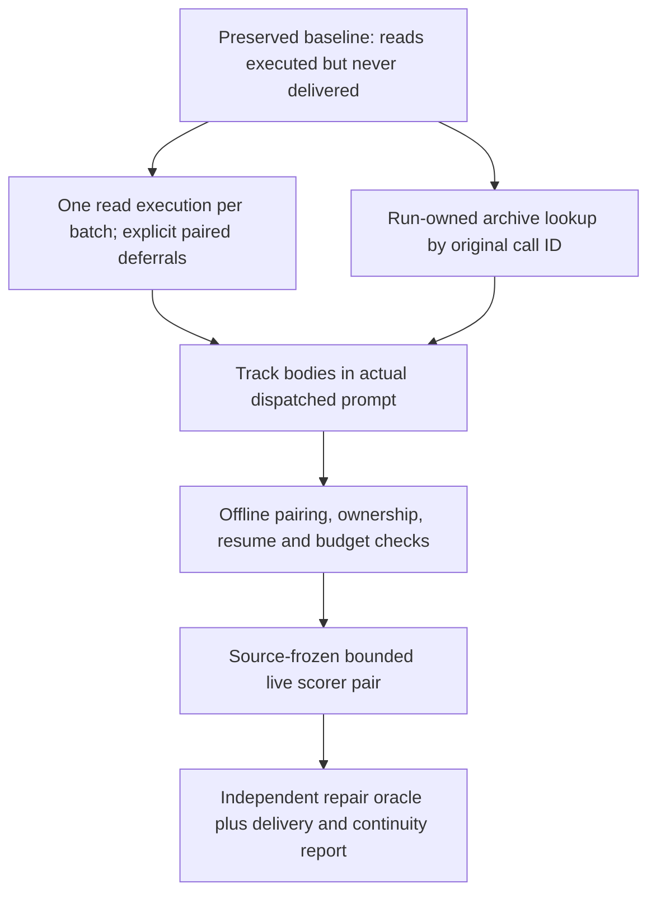

# Bounded delivery candidate

Owner-directed construction under CAV2-D65; authority effect none. User continued
from the [failed episode pilot](../../../../benchmarks/glm-episodes-v1/evidence/live-episodes-2026-09-07/README.md).

## Product frontier and DAG

Default delivery remains legacy-v1; bounded-reads-v1 is opt-in. The new bundle
limits read execution, provides structured archive access, and preserves the
newest complete exchange during overflow recovery when it fits. It must not
weaken strict request admission, scope, tool-call pairing, ownership, durable
accounting or independent patch verification. An exchange that cannot fit blocks;
it is not silently declared delivered. Preserve failed baseline trials.

Live scope: only exact-json-scoring, clear-v1 followed by recent-observations-v2,
both using the identical new bundle and revised task wording accepting either
archive tool. This wording is frozen into each new request hash. At most 24 model and 48 tokenizer attempts,
1,200 seconds total, 580 seconds per arm; existing request deadline remains.
Hard window 16,384, soft threshold 8,000, reserved output 2,048, token margin 256.
No automatic retries. Stop unknown transport outcomes and archive violations.
This is an exploratory comparison of retention under the new bundle. Historical
comparison changes multiple factors; it cannot isolate scheduling from archive
retrieval or establish a winner from one trial each. Heldout tasks remain unused.

## Operational support

The operator owns the existing funded endpoint and secret bridge for live calls.
Endpoint failure blocks that live trial, not local construction or analysis.
Default activation, deployment, publication, and product approval remain deferred
owner decisions. The three existing agents retain separate core delivery,
archive helper, and independent review roles; the parent owns CLI, runner,
construction records, join tests, live execution and report. Join condition:
source freeze plus passing relevant tests and no unresolved review blocker.

## Open Questions

- Can the model respect explicit deferrals within the existing 24-tool-call cap?
- Does newest-exchange retention fit both contract files at the chosen threshold?
- Will archive slices reach subsequent model requests and support completion?
- Does the combined intervention help across tasks after a controlled followup?

## Observed EOF boundary and bounded continuation

The first clear arm passed delivery continuity but stopped on an exact EOF page
request, using10model/12tokenizer calls. Preserve its manifest and failed result.
Correct EOF to an explicit empty final page; empty content remains insufficient
for meaningful archive recovery. After current tests/review, continue only the
untouched v2 arm under12model/24tokenizer/660seconds. No failed arm is replayed.
The linked source versions differ; this cannot be reported as an unchanged pair.
Evidence and unresolved questions are owned by the
[bounded pilot report](../../../../benchmarks/glm-episodes-v1/evidence/bounded-delivery-2026-09-07/README.md).

## Current result

Both intended arms were attempted across two explicit source versions. Clear
passed delivery continuity but stopped on the subsequently corrected EOF case.
V2 stopped on tokenizer HTTP500 before repair; no retry. Total13 model/16
tokenizer attempts. Local construction is complete and tested (261 distinct
checks); live verified repair and matched-policy comparison remain unproven.
The operator owns a later healthy-endpoint pilot. This result grants no default
activation, authority promotion, publication or deployment.
