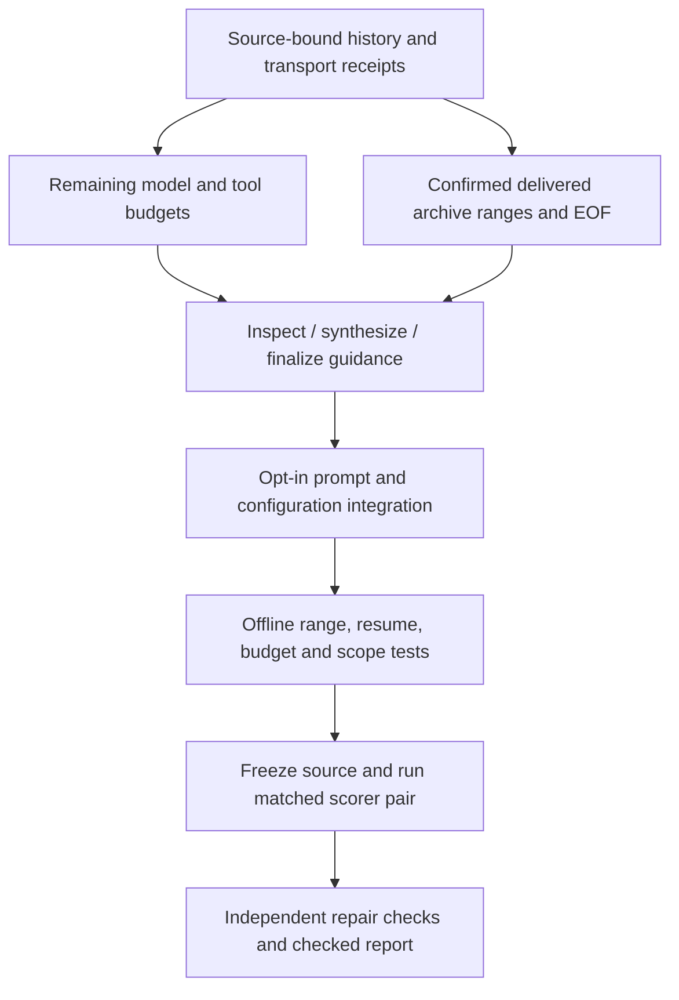

# Budget-aware completion candidate

User-authorized CAV2-D65 construction; authority effect none. The
[matched baseline](../../../../benchmarks/glm-episodes-v1/evidence/matched-repair-2026-09-07/README.md)
passed continuity in both arms but produced no patch in12 turns. V2 repeated
archive offsets0/1024; clearing reread source files.

`completion_policy: budget-aware-v1` requires bounded-reads-v1 delivery; omission
means none. This is advisory task guidance, not permission to change scope,
execute patches, skip verification or exceed limits. Model turns remaining
include the upcoming response. With3 or2 remaining responses the phase is
synthesize; with1 it is finalize. The prompt reserves a final JSON patch response
when the evidence supports one, never fabricating a repair to satisfy a metric.
Delivered archive ranges are half-open UTF-16 offsets merged from confirmed
successful tool-result delivery, with exact original source/hash checks. Full
original-file delivery stays distinct from partial archive coverage. Unknown
or merely executed responses cannot create confirmed coverage. The model prompt additionally includes exact bodies present in its current
rendered request under explicitly cumulative seen-or-present labels. This
provisional presence is not persisted as confirmed delivery; rejected render
attempts cannot manufacture confirmation. Duplicated verbose progress arrays
are replaced in this opt-in prompt to preserve context headroom. The projection
is derived from existing checkpoint history and transport accounting; no second
mutable store. Resume binds the completion policy and source bytes.

The three existing roles retain isolated ownership: helper1 projection/tests,
parent integration/CLI/runner/evidence, helper2 report bindings and independent
review. Join requires current tests and review before source freeze and live use.
New live budget: exactly scorer clear/v2, both using the same new policy and
runtime;24 model/48 tokenizer attempts,1200seconds total,580seconds perarm;
8000soft/16384hard window,2048reserved output and256margin. No automatic retry;
protected or uncertain failures stop the run. Runtime sources stay frozen.
Single-pair and changed-prompt comparisons remain exploratory.

## Operational support

The run operator owns existing credentials and endpoint availability, which gate
only live execution. Local construction/testing proceeds independently. Default
activation, authority promotion, publication and deployment remain deferred.

## Open Questions

- Does guidance prevent repeated page fetches and reserve a final patch response?
- Does added progress context remain within the same strict request budget?
- Can the model complete the independently verified repair without raised caps?

## Completed result

Implementation and 293 tests pass. The matched live pair produced one incorrect
patch (clearing,9turns,0/8oraclechecks) and one model-limit failure (v2,12turns).
No default promotion. Results and the next source-fidelity hypothesis are in the
[live report](../../../../benchmarks/glm-episodes-v1/evidence/completion-control-2026-09-07/README.md).
