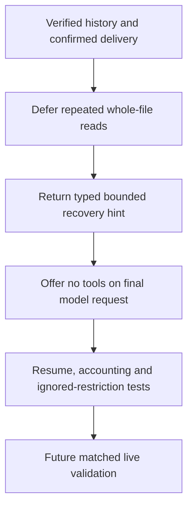

# Bounded execution completion control

Owner-directed candidate under CAV2-D65, extending completion and delivery
construction. Authority effect none; no ontology runtime dependencies.

Product frontier: new opt-in completion_policy bounded-execution-v2, requiring
bounded-reads-v1. Existing none and budget-aware-v1 behavior remains unchanged.
The new policy includes budget guidance. After confirmed delivery of a successful
whole-file read, a repeated read of that path returns ok:false/deferred:true and
completion.repeat-read-deferred without invoking the filesystem. It suggests a
1024-character archive read by the original call ID for nonempty files. Empty
files have no recovery suggestion. Unknown or merely projected delivery never
suppresses a read. No archive-page or scope checks are bypassed.

The repeat receives a native paired result and consumes its model turn and tool
ID. Deferred results do not count as successful reads or delivery. Final-turn
selection uses the actual receipt count, including on resume. The final request
has an empty tools list in both tokenizer and model payloads. If the provider
returns a tool call anyway, validation blocks before invocation. Unsupported
final text still fails candidate validation; this rule cannot manufacture a repair.

Exact scope: completion.mjs, agent.mjs, completion tests, benchmark report and
runner/report tests, documentation and construction. CLI and runner already bind
the completion-policy field; their shared validator admits the new explicit value.
Both arms receive the same policy and source snapshot. No cap increases or retries.

Runnable work: pure/integration, runner/report and broad regression tests.
Operational owner: run operator; endpoint availability is needed only for a future
live trial. No live calls are part of this checkpoint. Publication, deployment
and default activation remain deferred. No current local blocker.

## Live result

The [live pair](../../../../benchmarks/glm-episodes-v1/evidence/execution-live-2026-09-07/README.md)
prevented duplicate filesystem reads. Clearing repaired the task without archive
continuity; V2 passed continuity but returned invalid final text. The conditional
scorer regression was skipped.

## Open Questions

- Will GLM use the typed suggestion or continue requesting deferred file reads?
- Does a tool-free final response yield a valid repair with sufficient evidence?
- Does the complete request fit the provider token budget with the new instruction?

Validation and source hashes: execution-control-validation.json in this directory.
