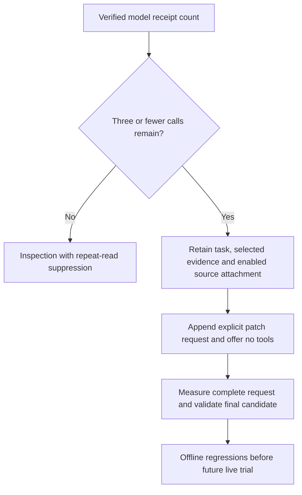

# Explicit finalization candidate

Owner-directed bounded construction under CAV2-D65, extending execution control.
Authority effect none; no ontology runtime dependencies.

Product frontier: opt-in completion_policy explicit-finalization-v3, requiring
bounded-reads-v1. It inherits v2 repeat-read handling. At three or fewer remaining
model calls, tools become unavailable and a final user-role instruction requests
only the specified JSON patch, complete replacement bytes and exact hashes. It
explicitly rejects progress updates and claims of unperformed verification, while
allowing the model to state insufficient evidence (which is not a valid repair).

This is one finalization attempt. Invalid output ends the run without retries;
unused budget is not consumed automatically. An early valid candidate can still
end inspection before the transition. No new mandatory archive-recovery gate is
introduced; benchmark continuity remains independently checked. If fewer than
four calls are configured, finalization starts immediately and may lack evidence.

Existing none, budget-aware-v1 and bounded-execution-v2 behavior is preserved.
The same helper selects tool availability at render and execution validation,
using actual receipts including resumed calls. Task text, selected native tool
pairs and the enabled source attachment remain in the final request. The appended
instruction is included in tokenizer admission; it has no budget exemption.
Policy and source hashes bind resume, paired configs and checked reports.

Exact scope: completion.mjs, agent.mjs, completion tests, report.mjs, runner/report
tests and documentation/construction. Runnable work: threshold, resume, evidence,
invalid-final, unoffered-tool, full-admission and regression tests. Operational
owner: run operator. Provider access is needed only for a later live trial.
No paid calls occur in this checkpoint. Publication, deployment and default
activation remain deferred. No current local blocker.

## Open Questions

- Does the explicit request improve final patch format and correctness live?
- Does earlier finalization leave enough evidence for each controlled task?
- Does the full final request fit the provider budget with its appended instruction?
- Should later work model required archive recovery explicitly before finalization?

Validation and source hashes: explicit-finalization-validation.json.

## Completed live iteration

The [complete loop](../../../../benchmarks/glm-episodes-v1/evidence/working-loop-2026-09-07/README.md)
produced final repair and continuity passes for both policies on both tasks.
Later bounded changes reference exact duplicate task text, add a state-derived
recovery directive, and retain exact JSON requirements as bounded untrusted data.
The current local suite passes 340 tests. All prior failed trials are preserved.
The final candidate is not promoted to a default; open questions remain above.
