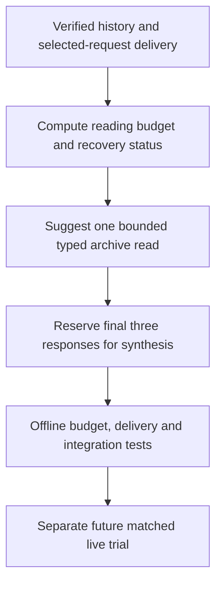

# Budget-aware inspection guidance

Owner-directed candidate under CAV2-D65, extending the existing completion-control
construction. Authority effect none; no ontology runtime dependencies.

Evidence: the [retention task trial](../../../../benchmarks/glm-episodes-v1/evidence/retention-pair-2026-09-07/README.md)
showed V2 skipping archive recovery and clearing exhausting its budget on pages.
Product frontier: add advisory inspection_guidance to budget-aware-v1. Reading
turns are capped by remaining tool calls and model turns minus three. Reserve
up to three responses for synthesis. After recycling with no meaningful archive
recovery seen or present, suggest offset zero of the shortest nonempty verified
read source, using its actual call ID and a maximum of 1024 UTF-16 code units.
Ties resolve by path then call ID. Empty sources never produce a suggestion.

The hint is advisory: a task may require archive recovery, but the engine does
not infer that obligation from prose or treat one page as complete understanding.
It does not enforce tool denial, claim task completion, or change budgets. A
selected-request projection may temporarily satisfy the seen-or-present flag;
rejected renders do not persist it. Existing delivery confirmation remains the
source of durable delivery status. Whole-file coverage and archive coverage
remain distinct. Prompt explanations were shortened to make room for guidance.

Exact scope: completion.mjs and tests, agent.mjs integration, documentation and
CONSTRUCTION.json. Runnable work: local pure/integration and regression tests.
Operational owner: run operator; credentials and endpoint availability affect
only a later live trial. No live calls are part of this checkpoint. Publication,
deployment and default activation remain deferred. No current local blocker.

## Live result

The [live retention pair](../../../../benchmarks/glm-episodes-v1/evidence/inspection-live-2026-09-07/README.md)
produced no patches: reserved fresh requests exceeded the soft limit by 17 and
44 tokens. V2 passed continuity; clearing did not. The conditional scorer pair
was not run. The next frontier is measured prompt overhead.

## Open Questions

- Does the guidance prevent omitted recovery and excessive paging in live runs?
- Does the modified full prompt fit the tightest measured context headroom?
- Is a three-response synthesis reserve appropriate across tasks and window sizes?

Test results and source hashes are recorded in inspection-guidance-validation.json.
