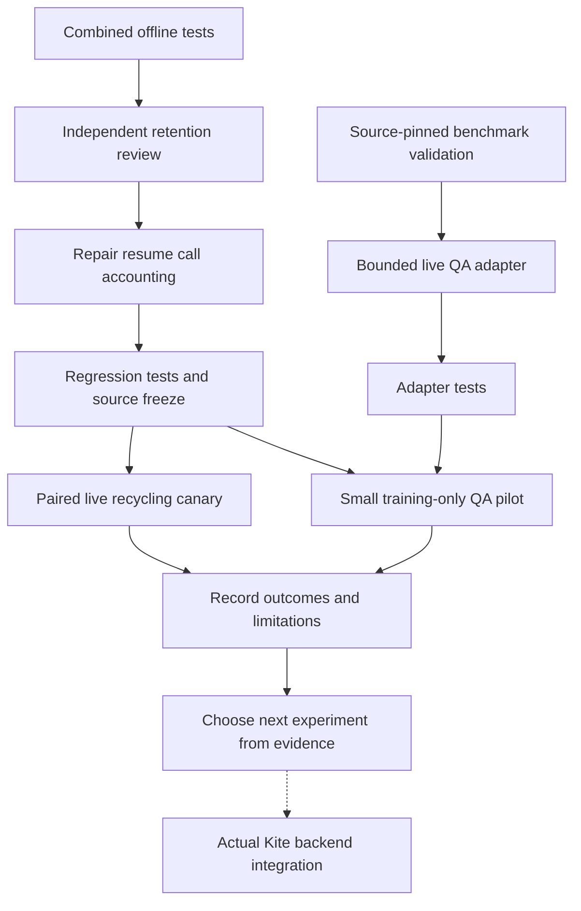

# GLM integration and paired evaluation

Status: owner-directed candidate work, authorized by “plan do and do next”.
Authority effect: none. Construction chain: [parent](../CONSTRUCTION.json).

The first combined offline run passed the existing runtime, benchmark, and Kite
contract tests (170 tests in the combined selection). Dataset validation passed
for 48 tasks, split 24/12/12. These are local mechanism checks, not model results.

Independent review reproduced a tokenizer-budget reset across fresh-client
resume. That defect blocks freezing the live candidate until repaired and tested.
It does not block constructing the QA adapter or paired-run harness.

## Ownership and boundaries

| Work | Owner | Gate / close condition |
| --- | --- | --- |
| QA adapter and its tests | benchmark agent | Gold-blind model inputs, complete-request admission, bounded attempts, failure accounting |
| Paired harness and canary metadata | retention agent | Same task/budgets, source pins, explicit arm records, no hidden retries |
| Resume budget repair | independent reviewer | Counters survive successful resume; failed/uncertain measurement cannot reset allowance |
| Join and actual pilot | parent agent | Review, passing combined tests, fixed run limits before calls, receipts inspected |

Current product frontier: the resume repair, QA adapter, and paired harness.
Runnable work is local implementation and deterministic validation. Later live
work is a small training-only QA run and one paired recycling canary, not the
full 48-task matrix or held-out evaluation. Every observed failure remains in
the evidence; no efficiency claim follows from a synthetic success.

Operational support: the run operator owns the configured credential reference,
endpoint availability, and finite request/time/token bounds. Authentication,
billing, or unknown transport failures stop live work rather than trigger a
retry. The runtime/repository owner owns later activation and publication;
those operations are deferred and do not block the local prototypes.

## Open Questions

- Will retention improve completion under the same 5,000-token recycle policy,
  or consume its tokenizer allowance trying projections that cannot fit?
- Do single-turn repository questions succeed through the real transport? They
  do not test active coding or recycling even when they mention continuation.
- Does the provider expose evidence about internal compaction? Local request
  admission alone cannot establish its absence.
- Which wider task/context experiments are justified by the pilot results?

## Completed join

The resume-counter repair, bounded QA adapter, and paired harness are complete.
The [final combined suite](integration-tests-2026-09-07.json) passed 196 tests.
The six-task training QA pilot passed all six tasks. The
[live retention pair](retention-pair-2026-09-07/README.md) completed: clearing
passed; retention exhausted its tokenizer allowance. The default stays clearing.

The next product frontier is budgeting retention candidate exploration before
testing broader context headroom. Real Kite integration, held-out evaluation,
and prompt optimization remain pending. No activation or publication occurred.
