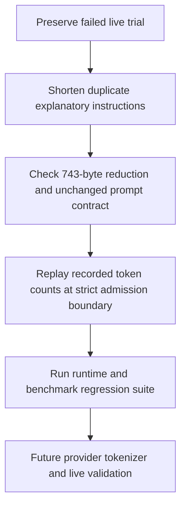

# Completion prompt overhead reduction

Owner-directed bounded construction under CAV2-D65, extending inspection guidance.
Authority effect none; no ontology runtime dependencies.

Product frontier: reduce opt-in budget-aware-v1 prompt overhead. Three completion
explanations and the conditional delivery explanation shrink from 1824 to 1081
UTF-8 bytes. Default completion-none instructions retain their previous delivery
text. Source attachments, native observation bodies, task text, metadata,
recovery suggestions, budgets and delivery accounting are unchanged.

Exact scope: agent.mjs, completion-integration.test.mjs, baseline fixture,
construction and documentation. Runnable work: targeted and broad local tests.
The regression fixture stores before/after instructional text and the two
measured inputs from the failed trial. Tests verify a minimum 700-byte system
prompt reduction and unchanged task/patch requirements. Separate loopback tests
return the recorded 5713/5740 tokenizer counts and prove that the 8000 soft limit
still blocks before model dispatch with the 2048 output reserve and 256 margin.
These tests are not a replay or retokenization of the complete historical prompts.
They must not be presented as proof that revised prompts fit the provider budget.

Operational owner: run operator. Provider access is needed only for later exact
full-request measurement/live trials. Local construction has no current blocker.
No paid model or tokenizer calls are part of this checkpoint. Publication,
deployment and default activation remain deferred.

## Live result

The [live pair](../../../../benchmarks/glm-episodes-v1/evidence/overhead-live-2026-09-07/README.md)
reached both 12-call caps without a context-admission block, but produced no
patches or archive recovery. Both policies looped on whole-file reads. The
conditional scorer regression was skipped.

## Open Questions

- What are the revised complete-request provider token counts?
- Does saved space allow a verified repair without excessive rereading?
- Does the shorter wording preserve useful behavior across both tasks?

Validation and hashes: prompt-overhead-validation.json in this directory.
