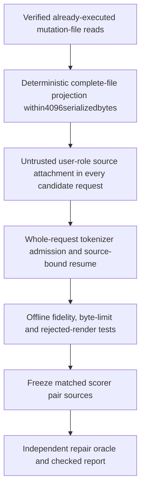

# Inspected mutation-source preservation

Owner-directed candidate under CAV2-D65; authority effect none. The prior
[completion-control trial](../../../../benchmarks/glm-episodes-v1/evidence/completion-control-2026-09-07/README.md)
produced a wrong-interface patch and repeated whole-file reads.

New opt-in `source_policy: inspected-mutation-v1` requires bounded-reads-v1.
Only already-read files in both observation and mutation scopes are eligible.
Validate original bytes/hash and native call/result pairing; deduplicate aliases.
Sort paths deterministically. Omit a whole file if it cannot fit; never summarize
or truncate code. The4096-byte bound includes JSON escaping and metadata. No
fresh filesystem read, oracle data, or new mutable state is introduced.

Source bytes live in a clearly labelled untrusted user-role data attachment,
not the system instructions. The system tells the model to preserve the exact
export names, arguments and result fields. Full requests still require measured
admission; source pinning cannot exempt bytes from the context limit. Confirmed
source-pin references are recorded separately after a successful response and
never relabel projected source as a native tool-result delivery.

Parent owns agent/CLI/runner integration, tests, plan and live evidence. Existing
helper1 owns pure source projector/tests; helper2 owns report bindings and
independent review. Join after current tests and review before a source freeze.
Live scope: one scorer clear/v2 pair, both budget-aware-v1 plus inspected-mutation-v1;
24model/48tokenizer attempts,1200seconds total,580seconds perarm,8000soft/16384hard,
2048reserved output,256margin. No retries or source changes during live work.

## Operational support

The operator owns existing credentials and endpoint availability for live calls.
Endpoint failure gates live execution only. Defaults, authority promotion,
publication and deployment remain deferred. Heldout/dev tasks remain unused.

## Result

The [bounded pilot](../../../../benchmarks/glm-episodes-v1/evidence/source-preservation-2026-09-07/README.md)
used 7 model and 10 tokenizer attempts and produced no repair. Strict admission
blocked clearing; archive ownership blocked v2. Followup source-policy changes
remove raw digest recovery and redundant prompt text. All 316 tests pass, but
those followup changes have not been validated live.

## Open Questions

- Does preserved exact source prevent interface-changing candidates?
- Does it reduce rereads while preserving room for acceptance context?
- Can either policy produce an independently verified repair within existing caps?
