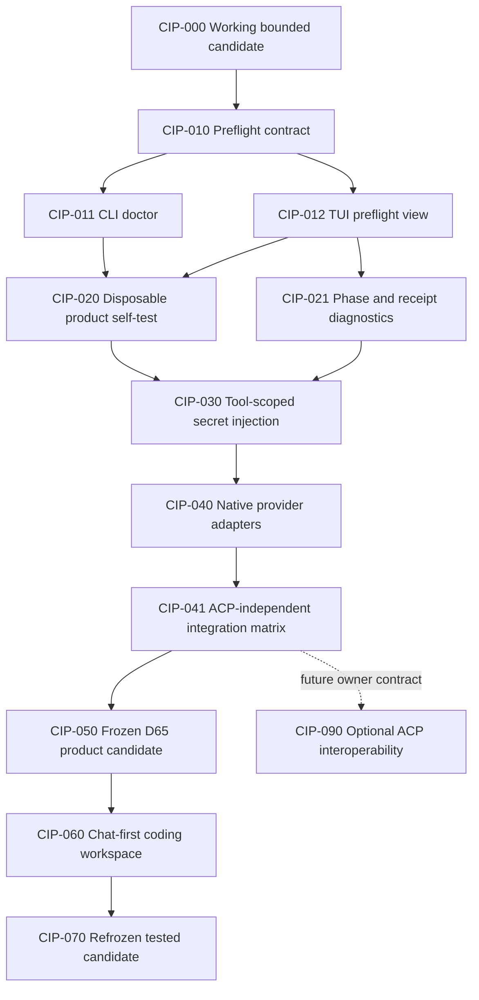

# CyberAlchemy Coding Agent Product Improvement Plan

This plan advances the working TUI proposal-and-apply candidate into a
self-diagnosing, provider-neutral product candidate. It does not approve the
product or authorize adoption, publication, release, deployment, credentials,
or external effects.

## Context

- Target: CyberAlchemy coding-agent TUI and ARE coding-agent runtime.
- Current state: a bounded local product candidate can produce a proposal,
  obtain exact-digest confirmation, apply a transactional patch, and verify it
  in a digest-pinned container.
- Current run-local evidence: 73 runtime tests passed, 30 TUI tests passed, and
  the disposable product canary returned `PASS_BOUNDED`.
- Primary user: a developer running the agent from the TUI against an explicitly
  scoped local repository.
- Primary constraint: failures must be understandable without weakening the
  existing fail-closed authority, sandbox, digest, rollback, and secret
  boundaries.
- Source references: `COMPLETION-DAG.md`, the coding-agent runtime
  `IMPLEMENTATION-DAG.md`, package READMEs, and current test suites.

## Layering Method

- Each layer answers one product decision and retains every earlier guarantee.
- A layer ends when the next unit of work has lower value for its decision than
  beginning the next decision layer.
- Deterministic credential-free tests precede optional live-provider evidence.
- Passing tests produce candidate evidence only; they do not approve a product.

## Current Product-Construction Frontier

The previous construction frontier closed at **L4/CIP-050: frozen exact tested
candidate**. A separately authorized prototype epoch is now active at
**L5/CIP-060: chat-first coding workspace**. It keeps the prior approval,
sandbox, transactional patch, rollback, secret, and provider guarantees while
removing one-shot launch and terminal-exit friction.

Runnable now:

- CIP-060 passed the complete runtime and TUI regression surfaces.
- CIP-070 is frozen as a new exact testable candidate for current product tests.
- A later owner may review that new immutable candidate and receipt through a
  separate product-approval decision.
- Live hosted-provider canaries remain operational work requiring explicit
  credentials and external-call authorization; they do not reopen construction.

## Dependency DAG

`CIP-090` is explicitly outside the current product critical path. ACP cannot
block the provider-neutral core candidate while its external owner contract is
deferred.

## Layer Decision Table

| Layer | Decision question | Minimum working unit | User/operator outcome | Risk reduced | Promotion decision |
|---|---|---|---|---|---|
| L0 — bounded product proof | After this layer, we know whether the TUI can produce, approve, apply, and verify one scoped change without implicit authority. | Existing TUI plus disposable product canary. | One verified local change with an exact approval boundary. | Core feasibility and effect-containment risk. | Already evidenced as a local candidate; retain as non-regression baseline. |
| L1 — deterministic preflight | After this layer, we know whether environment and configuration failures are actionable before a model session starts. | Typed preflight engine, `--doctor`, and TUI results view. | Immediate PASS/BLOCK report with exact remedies. | Late failure, stuck-session, and opaque-configuration risk. | Promote when all declared dependencies have deterministic checks and no model call occurs on BLOCK. |
| L2 — self-test and observability | After this layer, we know whether a user can prove the installed product path and diagnose every runtime phase from the TUI. | Disposable self-test action, phase timeline, redacted expandable receipts, and saved diagnostic bundle. | One-button product check and visible progress/failure cause. | Supportability, unknown-state, and regression-detection risk. | Promote when fault injection covers every phase and the self-test cannot target a user repository. |
| L3 — secret-scoped tools | After this layer, we know whether an explicitly authorized sandbox command can receive only named secrets without leaking material. | Command-to-secret binding, ephemeral injection, output redaction, and leak tests. | Authenticated build/test tools can run without exposing credentials. | Secret overreach and serialization/leak risk. | Promote only when prompt, journal, error, receipt, and output leak tests pass. |
| L4 — providers and product matrix | After this layer, we know whether local and hosted models use the same governed loop and whether a reproducible product candidate can be frozen without ACP. | Native OpenAI, Anthropic, and Google adapters plus one local and two hosted-provider fixtures behind a common integration matrix. | Provider choice without changing approval or safety behavior. | Provider coupling and interoperability risk. | Freeze a D65 candidate only after deterministic fixtures and explicitly authorized live canaries pass. |

## Node Contracts

| Node | Depends on | Deliverable | Done criterion | Status |
|---|---|---|---|---|
| CIP-000 | none | Current TUI/runtime candidate and product canary | Existing runtime, TUI, and disposable canary evidence remains reproducible. | complete-prototype |
| CIP-010 | CIP-000 | Provider-neutral preflight result schema and checker registry | Every check returns typed PASS, BLOCK, or `not_evaluable`; dependent checks retain causal blockers. | complete-prototype |
| CIP-011 | CIP-010 | `--doctor` CLI mode with JSON and human views | It checks Node, model transport, config, sandbox engine/image, repository scope, and output path without invoking a model or mutating the target. | complete-prototype |
| CIP-012 | CIP-010 | TUI preflight screen | The user sees running checks, causal failures, correction hints, and an explicit continue boundary. | complete-prototype |
| CIP-020 | CIP-011, CIP-012 | TUI-accessible disposable product self-test | It creates its own fixture, binds automatic approval only to that fixture, verifies in the selected sandbox, and deletes it on PASS. | complete-prototype |
| CIP-021 | CIP-012 | Runtime phase timeline and redacted receipt viewer | Model, tool, proposal, approval, apply, verify, rollback, cancel, and terminal states are visible without secret material. | complete-prototype |
| CIP-030 | CIP-020, CIP-021 | Tool-scoped secret injection and redaction | Only an explicitly bound command receives selected references; complete surface leak tests pass. | complete-prototype |
| CIP-040 | CIP-030 | Native model adapters behind the neutral transport | OpenAI, Anthropic, and Google fixtures normalize to the same event and receipt contracts. | complete-prototype |
| CIP-041 | CIP-040 | ACP-independent integration matrix | One local and two hosted-provider fixtures exercise the same governed loop; unavailable dependencies fail closed. | complete-prototype |
| CIP-050 | CIP-041 | Exact frozen product candidate and current product-test package | Exact source, dependency, image, configuration, and evidence digests are frozen for separate product-approval consideration. | frozen-testable-candidate |
| CIP-060 | CIP-050 | Chat-first launch, private automatic workspace, and repeated turns | Repository shorthand reaches preflight; storage remains outside the repository; each proposal is unique; terminal outcomes return to a ready composer; exact approval remains mandatory. | complete-prototype |
| CIP-070 | CIP-060 | New exact candidate and current product-test receipt | Full runtime, TUI, product-canary, and provider-matrix evidence binds the changed chat-first bytes. | frozen-testable-candidate |
| CIP-090 | external owner contract, CIP-041 | Optional ACP adapter and conformance tests | Owner-admitted protocol and conformance surface exist before compatibility is claimed. | deferred-external-contract |

## Product-Construction Waves

### W1 — Preflight

Included:

- Pure preflight checks with no model call.
- Collect-all dependency evaluation with causal `not_evaluable` results.
- CLI `--doctor` JSON receipt and concise human rendering.
- TUI checklist, correction hints, and explicit continuation.

Exit evidence:

- Unit tests for every PASS/BLOCK result.
- Tests proving a BLOCK prevents model/session creation.
- Docker/image probes use bounded commands and never pull implicitly.
- TUI tests cover running, failed, corrected, and passing states.

Deferred: automatic remediation, installation, image pulling, secrets, and live
provider calls.

### W2 — Product Self-Test and Diagnostics

Included:

- A TUI control for the existing disposable product canary.
- Phase events and elapsed-time indicators.
- Redacted expandable arguments, observations, and terminal receipts.
- Atomic diagnostic-bundle export outside the target repository.

Exit evidence:

- Fault injection at model, tool, proposal, apply, verify, rollback, and close.
- Tests proving the self-test cannot accept the selected user repository.
- Snapshot tests showing no secret values or locators in diagnostic surfaces.

Deferred: telemetry upload, remote support, analytics, and automatic retry.

### W3 — Tool-Scoped Secrets

Included:

- Neutral `SecretUseBinding` from command identity to secret references.
- Ephemeral injection into a named sandbox command only.
- Redaction before observations enter model context, journals, receipts, or UI.
- Deny-by-default policy and ambiguous-reference blocks.

Exit evidence:

- Canary secrets across stdout, stderr, exceptions, timeouts, journals, and UI.
- No material retained after command completion.
- Missing backend, denied command, and redaction uncertainty fail closed.

Deferred: cloud-provider administration, secret creation/rotation, and ambient
repository credentials.

### W4 — Provider Matrix and Frozen Candidate

Included:

- Maintained-SDK adapters for OpenAI, Anthropic, and Google.
- One shared conformance fixture for prompt input, typed events, usage/cache
  telemetry, cancellation, errors, and redacted receipts.
- ACP-independent local/hosted integration matrix.
- Exact product-candidate manifest and reproducible product tests.

Exit evidence:

- Credential-free adapter fixtures pass deterministically.
- Separately authorized live canaries pass for selected providers.
- Existing product canary and all earlier-layer tests remain green.
- Frozen candidate bytes are presented for a separate owner product decision.

Deferred: ACP, product approval, adoption, publication, release, deployment,
and provider-account operations.

## Operational-Support Lane

| Task | Owner | Affected stage | Blocking basis | Current state |
|---|---|---|---|---|
| Keep the exact Node runtime available | Local operator | all verification waves | Exact prerequisite for current commands | available on current host |
| Keep Docker/Podman and the digest-pinned image available | Local operator | W1-W4 sandbox checks | Exact prerequisite for container execution | available on current host; not a portable guarantee |
| Supply provider accounts and secret references | Deployment/operator owner | W4 live canaries only | Credential and external-effect boundary | deferred until explicit live-canary authorization |
| Select storage location for diagnostic bundles | Local operator | W2 | Must remain outside the target repository to preserve baseline | decision required during W2 implementation |
| Product approval decision | CyberAlchemy coding-agent product owner | after CIP-050 | D65 owner decision over one immutable candidate digest | not requested |
| Commit, publish, release, or deploy | Publication/deployment owners | after separate approval and authority decisions | External-effect boundary | deferred |

Operational tasks for W4 do not block W1-W3 construction. Missing Docker or a
selected image does block the exact sandbox-dependent check being attempted and
must be reported, never bypassed.

## Non-Regression Guardrails

- Model output, tool requests, policy decisions, passing tests, and UI controls
  never grant effect authority.
- Every mutation remains bound to an exact candidate digest, repository
  baseline, mutation allowlist, and explicit user confirmation.
- No sandbox means no command execution; there is no host fallback.
- Single- and multi-file candidates share transactional verification, rollback,
  and ambiguous-effect handling.
- Automatic approval exists only inside a newly created disposable self-test
  fixture and can never target a user repository.
- No secret value or private locator enters prompts, model-visible results,
  journals, diagnostics, receipts, or snapshots.
- ACP remains optional and deferred until its owner admits an exact contract.
- Product tests and a frozen candidate do not constitute product approval.

## Promotion and Stop Rules

- Continue from W1 when preflight blocks all known invalid launch conditions
  before session creation and gives actionable evidence.
- Continue from W2 when the complete local path is self-testable and every
  terminal failure is attributable without exposing secrets.
- Continue from W3 when independent leak tests cover every output surface.
- Freeze CIP-050 only when the provider matrix preserves every earlier
  authority and safety guarantee.
- Stop a wave on ambiguous effects, uncertain redaction, repository drift,
  missing exact baselines, or any proposed fallback to host execution.

## Open Decisions

- Whether diagnostic bundles should be JSON only or JSON plus a human-readable
  Markdown projection. Recommendation: canonical JSON plus derived Markdown.
- Which two hosted providers should be required for the first product matrix.
  Recommendation: OpenAI and Anthropic, with Google required before broader
  provider-neutral claims.
- Whether `--doctor` should run automatically on every TUI launch.
  Recommendation: always run cheap static checks; require an explicit action for
  container execution probes.

## Claim Ceiling

This artifact records a completed local construction frontier and one frozen
testable candidate. The Goals package currently cannot register it as admitted
execution state. It authorizes no further implementation,
credential use, provider call, product approval, adoption, publication,
release, deployment, or external effect.
