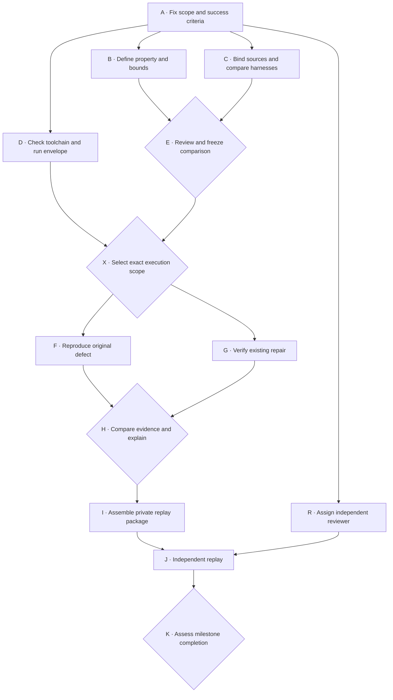

# CRABS Replay-and-Review DAG

Status: bounded replay milestone completed. Authority effect: none. Current node
evidence and assignments are in [STATE.json](crabs-replay-review-v1/STATE.json);
the completion decision is in
[COMPLETION.md](crabs-replay-review-v1/COMPLETION.md).

This DAG plans the first milestone of the [repair-assurance roadmap](repair-assurance-implementation-layering.md): independently reproduce the existing bounded CRABS defect and repair. It reuses the existing patch. New repair construction, the 48-case expansion, second-target adoption and a customer pilot are later work.

The [machine-readable DAG](repair-assurance-dag.json) owns node identities, dependencies, outputs and exit criteria. Its format is a local planning carrier, not an admitted repository schema or runtime. Goals admission remains subject to the PLAN route's recorded blocker.

## Dependency graph

All incoming dependencies are required. Diamonds are review or execution gates,
not automatic approvals. Concurrency shows independent work; it authorizes no
subagent dispatch or contact with another person.

## Work units

| ID | Work unit / proposed owner | Deliverable | Exit evidence |
| --- | --- | --- | --- |
| A | Fix scope and success criteria — Assessment lead | Scope record selecting the existing two-singleton CRABS defect/repair pair. | Name the exact bounded claim, deliverable, exclusions, and evidence required; no whole-CRABS claim. |
| B | Specify the property and bounds — Domain owner and verification engineer | Property contract with expected order equivalence, valid operations, input domain, bounds and assumptions. | Distinguish intended domain behavior from derived obligations; label manual authorship; include valid cases to reject a reject-all repair. |
| C | Bind sources and compare harnesses — Verification engineer | Original/repair source and patch manifest; property-to-code and harness-correspondence record. | Verify source identity and compare original main.assertion.1 with repair main.assertion.3 semantically; changed assertion IDs do not establish equivalence. |
| D | Check toolchain and execution envelope — Environment owner | Pinned tool availability report and exact commands, time/memory/output limits, environment and evidence destinations. | Use repository tools/toolchain/run for builds and preserve pins; unavailable dependencies remain explicit; plan fresh outputs without rewriting historical evidence. |
| R | Assign an independent reviewer — Product owner | Named reviewer, access boundary and independence disclosure. | Reviewer is distinct from patch author; assignment does not authorize contacting anyone or sharing private material. |
| E | Review and freeze comparison contract — Domain owner and reviewing engineer | Reviewed immutable property, harness mapping, source identities and comparison policy. | Confirm equivalent input domains, observations, modeled dependencies and bounds; reject weakened property, silent exclusion or vacuous success. |
| X | Select exact execution scope — Repository execution owner | Separately routed validation/implementation envelope for exact commands, sources and output paths. | Existing authorization is honored if it covers the exact effects; otherwise obtain only missing authorization. This planning request itself does not authorize runs. |
| F | Reproduce original counterexample — Evidence producer | Fresh native witness, CBMC named-property result and raw evidence bound to original bytes. | Confirm the declared counterexample; tool failure, timeout or a different failed assertion is not a reproduced subject defect. |
| G | Verify existing repair — Evidence producer | Original-witness replay, named CBMC check and relevant native regression results bound to repaired bytes. | All selected checks have typed outcomes; preserve valid behavior and the frozen property; no counterexample means only within the bound. |
| H | Compare evidence and explain result — Reviewing engineer and EVF verifier | Paired assessment, root-cause explanation, impact/reachability distinction and residual gaps. | Bind both results to the frozen comparison contract; verify integrity and comparability; preserve unresolved and conflicting evidence. |
| I | Assemble private replay package — Assessment lead | Manifest, accessible sources/patch, tool setup, exact commands, raw results, report, reviewer checklist and open questions. | A reviewer can obtain every required input within the private boundary; no reliance on conversation or undocumented local paths. |
| J | Perform independent replay — Independent reviewer | Reviewer-produced run records, corrections and comparison against original package. | Replay both subjects under the same property and bounds without author coaching; run authorization and private access must cover the reviewer environment. |
| K | Assess milestone completion — Assessment lead and independent reviewer | Signed or attributable milestone assessment with replay outcomes, costs and remaining gaps. | Declare independently reproduced bounded defect-and-repair assessment only if required evidence closes; no product approval, certification, release or deployment. |

## Frontier and scheduling

- All nodes A through K completed. Deferred items D48 and D2 remain outside this
  milestone and require separate scope and authority.
- After A, B/C/D/R have independent dependencies. Reviewer assignment can occur
  while property, harness and environment preparation proceeds.
- E depends on semantics and source/harness comparison, not tool availability.
- X joins the reviewed comparison with the exact executable environment and
  effect scope. It preserves any authorization already given; it requests no
  duplicate approval.
- F and G may execute independently after X, using isolated evidence destinations
  and a resource budget that permits concurrent execution. Serial execution is
  equally valid when resources are constrained.
- H cannot declare repair closure without both original and repaired evidence.
- R is a hard dependency of J, not a blocker of package preparation.
- There is no duration-based critical-path claim until work estimates exist.
  The dependency bottlenecks are E/X, H and J/K.

## Failure and rework

A timeout, unavailable tool, stale source, different failed assertion or missing
case remains a typed non-success outcome. Record it and leave the affected
success gate unresolved. Reporting an inconclusive result is valid, but it does
not satisfy this milestone's independent-reproduction criterion.

If the old defect does not reproduce, investigate exact source and harness
bindings; do not silently replace it with a synthetic defect. If the existing
repair fails, preserve the finding and plan a separate repair attempt.

Rework creates a new scoped attempt with explicit supersession and fresh
downstream evidence. This execution DAG remains acyclic; historical observations
are not edited and there are no automatic retry loops. A property or bound
change must be reviewed as a changed assessment, not a repair success.

## Operational support and deferred work

| Item | Owner | Exact affected node/stage | Current posture |
| --- | --- | --- | --- |
| Pinned compiler/provider availability and output limits | Environment owner | D/X, then F/G and reviewer execution | Verified for fresh GCC15 / CBMC 6.11.0 epoch; historical GCC13 unavailable |
| Exact effect scope and destination approval where missing | Execution owner | X and J environment | Local execution separately authorized by the user |
| Reviewer assignment and access | Product owner | R/J | User authorized /root/crabs_independent_replay; fresh context on shared host |
| Missing Task Session request contract | Runtime/governance owner | Later 48-case run only | Recorded blocker; no dependency edge into this milestone |
| Second target and customer pilot | Product owner | After K, separately planned | Deferred; no customer contact or access |
| Product approval, publication or deployment | Respective owner | Separate future authority boundaries | Not implied by K |

## Completion contract

K closes only when an independent reviewer reproduces the original bounded
counterexample and the existing repair's bounded result using an equivalent
property and bounds, with required regressions, integrity checks and gaps
accounted for. Record reviewer effort, setup work and provider cost.

This is proof of a reproducible assessment workflow for this case. It is not
whole-CRABS correctness, security certification or evidence that a second target
will work. Deeper evidence hardening remains in the roadmap's next layer.

## Open Questions

Scope, source availability and resource limits are resolved in [PROPERTY.md](crabs-replay-review-v1/PROPERTY.md). Reviewer assignment is recorded in STATE.json. Independent-host reproducibility, broader bounds and commercial readiness remain open; this review uses a shared host.

## Plan validation

Validate unique IDs, known dependencies, acyclicity, reachability from A to every
node, a single completion sink K, exact diagram/JSON edge agreement and local
links. These structural checks are separate from the fresh provider results linked in STATE.json. The existing repair is reused.
