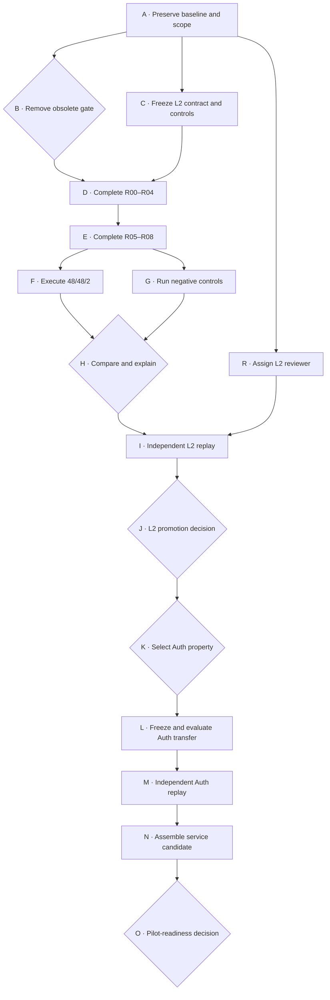

# Repair Assurance Expansion DAG

Status: L2 complete; Auth Foundation selected for L3 and ready for a fresh
freeze and replay. Task Session excluded.
Authority effect: none.

All incoming dependencies are required. Diamonds are decision or review gates.
An eligible node does not authorize its effects. Failed, inconclusive and
conflicting outcomes remain evidence and stop success promotion.

The critical dependency chain is A-B-D-E-F/H-I-J-K-L-M-N-O. C, R and G may
be prepared alongside their independent branches only when write scopes do not
overlap and authorization covers any execution.

The product owner selected Auth Foundation as the replacement L3 target on
2026-09-12. The financial-settlement assessment remains deferred evidence until
its real consumer implementation and owner are available; no surrogate consumer
may be substituted. Node L requires a new candidate epoch because two recorded
host-tool identities have drifted since the existing Auth completion evidence.

See [DAG.json](DAG.json) for node exit criteria and blockers, and
[WORK-PACK.md](WORK-PACK.md) for task/SWU mappings.

## Open Questions

See [WORK-PACK.md](WORK-PACK.md#blockers-and-open-questions).
