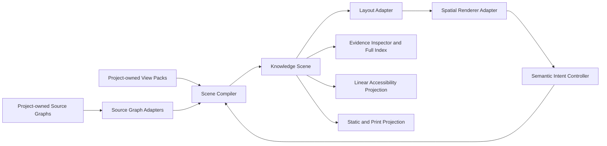
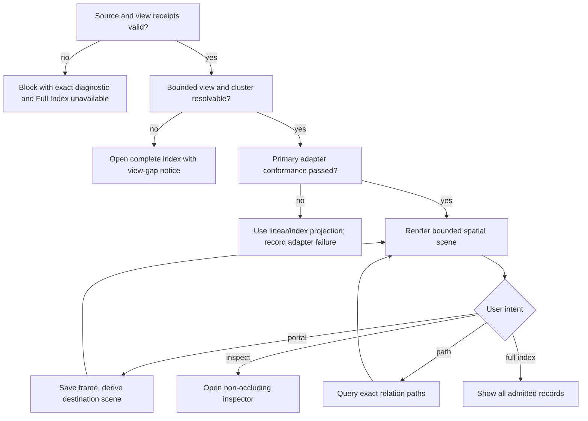

# Unified Ontology Evidence Workbench Architecture

Status: authored-complete candidate design; implementation and Plan evidence pending.  
Authority effect: none.

## 1. Context view

The OEW sits between project-owned ontology/view sources and human presentation. It reads immutable, digest-bound graph/view/evidence records; it never edits or promotes them.



The person starts in a bounded home cluster, follows real directed relations, expands Grouped Portals, compares relation-bearing paths, inspects evidence, and can always reach the complete index.

## 2. High-level structure view

| Boundary | Owns | Must not own |
|---|---|---|
| Source Graph Adapter | schema normalization, digest checks, exact identities/evidence/mapping loss | grouping, layout, user navigation |
| View Pack Compiler | typed selections, clusters, sequences, allowed readings, source proofs | source relation semantics |
| Scene Query | home/focus/path selection, internal/cut relation partition, grouped portals | coordinates, pixels, library objects |
| Navigation Store | atomic Navigation Frames, history, selection, filters, viewport, panel, focus | source truth |
| Layout Adapter | dimensions, hierarchy, ports, coordinates, bend points, label routes | cluster membership, predicates, filtering |
| Renderer Adapter | nodes, spatial paths, markers, labels, viewport, hit targets, intent emission | relation inference, evidence, Path algorithm |
| UI API Profile | development-only Page/Layout/Component/View Model/Hook/Form/Action/Guard/Binding inventory and formation evidence | source semantics, ontology authority, runtime DomainSpec dependency |
| Evidence/Index | evidence trace, authority ceiling, diagnostics, complete records | spatial relation substitutes |
| Linear/Static Adapters | equivalent reading order and printable arrows/sentences | alternate semantic graphs |

One `KnowledgeScene` revision is the boundary object. A `SceneGeometry` receipt is a separate renderer/layout artifact and may be regenerated without changing scene identity.

## 3. Low-level component view

### Core data

- `SourceNodeBinding`: source ID, kind/role, label, definition, sources, evidence, authority.
- `SourceRelationBinding`: source relation ID, endpoints, exact predicate, source direction, evidence, mapping status.
- `ViewPack`: the sole owner of stable cluster membership and view/sequence definitions referencing source IDs. Its digest is computed over canonical bytes excluding its own `view_pack_digest` field.
- `KnowledgeScene`: graph/View Pack digests, scene scope, source-identity nodes, full internal and cut relation bindings, compiled cluster visibility, Grouped Portals, legend, path result, Navigation Frame, and denominators. Node and relation keys are their exact source IDs; relation endpoints always reference source node IDs.
- `NavigationFrame`: view, scene, focus, selection, filters, viewport, panel, history origin, initiating control/focus.
- `SceneGeometry`: node boxes, ports, relation sections, labels, markers, cluster bounds, seed/input digest.

### Services

1. `compileSourceGraph(input) -> SourceGraphReceipt` rejects stale, duplicate, dangling, non-total, or unauthorized bindings.
2. `compileViewPack(source, pack) -> CompiledView` proves every reference and membership rule.
3. `deriveScene(compiledView, query, frame) -> KnowledgeScene` partitions internal and cut relations without loss; the View Pack rejects missing, overlapping, or unassigned cluster membership under `exactly-one-cluster-per-admitted-node`.
4. `groupPortals(cutRelations, destinationCluster) -> GroupedPortal[]` retains one constituent record per cut relation: exact relation ID, inside/outside endpoints, source direction, traversal direction, and destination cluster. It never infers a cluster.
5. `findPaths(sourceGraph, from, to, policy) -> PathResult[]` accepts only `directed-shortest@1.0.0` or `undirected-shortest@1.0.0`, returns at most 8 paths of at most 8 contiguous exact relation hops, and stops after 250 ms.
6. `layout(scene, stableMeasurements, options) -> SceneGeometry` uses stable ordering and a nonzero pinned seed.
7. `render(scene, geometry) -> semantic DOM/SVG + intents` maps one exact relation ID to one spatial path.
8. `restore(frame) -> scene + viewport + selection + focus` commits atomically after the target is mounted.

### Adapter capability handshake

The first spatial adapter must declare and prove: parallel-edge identity, compound/group rendering, edge labels, markers, patterns, DOM addressability, geometry evidence, keyboard hooks, viewport control, reduced-motion, forced-colors, and deterministic export capability. Missing mandatory capability fails closed before it becomes the active adapter.

React Flow `12.10.1` + ELK `0.9.3` under upstream lock SHA-256 `20342fbb10c311a3259a4f7acb367cc79b2b2ad565ede2c3e1704a797d32ed96` is the first admission candidate. Source ingestion uses controlled edge arrays; React Flow `addEdge()` is forbidden for ontology loading. Cytoscape + ELK is a non-operational alternative, not an automatic fallback: it may activate only after the same conformance suite and a semantic DOM controller pass. A primary-adapter failure degrades to the complete linear/index projection.

### DomainSpec UI API profile

`UI-API-CONTRACT.md` and `UI-API-INVENTORY.json` type the presentation API above `KnowledgeScene` through the development-only `domainspec-ui-profile/v0.1`. Page, Layout, Component, View Model, Hook, Form, Action, Guard, and durable Binding are admitted only as typed instance records that bind the exact formation-schema path/digest and carry every required field, native boolean values, individual source confidence, owner module, runtime symbol, and realization SWU. Actions map bijectively to `SemanticIntent.kind`; View Models remain source-backed and non-authoritative; Guards mirror existing rules with no decision authority. Adapter is represented by six canonical DS-D1.13 Mapping instances with source/target shape contracts, direction, deterministic transforms, and UI-boundary metadata; State Indicator remains its declared split. The OEW dashboard overlay host owns the terminal `/` route. The build owns the exact profile snapshot and compiled inventory paths recorded in the inventory and never imports the DomainSpec project at runtime. These candidates organize implementation without changing Scene schemas or gaining definition/ontology authority.

## 4. Workflow process view

### Load and home

1. Fetch local same-origin source graph, view-pack registry, evidence sidecar, and adapter receipt.
2. Verify schemas, digests, exact identity totals, no dangling references, and authority-effect ceiling.
3. Verify the build-bound OEW UI API profile receipt, all nine formation schemas/instances, owner/runtime/realization bindings, and action/intent bijection; fail visible-UI admission without changing source semantics.
4. Resolve requested View Pack or declared default.
5. Compile a bounded home scene from owner-approved cluster membership.
6. Populate and prove the complete Full Index/linear projection from the same scene/source revision.
7. Measure cards, compute deterministic geometry, and only then attempt to activate nodes and actual relation paths; retain the proven fallback if the adapter fails.

### Portal navigation

1. User activates a Grouped Portal.
2. Controller records the complete current Navigation Frame and activating element.
3. User chooses the group or one exact constituent relation.
4. Scene Query follows the endpoint outside the current scene, independent of source-edge direction.
5. New scene renders, announces its purpose/counts, and focuses its heading or chosen node.
6. Back restores the entire prior frame and activating control.

### Path

1. User selects two nodes and an admitted relation policy.
2. Query service returns zero or more exact relation-bearing paths.
3. Path view lists every hop as `source —predicate→ target`, evidence, and mapping status.
4. Selecting a hop highlights the same relation ID in the scene and inspector.

## 5. Decision flow view



The fallback is functional degradation, not semantic degradation: if the spatial adapter fails, linear/index evidence remains complete and says why geometry is unavailable.

## 6. Dependency and interface view

| Interface | Input | Output | Version/failure rule |
|---|---|---|---|
| Project source adapter | owned node/relation/evidence/view files | `SourceGraph` + digest receipt | schema-specific; reject unknown fields/duplicates/dangling refs |
| Scene compiler | SourceGraph + ViewPack + SceneQuery + NavigationFrame | `KnowledgeScene` | `oew.knowledge-scene.v1`; total source bindings |
| Layout adapter | scene IDs, hierarchy, dimensions, ports, prior positions, seed | `SceneGeometry` | pinned ELK/options/seed; byte-equal replay gate |
| Renderer adapter | KnowledgeScene + SceneGeometry | semantic DOM/SVG and intents | capability handshake; no semantic inference |
| UI API profile compiler | DomainSpec development profile + profile schema + nine formation schemas + OEW typed inventory | owned snapshot, typed build-time presentation contracts + conformance receipt | development-only; exact digests and instance fields; no runtime cross-project load or candidate promotion |
| Evidence inspector | selection + sidecar | exact source/evidence/authority/mapping view | never hides the selected spatial entity |
| Path service | SourceGraph + endpoints + policy | ordered exact relation hops | graph revision bound; no causal/workflow inference |
| Static adapter | KnowledgeScene + SceneGeometry | source-bound SVG/print | deterministic IDs, arrow order, visible relation sentences |

No product build may depend on post-build string replacement of minified JavaScript. Body War generation must compile typed source modules and data assets, then run the same validators/browser suite against the resulting owned build.

## State and navigation model

```ts
type NavigationFrame = {
  frameId: string;
  graphDigest: string;
  viewPackId: string;
  viewPackDigest: string;
  scope: "home" | "focus" | "path" | "full-index";
  focusNodeId?: string;
  pathRequest?: { fromNodeId: string; toNodeId: string; policyId: "directed-shortest" | "undirected-shortest" };
  selected: { kind: "none" | "node" | "relation" | "portal" | "path-hop"; id?: string };
  filters: Record<string, string[]>;
  indexState: { query: string; sortKey: "kind" | "label" | "predicate" | "source-id"; sortDirection: "ascending" | "descending" };
  viewport: { x: number; y: number; zoom: number };
  panel: { id: "none" | "inspector" | "filters" | "legend" | "path"; modal: boolean };
  expandedPortalIds: string[];
  initiatingControlId?: string;
  focusTargetId?: string;
  focusFallbackOrder: ("initiating-control" | "selected-entity" | "scene-heading" | "workbench-heading")[];
};
```

Frame transitions are reducer events. History stores frames, not node IDs. Restoration refuses a changed graph/View Pack digest, is cancellable while pending, waits for scene and geometry commit before applying viewport and DOM focus, and records `failed-stale-revision` or `failed-missing-target`. Filter changes create a new frame; they do not rewrite the home/focus query. The complete index always contains all admitted source rows; its query/sort produces a separately counted filtered result.

## Geometry and canonicalization

`SceneGeometry` is sorted by exact source IDs, rounded to 0.25 px, serialized as canonical JSON, and bound to the scene digest, ELK `0.9.3`, an options digest, nonzero seed, and worker mode. Determinism compares canonical geometry, not raw ELK object bytes. Endpoint distance must be at most 4 px from the declared node boundary; label and marker boxes are separate machine-addressable records.

## Prototype admission budgets

These are fail-closed prototype caps, not proven production performance: home ≤24 nodes/48 internal relations/12 Grouped Portals; focus ≤32 nodes/64 internal relations/16 portals; Path ≤8 results and ≤8 hops; query ≤250 ms; layout ≤2,000 ms; committed focus transition ≤500 ms; input-to-visible-state ≤100 ms excluding declared layout; zero long tasks above 200 ms after initial layout; renderer heap delta ≤150 MiB on the exact 276/301 fixture. The execution receipt records raw measurements and may only tighten or revise these numbers through a new owner-approved design decision.

## Visual semantics

- Relation identity: exact predicate text.
- Quick recognition: stable predicate color token.
- Redundant family/status cue: line pattern; never substitutes exact predicate.
- Direction: path orientation, endpoint arrow marker, and textual direction phrase.
- Node identity: label text; node-kind and role icons are secondary, drawn from separate registries.
- Cluster portal: category icon + cluster label + purpose + destination node/relation counts + up to three predicate summaries; expand exposes all constituents.
- Selection/status/authority: badges or outlines that do not override predicate color.

Thirty-nine simultaneous legend items are not shown by default. The legend lists cues currently visible in the scene, with search/filter access to the complete registry.

## Responsive and accessibility contract

- Desktop: graph and non-modal inspector may coexist only when neither occludes selected nodes/edges; otherwise inspector is a resizable region.
- Narrow viewport: inspector/filter/path becomes one modal sheet with heading, close, focus trap, and return-focus contract; graph remains behind but inert while modal.
- Keyboard: graph has a documented entry point; nodes/relations/portals are reachable through roving or linear projection; Escape closes transient surfaces; Back restores the initiating control.
- Forced colors: relation paths, markers, selection, and portal boundaries remain perceivable through current color plus pattern/border/text.
- Reduced motion: animated layout/viewport transitions are disabled; state changes remain announced.
- The complete linear/index projection is not a hidden accessibility afterthought; it is a first-class equivalent inspection path.

## Decisions and risks

| ID | Decision | Risk/control |
|---|---|---|
| ADR-01 | One scene model, multiple adapters | God-object risk: separate source, scene, geometry, navigation schemas |
| ADR-02 | React Flow + ELK first admission | DOM/performance and multiedge risk: full fixture gate, no `addEdge()` ingestion |
| ADR-03 | Cytoscape + ELK fallback | Canvas a11y risk: semantic DOM required before activation |
| ADR-04 | Source-owned clusters only | Missing registry: degrade to view selection/index, never infer authoritative groups from layout |
| ADR-05 | Exact predicate + redundant cues | 39-color overload: contextual legend and text primary |
| ADR-06 | Source-owned build | Migration cost: keep retained bundle only as comparison baseline, never patch it as final path |
| ADR-07 | DomainSpec development UI profile types the presentation API | Candidate-authority/circularity risk: bind exact profile digest, keep authority none, require separating negatives, and return only append-only corpus evidence |

## Evidence ceiling

This design is authored-complete only. Planned schemas and fixtures are not executed evidence. The Design selection validator receipt controls whether normal planning may proceed; the Plan must start at `plan-evidence-pending`.
