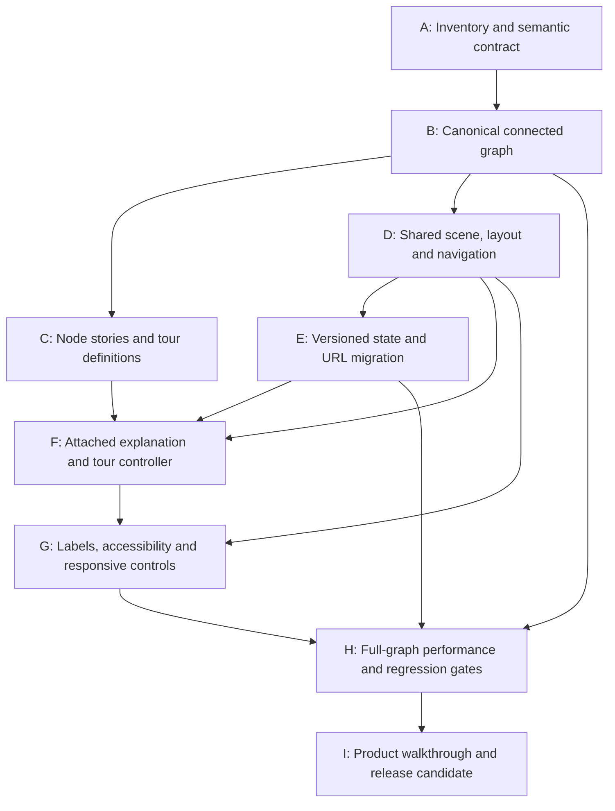

# Explorer product plan

Status: implementation and local candidate validation complete after user authorization. Date: 2026-09-18.
No deployment or release approval is implied.
Scope: Explore the engine, its documentation entry links, and tour entry links.
Owner: product owner; implementation owner: ARE documentation maintainer.

## Objective and confirmed decisions

One connected, stable graph explains the engine across workflows. A workflow chooses
where to focus and which path to highlight; it does not replace a graph. A guided
tour tells the story at each node, with a short attached explanation and highlighted
nodes and relations. It never opens a modal or automatically opens the full manual.

The user confirmed: remove persistent connection labels and redundant badges;
keep node titles and accessible descriptions. Preserve capability limits and
prototype/off-by-default facts in relevant node explanations and full guides.

## Planning baseline (before implementation)

- `src/CanvasGraph.tsx` owns one ReactFlow instance but builds feature nodes only
  from `featureMaps[feature]`. Navigation swaps the feature subgraph.
- Inventory baseline: nine feature maps contain 88 parts and 95 local relations,
  before merging with eight core components. Repeated titles include Runtime
  journal, Reasoning State, and Secret provider; matching titles alone do not prove
  identical meaning. The final node count is an audit result, not a target.
- `src/featureMaps.ts` uses array indices for IDs and local connections. Related
  features are links, not explicit inter-feature graph relationships. The same
  concepts appear in multiple maps and need an identity review before merging.
- Current core-to-feature edges all target a feature's first node and say “feature
  detail.” This documents association; it does not establish a real runtime flow.
- `src/main.tsx` sends core-node selection into `openCard`; this opens a whole guide.
  It is a canvas card, not a modal in current code. The requested tour must use a
  separate, explicit node-explanation action instead of this guide-opening behavior.
- `src/GuidedWalkthrough.tsx` is a separate landing-page illustration, not an
  explorer tour controller. `ExplanationPaths.tsx` switches illustration/live chat.
  The default entry is live chat; the walkthrough is selected only by
  `?explanation=walkthrough`. Keep Try ARE/live-chat entry behavior separate. Add
  an explicit Start guided tour control in Explore and a distinct landing tour
  link; reuse vetted story content rather than importing the landing component.
- Feature positions/views live in module-level variables; guide cards use versioned
  session storage. Focus relies on 100/120 ms timers and separate controllers.
- Feature nodes have no attached story controls; highlighting is mainly a core lens
  effect. All relation labels stay visible and compete for space.
- Layout and sidebar now have tested space/scroll targets, but tests only exercise
  one feature map at a time. They do not prove a complete graph or tour usability.

## Intended experience

Open Explore: a fresh session focuses the first feature, with shared node icons and readable titles. Saved views take precedence. Show all reveals the complete connected engine.
Choose a workflow: focus its path in that same graph. Show all restores context.
Choose a node: show its explanation attached to that node. Related-node actions pan
to the destination; they do not swap graph data. “Read full guide” is an explicit
optional action and returns to the same node, position, and tour step.

Start tour: focus its first node and show a short explanation: what arrives, what
this node does, what leaves, and why the next relation matters. Back/Next/Exit stay
in the attached explanation. A step may highlight several nodes and edges while
one node owns the explanation. The complete story is never dumped into a modal.
Manual pan pauses camera following; “Follow step” resumes it. Selecting another
node pauses the tour rather than silently advancing. Exit clears tour emphasis
and retains the user's layout. No automatic timed progression.

Keep one active explanation by default. Every semantic node has its own authored
story and source references; users may inspect it without starting a tour. Full
manual cards remain optional reading tools, not tour steps.

## DAG

| Task | Dependencies | Implementation and completion evidence |
| --- | --- | --- |
| A | None | Inventory all nine feature maps, eight core concepts, workflow paths, route entry points, manual references, and tour/live-demo entries. Map repeated concepts to stable semantic IDs. Every retained node and edge has a source and a defined meaning. Fix the shared camera/state interface before D/E: ordered focus requests, measured-node readiness, cancellation, manual-pan pause, and reduced-motion behavior. |
| B | A | Add `engineGraph.ts` with stable nodes/typed edges and workflow memberships. Replace array-index identity. Resolve genuine shared concepts; preserve distinct lifecycle states. Add only source-supported inter-feature relations. Validate IDs, endpoints, workflow reachability, and one weakly connected semantic graph. Cycles are allowed in the engine; the implementation plan is the DAG. Documentation associations cannot be used to fake runtime connectivity. Optional reading cards are excluded from semantic connectivity and Show all bounds; Fit workspace may include them as an explicit separate action. |
| C | B | Add `engineStories.ts` and `engineTours.ts`. Every node gets concise explanation, source section, and relevant limits. Steps reference canonical node and edge IDs; each transition has an authored rationale. Start with one complete request-to-continuation tour, then four workflow tours using the existing reading paths. |
| D | B | Render the complete graph in `CanvasGraph.tsx`; workflow selection changes focus/emphasis only. Use deterministic authored regions, stable positions, route focus, Show all, Fit workflow, search, and focus recovery. Minimize edge crossings. Compute full-graph bounds and a fitted overview zoom; do not assume the current minimum zoom of 0.35 can show the complete graph. Overview uses simple node marks/titles; selected regions and explanations use a readable zoom. Zoom detail never changes semantic identity or connectivity. Layout never resets on selection. Avoid a new layout dependency until the authored layout is measured. Complete an early full-graph bounds/render/download spike here; failures block F rather than waiting for the final H gate. |
| E | B, D | Unify feature positions, guide cards, viewport and selection under versioned workspace state; remove module globals. Migrate current workspace and legacy feature/guide/node/card routes. Keep aliases for old IDs. Separate graph/content/schema versions. Share the new viewport limits with D (the current validator rejects zoom below 0.35). Validate malformed or stale state, bound storage, preserve guide offsets, and define reset. A single camera coordinator waits for measured nodes rather than arbitrary timers. |
| F | C, D, E | Build a reducer/state machine for idle/running/paused/completed tour states. Render one accessible node-attached explanation. Highlight explicit step nodes/edges with strong outline/stroke and subdued surroundings. Back/Next/Exit, branch/related navigation, full-reader return and manual-pan behavior must work without graph replacement, camera races or unexpected guide cards. |
| G | D, F | Remove edge text renderers/labels and redundant header badges/counts; retain edge meaning in node stories and an accessible relationship list. Keep titles. Provide keyboard node selection, clear focus, live step announcement, reduced motion, touch controls and readable anchored explanation placement. No modal role, backdrop, focus trap, or required hover. Preserve sidebar isolation and canvas targets. |
| H | B, E, G | Test the complete semantic graph, all workflow tours and stale-state cases. Benchmark tour stepping, panning, zooming, dragging and explanation/card scrolling on full data, desktop/mobile and reduced motion. Compare against current budgets. Replace tests that assume one selected feature's nodes are the whole graph or demand status badges; verify required limits in node explanations instead. |
| I | H | Verify a first-time user can understand a full path, change workflow without losing context, inspect a relation and return from a manual. Capture desktop/mobile and keyboard-only evidence, review content accuracy and unresolved failures, update architecture/navigation docs and release notes. Produce a tested candidate for owner review. |

Execution order: A → B → (C and D); D → E; (C, D and E) → F → G → H → I.
Story drafts may start during A, but final story/tour bindings depend on B.
These are dependency lanes, not an instruction to spawn additional agents.

## Proposed route and state contract

Keep the existing `view` entry routes. Treat `feature`/legacy `guide` as workflow
focus aliases; they never choose graph membership. Preserve explicit `card` links
for full guide cards. Resolve legacy `node` links through a reviewed alias table.
Add stable `tour`, `step`, and selected-node fields after B defines the canonical
identities. Tour links load the full graph before resolving their focus target.
Unknown or removed targets show a recovery action, not a silent jump to step one.
Direct node selection and search inspect nodes. Only explicit card/manual actions
open full guide content. Preserve legacy `node` + `page=1` full-reader behavior;
`card` remains an explicit reading action. Contradictory tour/node/card destinations
show a recovery choice rather than silently running competing handlers.

The camera coordinator processes the latest explicit navigation or step request
and cancels older requests; it does not replay a stale focus after manual pan.
Manual pan pauses following. Restore a saved viewport only when there is no new
explicit target. Unmount/reset cancels pending work. Full-reader return restores
the selected node, paused tour step and keyboard focus to its explanation trigger.
Persist stable tour/step IDs and layout, not DOM state or in-flight animations.
Reload restores an active tour as paused. Content/schema migration prunes removed
IDs while retaining unaffected cards, positions and reading offsets. Reset clears
cards, graph layout, focus and tour state deliberately.

## Acceptance and performance gates

- Graph node/edge identities remain stable across workflow selection, tour steps,
  browser back/forward and manual return. No feature array swap or forced remount
  while exploring, switching workflows, or stepping through a tour, except reset.
  Opening the full article may unmount the explorer as it does today; returning
  must restore the same semantic IDs, positions, viewport, tour step and focus.
  Tests distinguish restored state from actual DOM retention. Every semantic node is reachable from the entry
  in the undirected projection; directed paths must separately match documented
  behavior. No invented connector solely to pass the connectivity check.
- All node stories and tour references resolve. Highlight sets match the authored
  step, and remain visible through pan/zoom. No persistent connection labels.
- No automatic full guide card or modal when starting/advancing a tour. Attached
  explanation remains linked to its owner during drag, zoom, and resize, stays
  readable, and does not cover the owner or navigation controls.
- Keyboard-only and touch users can complete, pause, restart and exit each tour.
  Each node has one clear keyboard activation target. Escape closes its explanation
  and pauses an active tour, returning focus to the owner node. Explicit Exit clears
  tour state and returns focus to the tour launcher.
  Non-color cues identify active nodes/edges. Reduced motion removes camera/edge
  animation. The text relationship view preserves removed label information.
- Preserve measured header sizing and current graph-height floors: 75% of remaining
  viewport on desktop and 48% on mobile with navigation open; hiding it increases
  area. Sidebar/explanation scrolling never pans the graph or scrolls the page.
- Keep current canvas download ceilings: 180 KiB gzip and 550 KiB decoded. Latest
  build is about 166.5 KiB gzip / 541.2 KiB decoded: decoded headroom is small.
  Audit `documentationContent.ts`, which currently imports the complete manual
  JSON, before adding stories. Defer rich guide loading or split content if needed.
  Measure the union of graph and visited tour payloads, not just the cold route;
  report full-guide loads separately under their route budget and cumulative
  transfer. Do not raise the ceiling or hide bytes behind lazy loading.
- Retain structural scroll gates: zero App/card rerenders, zero Markdown reparses,
  zero canvas remounts, unchanged viewport and at most three coalesced storage
  writes in the existing 32-wheel-event workload. Add equivalent explanation tests.
- Add performance fixtures for all graph nodes/edges plus nine open guide cards
  and an active explanation. Proposed dedicated-host targets: p95 step response
  <=100 ms excluding optional camera animation, p95 pan/zoom frame <=33 ms, no
  application long task >100 ms in the measured workload. Record device/browser,
  warm-up and repeated samples; shared-host timing remains diagnostic until a
  reproducible reference environment is available. No invented FPS claims.

## Implementation choice and research

Reuse React Flow. Its NodeToolbar provides node-anchored content that stays the
same size while zooming; evaluate it for the explanation with collision/viewport
clamping and focus tests before adopting it. It is not a reason to add a modal tour
library. ViewportPortal is an alternative if world-space attachment is necessary.
The installed NodeToolbar typings expose `nodeId`, `isVisible`, and `position`;
the installed ReactFlow instance exposes `fitView`, `getNodesBounds`, and
`viewportInitialized`. This establishes API availability, not collision handling
or accessible focus behavior; the anchored prototype must verify those.

Sources: [Node Toolbar](https://reactflow.dev/examples/nodes/node-toolbar),
[performance guidance](https://reactflow.dev/learn/advanced-use/performance),
[accessibility](https://reactflow.dev/learn/advanced-use/accessibility).

## Whole-page review coverage

H/I also cover direct-entry and loading states, unknown node/workflow/tour IDs,
failed content loading with a usable retry, empty search results, unavailable or
full storage, browser reload/back/forward, and reset while a tour is active. These
must show a small explanation and a recovery action without hiding the canvas.
Keep a visible Show all/Fit selection escape route after pan or navigation.

Test 320px/390px portrait and landscape screens, resizing with an open explanation,
200% browser zoom, keyboard focus visibility and return, and touch pan versus text
scroll. Include Chromium, Firefox, and WebKit smoke coverage for the supported
browser matrix; record untested browsers rather than treating Chromium as proof
for all browsers. Preview content and walkthrough snapshots must not imply live
execution, model learning being enabled, or measured quality gains.

## Construction frontier and operational support

Current frontier: local implementation and validation. The user authorized execution
after the independent plan review. Source changes and their evidence are recorded
in the execution table below. This does not imply deployment or release approval.

Operational support: maintainer owns the reproducible performance environment (H);
product owner owns final content/product review (I); deployment owner owns packaging,
release authorization and deployment after I. No deployment, licensing rewrite,
backend/provider work or model benchmark is a prerequisite for the local explorer
construction. The missing full-graph/tour evidence is a real blocker to a
product-ready claim; unrelated repository governance validation does not block
preparing this candidate plan.

## Independent review disposition

[Subagent review](EXPLORER-PRODUCT-REVIEW.md) found two high-priority dependency/layout
gaps, seven medium implementation/test gaps and one low entry-route clarification.
All have been incorporated: B precedes final C; D defines bounds/zoom before E;
A owns the shared camera interface; D includes an early complete-graph spike;
E defines URL/reload/reader focus policy; semantic fit excludes guide cards;
G/H test attached explanations, removed badges, page recovery, and visited-tour
payloads. The review confirms feasibility, not implemented behavior or release.
No source code or benchmark results were changed during the planning round.
The subsequent implementation is recorded below.

## Execution record

| Tasks | Delivered implementation | Evidence |
| --- | --- | --- |
| A–B | 73 semantic nodes, 105 source-backed relations; shared concepts merged and legacy identities frozen | [Graph inventory](evidence/product-explorer/graph-inventory.json), `engine-graph.test.mjs` |
| C | Stories for every node and five authored tours | `engineStories.ts`, `engineTours.ts`, graph contract tests |
| D–E | One scene; feature and eight property views focus it; measured camera, schema-2 migration and legacy URLs | Complete-graph, workspace and recovery checks |
| F–G | Attached explanations, relation highlights, tour controls, compact navigation, independent scrolling | Desktop, mobile, keyboard and layout checks |
| H | Isolated production build, route byte budgets, browser proofs and full-graph/card workloads | [Candidate receipt](evidence/product-explorer/candidate.json) |
| I | Architecture and local candidate notes with test evidence and explicit support limits | [Architecture](ENGINE-EXPLORER-ARCHITECTURE.md), [candidate notes](EXPLORER-RELEASE-NOTES.md) |

The scripted reader journey checks inspection, workflow changes and manual return.
It is not a human comprehension study. The final receipt determines validation
status; unavailable browsers and diagnostic timing are not converted into passes.

## Open Questions

- Which fixed device/browser owns timing gates? Shared-host timings are diagnostic;
  structural and download gates apply now.
- WebKit needs a host with its required libraries before Safari support is claimed.
- Collect human first-time-reader feedback before claiming comprehension gains.
- Actual browser-control zoom and broader assistive-technology coverage remain
  distinct from the tested 200% geometry emulation. No WCAG certification is claimed.

