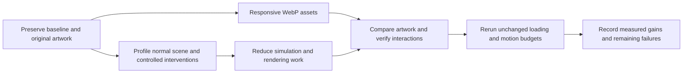

# Hero performance optimization

Owner-directed implementation, 2026-09-18. Original question: asset weight, loading time
and animation fluidity. Baseline: [PAGE-PERFORMANCE-BASELINE.md](PAGE-PERFORMANCE-BASELINE.md).
Operational scope is local preview and build; no deployment or release is included.

## Hypotheses and construction DAG

H1: five eagerly loaded PNGs dominate cold transfer. H2: background computation and
repeated scene updates contribute to transition stalls. A one-sample diagnostic with the
background disabled reduced script time, while removing filters alone did not initially
help; that directed the first CPU optimization. Diagnostic interventions are not shipped.

## Implementation

- Preserve five original PNGs in `source-assets/cyber-engine`. Generate transparent 384px
  and 768px WebP variants with reproducible settings and source/output SHA-256 hashes.
  Responsive selection preserves a higher-resolution option without forcing every visitor
  to decode it. `scripts/check-hero-assets.mjs` verifies built hashes, source provenance,
  a 1.25 MiB combined-family ceiling and the absence of original PNGs from runtime output.
- Integrate the slow decorative flow at its 30 Hz drawing cadence, subdividing longer
  stalls. Stop repeating boundary corrections when no correction occurred. Remove per-dot
  projection allocations and repeated trigonometry. Preserve point count and seeded flow.
- Batch background dots by opacity rather than issuing 1,100 individual fills. Maximum
  alpha quantization difference is 1/64; positions, radii and color remain unchanged.
- Render the 96 decorative story particles to a canvas using the same Anime.js object
  targets, coordinates, easing and stagger timings. Labels, diagrams and interactive
  components remain SVG/HTML. This removes per-point SVG attribute updates.
- Remove an unused inherited CSS custom property updated each frame. Stop seeking the
  replaced SVG timeline once chapter four hides it, preserving the logical playhead,
  replay and reverse navigation.

The vendored library already supports [JavaScript object targets](https://animejs.com/documentation/animation/targets/javascript-objects/);
its local narrow type declaration now includes that supported use. No animation library
or runtime dependency was added.

## Verification and evidence

- Production build, type checks, existing JS/CSS budgets and both image-family checks pass.
- Eleven particle-flow, benchmark-calculation and download-budget unit tests pass.
- `scripts/hero-optimization-proof.mjs` compares original PNG and optimized WebP renders at
  the same displayed size, verifies decoded responsive assets, visible canvas pixels,
  context-scene changes, assembly, chapter navigation and exact reverse point-cloud restore.
  Screenshots: `evidence/performance/hero-visual/`. Manual inspection retained engine detail
  and transparency at the reviewed desktop/mobile sizes.
- `scripts/sculptures-proof.mjs` passes loop, shared pause, reduced motion, offscreen/hidden
  suspension, navigation, fallback and seven responsive-size checks.
- Controlled profiling: `evidence/performance/hero-profile-before.json` and
  `hero-profile.json`. Normal-scene sampled script duration fell from 1.397 s to 0.349 s,
  and style recalculation from 0.481 s to 0.055 s over roughly three seconds. Single samples
  locate costs; they are not guarantees or substitutes for the repeated benchmark.
- Original full benchmark: `evidence/performance/page-before-optimization.json`.
  Final repeated comparison: `evidence/performance/page-current.json`.

Rebuild images with `npm run assets:hero`; run performance acceptance with
`npm run benchmark:page`. The loading and frame-time limits remain unchanged.

## Final repeated result

Twelve page loads completed with no unexpected HTTP/browser errors. Overall **FAIL**:
mobile cold-loading and several motion samples still exceed the unchanged budgets.
The figures below are nearest-rank p75 of three repetitions per profile/cache state.

| Measurement | Before | After | Target |
| --- | --- | --- | --- |
| Initial transfer | 9.38 MiB | 0.495 MiB | ≤2 MiB |
| Initial image response bodies | 9.23 MiB | 0.340 MiB | ≤1.5 MiB |
| Estimated decoded image RGBA | 31.24 MiB | 4.06 MiB | Informational |
| Desktop cold readiness | 8.49 s | 1.41 s | ≤3 s |
| Desktop cold LCP snapshot | 8.51 s | 1.26 s | ≤2.5 s |
| Mobile cold readiness | 21.11 s | 4.81 s | ≤3 s |
| Mobile cold LCP snapshot | 21.02 s | 3.44 s | ≤2.5 s |
| Mobile warm readiness | 2.45 s | 1.75 s | ≤3 s |
| CLS | ≤0.00136 | 0 | ≤0.1 |

Initial transfer is down **94.7%**. Mobile cold readiness varied from 1.98 s to 4.81 s;
the slower samples are retained, not discarded. During the run the shared WSL host had
approximately 4 GiB of swap occupied; this is an observed limitation, not proof that host
pressure caused all remaining failures or grounds to waive the budgets.

Across three repetitions, desktop assembly frame-interval p95 was 33–50 ms, transitions
17–67 ms, and final/explanation loops about 17 ms. Mobile assembly was 33–67 ms and
transitions 33–83 ms, improved from the baseline's 50–200 ms assembly and 67–350 ms
transitions. Some final/explanation mobile samples still exceeded 25 ms.
Control-response proxy was 23–37 ms desktop and 126–222 ms mobile (one failure above
200 ms). Phase timing and zero paused-clock advancement passed all six motion runs.

Next unresolved performance work: investigate assembly compositing/paint on a controlled
Windows Chrome run, then compare any further changes against these same budgets. Extra
compositor layers are a hypothesis to test, not an unmeasured shipped change; see
[Chrome animation guidance](https://web.dev/articles/animations-guide). Layer promotion
can trade paint work for memory, so blanket `will-change` is not assumed to be a fix.

## Open Questions

Physical Windows Chrome/GPU validation and deployed cache/compression remain owned by
[the benchmark method](PAGE-PERFORMANCE.md#open-questions). Headless WSL timing can expose
stalls but cannot certify physical display smoothness. Product frontier: optimized local
candidate and repeatable evidence; hosting owner handles any later deployment separately.
