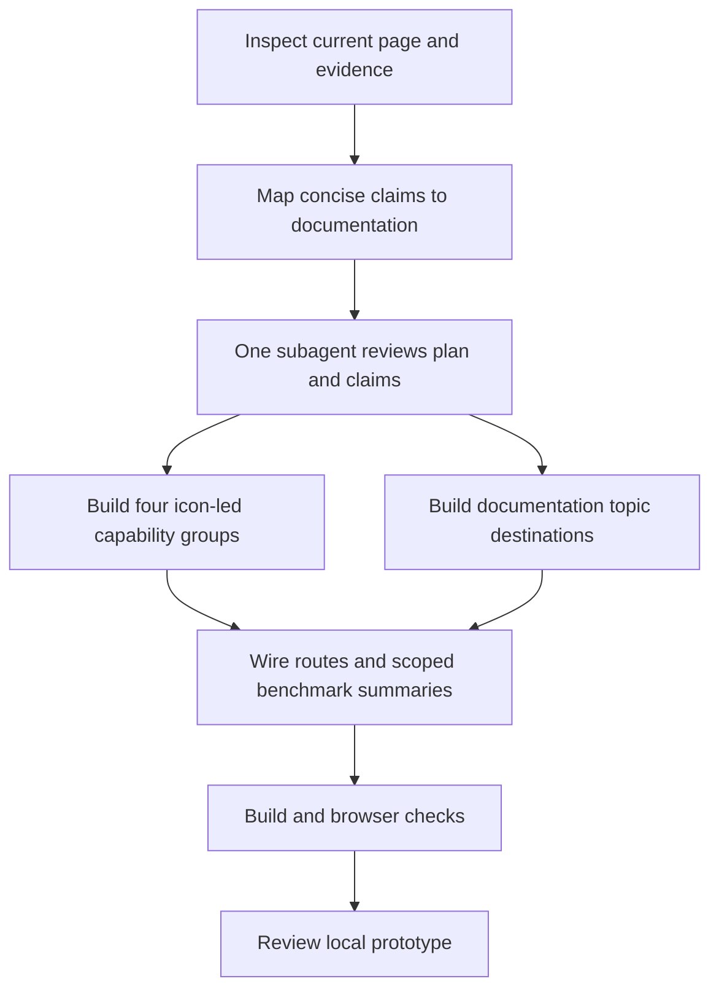

# Landing capabilities update

Owner-directed prototype implementation, 2026-09-18. Source claims: [inventory](PRODUCT-VALUE-INVENTORY.md). No deployment or engine changes.

## Objective and D65 boundary

Show product breadth through short icon-led capability lists and scoped evidence; move detail into working documentation destinations. Current product frontier: landing content and navigation. Runnable work: components, topic pages, routes, styles, build and browser checks. Write ceiling: this prototype only. Existing hero motion and live chat remain integrated. No new provider calls or ontology selectors are required. Operational hosting and recovery of historical raw benchmark files are deferred; missing raw evidence must remain visible in benchmark documentation.

## DAG

## Acceptance

- Four groups: Understand and adapt; Keep work connected; Act and verify; Connect your tools.
- Each capability has icon, title, one sentence and an actual documentation link. No landing accordion or heavy card grid.
- Runtime, Codex, gateway, client/backend/model/retrieval adapters are represented.
- Three evidence summaries retain model, sample and measured outcome. Documentation explains controls, limitations, historical evidence availability and unsuccessful transfer.
- Hash links support direct navigation, browser back, keyboard access and narrow panes. Unknown documentation topics have a clear recovery link.
- Preserve live chat and hero behavior; do not restore simulated conversation.
- Run production build and browser checks at wide, mobile and 240px embedded widths. No live model calls needed.

## Review and completion

One reviewer approved proceeding with refinements: per-capability topic anchors, adjacent metric scope, missing-raw-run and manifest-drift disclosure, preserved chat/canvas routes, focus/back behavior, corrected gateway copy, and supersession of the earlier expanded landing layout. All were incorporated. Build passes (Vite reports the 509 kB bundle-size advisory); 34 browser checks plus keyboard Enter/focus verification passed at 1366, 390 and 240px. Browser verification is recorded in `evidence/capabilities-proof.json`.

## Open Questions

Public hosting and raw benchmark archive recovery remain owned by [inventory](PRODUCT-VALUE-INVENTORY.md) and [visitor plan](VISITOR-CHAT-PLAN.md). The topic pages document current scope; they do not certify every host/provider integration.
