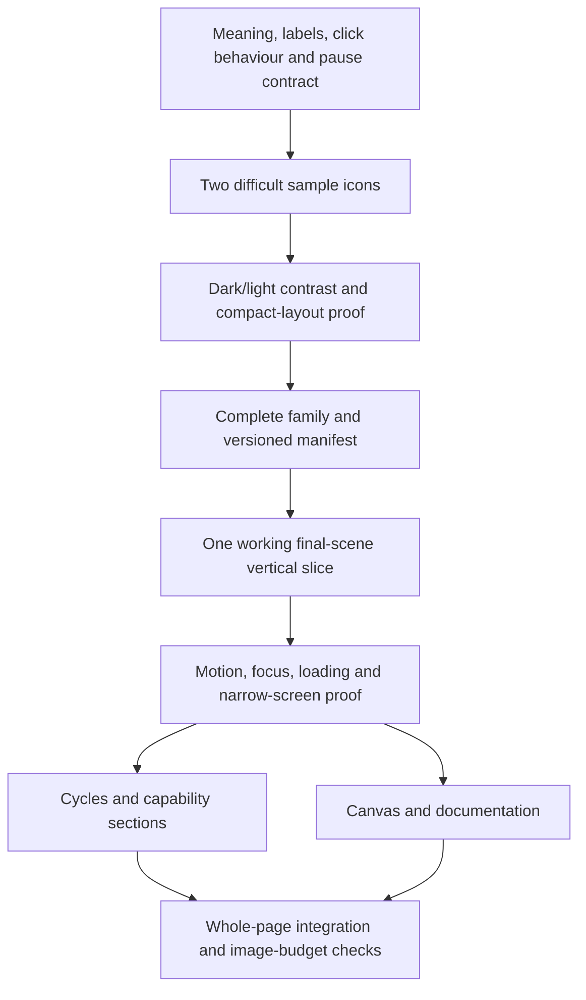

# Light Sculptures plan audit

Status: reviewed proposal; no product implementation changed. Request `are-plan-audit-120`.
Audited plan: `LIGHT-SCULPTURES-PLAN.md`. The findings below are plan amendments proposed
for the next revision, not a claim that implementation or accessibility conformance passed.

## Highest-priority findings

1. **Interaction contract missing.** `Hero.tsx` marks the illustration and map labels
   aria-hidden. Canvas nodes are real buttons. Reusing the same artwork can suggest that
   the hero nodes are clickable when they are not. Decide explicitly: recommended final
   hero nodes are labelled links to their existing canvas/document destinations, with
   visible focus and one short exploration hint. If approved, remove hiding only for the
   meaningful interactive layer, use real HTML links, and make non-current scene controls
   inert/unmounted. Never insert focusable content inside aria-hidden ancestors. Supporting
   illustrations stay decorative and must not impersonate interactive controls.
2. **Pause is under-specified and fades away.** `hero.css` hides `.intro-controls` after
   introduction for fine pointers. Keep Pause discoverable throughout continuous playback;
   chapter navigation may still fade. Define one session-level user pause preference shared
   across hero, cycle diagram, canvas signals and particles, distinct from temporary
   offscreen suspension. Returning to a route or clicking a chapter must not silently erase
   it. OS reduced motion takes precedence. Explicit replay behaviour must be documented.
3. **Eight abstract blue shapes can become indistinguishable.** Existing Evidence is layered
   sheets; proposed Context and Progress could look like variants of it. Define silhouette,
   visual weight, viewing angle, transparent padding and brightest-point rules first. Validate
   at actual rendered size with labels on both backgrounds. Generate two difficult assets
   (Context and Progress) before the remaining four; reject confusing forms before rollout.
4. **Light canvas plus dimming is a compounded contrast risk.** `style.css` applies opacity
   .44 to dim components (.55 on narrow screens), including labels. Darkening the PNG alone
   does not address this. Keep labels/focus affordances legible in every lens. Separate
   ornamental glow opacity from the meaningful silhouette and label. Use outline/shape plus
   text for selection, rather than brightness alone. Removing the badge must not remove the
   only focus/selection indication. Meaningful graphical cues and controls need contrast;
   this does not mean every decorative glow pixel needs a 3:1 ratio.
5. **Small viewport is not the same as zoomed canvas.** Graph zoom transforms artwork,
   labels and click targets together. Test 320px viewport, 200% browser zoom, minimum graph
   zoom, restored workspace zoom, and touch separately. Declare a low-zoom line-glyph mode
   or equivalent accessible component list. Fixed hit boxes must not scale or move with
   decorative breathing. Use actual parent/container dimensions, not only viewport width.
6. **Continuous motion may imply false runtime behaviour.** A spinning final map can look
   like execution or self-improvement happening now. Keep a calm rest and conceptual context.
   Hero hub-and-spoke paths are explanatory membership, whereas `data.ts` relationships are
   directed interactions: do not animate a supposedly real workflow over arbitrary spokes.
   Explicitly author representative paths for act/check/continue and ask/blocked outcomes;
   never imply every task must visit every station or permissions always approve.

## Missing implementation contracts

- Model motion as scene, playhead, userPaused, reducedMotion, intersectionVisible and
  documentVisible. Derive running state. Specify seek/finish/rest/replay transitions and
  reset timestamp on resume to prevent catch-up jumps. Freeze CSS, Anime.js and RAF together.
  Hero currently queues RAF continuously even while inactive; stop scheduling rather than
  merely skipping state changes. ParticleSurface already demonstrates scoped cancellation.
- Use transform wrappers with a single owner each: scene positioning, entry timeline,
  ambient icon movement, selection. Do not let CSS transforms overwrite Anime.js values.
  Clean up scopes, observers and RAFs on route changes and React StrictMode remounts.
- HTML icon and SVG image renderers need different markup; selectors such as
  `.icon-border svg` and `.map-station .component-glyph` will not style HTML images.
  Define explicit classes/size tokens. Preserve stable React Flow node box and handle
  coordinates; decorative image resizing must not invalidate existing persisted layouts.
- Labels must come from the same semantic registry as component identity and destination,
  with documented short presentation labels. Current hero, data and capability names differ.
  Do not modify canonical product definitions just to make a short label fit.
- Loading/failure: reserve dimensions, serve correctly under the app base URL, decode before
  revealing an icon, provide the correct existing line glyph if loading fails. Unknown IDs
  produce a development error and neutral labelled fallback, never a misleading Goal icon.
  No alpha hit-testing: the full stable button area is the pointer target.
- Asset ownership: pick one manifest as the source; explicitly copy versioned exports to each
  build with checksums rather than coupling KELD to an A.R.E dev-server path. Include public
  chat packaging/security checks for new static assets. Do not eagerly load all icons on
  documentation-only routes or preload every asset at page entry.
- Account for actual unique image downloads, decoded pixel memory, active CSS filters and
  animation work, not just compressed file size. Existing JS/CSS budget intentionally omits
  images. The 300 KiB figure is a proposed target, not demonstrated evidence. Add an image
  budget rather than silently changing the meaning of existing JS/CSS budget fields.
- Repeated components need scoped SVG IDs. Do not use decorative motion as a live-region
  announcement. Expose a stable textual equivalent for the final map and relationships.
- Test state transitions, not only screenshots: seek into/out of scene 4, pause during entry,
  scroll away/back while paused, background/foreground tab, reduced-motion toggle during
  playback, route away/back, failed asset loads, long labels and keyboard-only traversal.
  Focus and click targets must remain stable while artwork moves. Run motion-enabled tests
  separately from existing canvas proof, which starts with reducedMotion:'reduce'.
- Layer claims separately: emitted build, readable assets, interaction behaviour, screenshot
  review and accessibility/performance evidence. A screenshot or HTTP 200 does not prove the
  whole page works. Do not reuse pre-change layout evidence as current validation.

## Revised construction order

The first implementation should stop at a reviewable final-scene slice before broad rollout;
this is a quality checkpoint, not an extra approval demand beyond the user's authorization.
Prefer static capability artwork while reading. Only the active/visible explanatory scene
needs a loop; simultaneous visible scenes must still respect the shared pause preference.

## Standards references

- W3C [Pause, Stop, Hide](https://www.w3.org/WAI/WCAG21/Understanding/pause-stop-hide.html):
  automatically moving content longer than five seconds alongside other content requires a
  pause/stop/hide mechanism unless essential. Reduced motion alone is not that mechanism.
- W3C [Non-text Contrast](https://www.w3.org/WAI/WCAG22/understanding/non-text-contrast.html):
  required graphical/control/state cues have 3:1 adjacent contrast requirements, with exceptions.
- W3C [Target Size Minimum](https://www.w3.org/WAI/WCAG22/Understanding/target-size-minimum.html):
  24×24 CSS px minimum or specified exceptions. Aim for 44px touch controls as a design target;
  do not confuse that target with the AA minimum or nominal pre-zoom node dimensions.

## Scope and open questions

This audit is evidence for revising the plan; implementation remains untouched. Exact
ontology selector dependencies: none. Operational residue is unchanged: owner visual
acceptance, hosting and workstation maintenance are not authorized by this audit.

Open decisions: final-scene links versus explicitly illustrative nodes; exact shared pause
persistence lifetime (recommended current session); compact final-scene arrangement and
low-zoom canvas strategy. Proposed defaults above should be resolved in the plan before code.
Related questions remain owned by `LIGHT-SCULPTURES-PLAN.md`.
