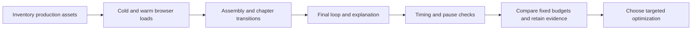

# Page loading and motion benchmark

Owner-directed local implementation, 2026-09-18. Authority effect: none.
Objective: measure full browser loading and animation cost before optimizing the artwork.
This extends the existing route JS/CSS budgets, icon byte budget and canvas benchmark.

Measured results: [original baseline](PAGE-PERFORMANCE-BASELINE.md),
[first optimization](HERO-PERFORMANCE-OPTIMIZATION.md), and
[second pass with worker rendering and route-scoped preloads](PERFORMANCE-PASS-2.md).
Initial transfer is about 0.50 MiB. Desktop cold readiness is 0.98 s; mobile cold readiness
is 3.14 s, still above 3 s. LCP, control-response proxies, pause and phase timing pass this
run, but early motion and some final-loop samples still fail. Mobile warm readiness and
some desktop motion samples regressed. Overall status remains **FAIL**.

## Run

```sh
npm run benchmark:page
# Faster diagnostic after building (not the three-repeat acceptance run):
node scripts/benchmark-page.mjs --repeats=1 --profile=desktop --check
```

Uses the existing Playwright dependency in `../video`, Chromium from `ARE_CHROMIUM` or
the existing workstation cache. No new package, telemetry service or external backend.
Output: `evidence/performance/page-current.json`. Each run replaces that bounded report;
it does not retain videos, traces, browser profiles or another copy of the assets.
Use `--output=evidence/performance/page-before.json` to preserve a deliberate comparison.

## DAG and execution boundary



Current product frontier: a repeatable benchmark and measured baseline. Runnable work:
build, test benchmark calculations, run both profiles three times, identify failures.
Operational owner: workstation owner for Windows/WSL connectivity; hosting owner for
deployed compression/cache policy. Those remain separate from the local benchmark.
No ontology records/selectors, deployment, cache deletion or authority promotion involved.

## Method

- Production `dist`, served from an isolated loopback fixture with real gzip transfer for
  text and one-hour caching for assets. It does not assume the production host has those
  settings. File inventory includes sizes and hashes; inventory bytes are not page bytes.
  `/api/are/status` explicitly returns `configured:false`; model latency and live chat
  are outside this visual benchmark. Unexpected HTTP errors still fail the run.
- Desktop: 1366×768, 10 Mbps, 40 ms latency, native CPU. Mobile approximation: 390×844,
  4 Mbps, 100 ms, 4× CPU slowdown. These are declared lab profiles, not named devices.
- Three fresh browser contexts per profile. Cold navigation then warm navigation reuse
  that context's cache. Loading summary uses nearest-rank p75; with three samples that
  selects the slowest. Every repetition remains available in the JSON.
- Resource Timing captures transferred, encoded and decoded response bytes for the initial
  hero. Image decode readiness is measured separately from LCP. Estimated RGBA bytes use
  unique decoded image dimensions; they are not GPU memory measurements.
- LCP is a pre-interaction snapshot. CLS uses the largest session window and excludes
  recent-input shifts. These are synthetic observations, not real-user Core Web Vitals.
- rAF intervals sample assembly, three chapter transitions, final loop and explanation.
  p95, frames above 33.34 ms and long-task blocking time expose stalls. These measure
  scheduling, not compositor frame presentation, GPU raster cost or exact dropped frames.
- Pointerdown-to-two-rAF is a control-response proxy, explicitly **not INP**. Event Timing
  durations are retained as supporting observations; no field percentile is claimed.
- Final-loop phase intervals are compared with the intended 1800 ms step. Pausing must
  advance the scene clock by zero. Full-cycle, reduced-motion and navigation correctness
  remain covered by `scripts/sculptures-proof.mjs`.

## Fixed budgets

Source: `page-performance-budget.json`. Do not automatically increase limits after failure.

| Measurement | Target |
| --- | --- |
| Cold transfer, all initial resources | ≤2 MiB |
| Cold initial images | ≤1.5 MiB |
| Warm transfer | ≤256 KiB |
| LCP snapshot | ≤2.5 s |
| Hero images decoded and controls available | ≤3 s |
| CLS | ≤0.1 |
| Control response proxy | ≤200 ms |
| Frame interval p95 | ≤25 ms |
| Intervals above 33.34 ms | ≤5% |
| Long-task blocking time | ≤50 ms per second |
| Final-loop phase error | ≤350 ms |
| Paused clock advance | 0 ms |

The frame targets aim for mostly 60 Hz motion, allowing occasional scheduling variation.
They are project regression targets; laptop refresh rates and real GPUs still matter.
Missing observations, incomplete runs and browser errors fail rather than becoming zero.
`--check` returns nonzero for either load or motion failures.

LCP/CLS targets follow [Google's Web Vitals thresholds](https://web.dev/articles/defining-core-web-vitals-thresholds).
The 200 ms interaction target is inspired by [INP guidance](https://web.dev/articles/inp),
but our proxy is deliberately not labelled INP.

## Open Questions

- Validate GPU-heavy scenes on Windows Chrome on the actual laptop. WSL headless Chromium
  can use software rendering; CPU throttling is not a physical-device emulator.
- Validate Windows-to-WSL networking separately. This fixture cannot reproduce that path.
- Confirm deployed cache/compression and collect real-user p75 before claiming field success.
- After the baseline, optimize hero image formats/dimensions and expensive animation work,
  then rerun unchanged budgets. Preserve visual appearance and semantic content.
