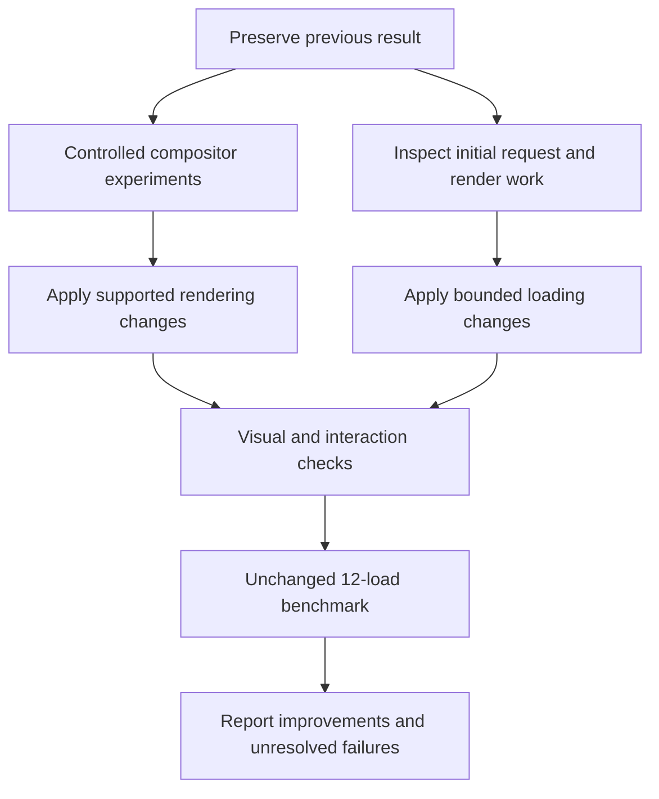

# Performance pass 2

Owner instruction: plan and implement. Scope: ARE documentation hero loading and motion.
Baseline: `HERO-PERFORMANCE-OPTIMIZATION.md` and `evidence/performance/page-before-pass-2.json`.
All loading/motion budgets remain unchanged. No publication or deployment is included.

## Hypotheses and DAG

- H1: moving artwork shares paint surfaces; narrowly scoped compositor hints reduce paint
  work without changing positions, timing or image quality. Compare browser-injected
  hints with an unmodified control before changing the product.
- H2: late discovery of hero images adds a request dependency; route-scoped image preloads
  can overlap fetching the lazy hero chunk without burdening documentation/canvas routes.
- H3: below-fold layout/paint competes with the first scene; browser rendering containment
  can defer that work while retaining searchable, accessible content and anchor navigation.

Product frontier: measured local candidate. Runnable work: diagnostics, scoped changes,
regression checks and repeated benchmark. Operational owner: workstation owner for Windows
GPU/WSL conditions; hosting owner for deployed headers. Neither grants implementation or
deployment authority beyond this exact user request. Ontology record dependencies: none.

## Open Questions

Does layer promotion improve the measured scenes enough to justify extra layer memory?
Do loading changes preserve direct anchors, focus and reduced motion? Can the remaining
headless variation be reproduced on the physical laptop? Results must retain all failures;
method and target definitions are owned by `PAGE-PERFORMANCE.md`.

## Implementation decisions

- H1 not promoted: two alternating-order repetitions improved some samples but did not
  establish a consistent pass. No permanent compositor hints were added. Headless layer
  counts were unavailable; see `evidence/performance/compositing-diagnostic.json`.
- H2 implemented in `src/heroAssets.ts`: responsive preloads begin when the intro lazy
  component is requested. Images and preloads share URLs, sizes and source candidates.
  Direct documentation visits were verified to fetch no hero images.
- H3 deferred: no evidence justified accepting containment's anchor/layout risks.
- H4 added after inspecting the remaining main-thread work: `src/particleRenderer.ts`
  shares the unchanged flow, opacity buckets and drawing cadence between a dedicated
  OffscreenCanvas worker and the main-thread fallback. DOM visibility, motion preference,
  pause, resize and pointer controls stay on the main thread. Unsupported or failed workers
  remount a fresh canvas before entering the compatibility renderer.

Worker testing includes successful initialization, unsupported browsers, a blocked worker
request, pause/resume, OS reduced motion and offscreen suspension. The worker is a same-origin
bundled module; the existing `script-src 'self'` policy allows it without broadening CSP.

The browser's 4× CPU throttle may not constrain a dedicated worker identically to the main
thread. Frame sampling still observes UI scheduling; it does not measure worker CPU or GPU
presentation. Physical laptop validation remains required. No benchmark limits were changed.

Functional verification can be repeated with `npm run test:hero`. Run
`npm run benchmark:page` separately, with other browser checks finished.

## Result — improvement, performance gate still FAIL

Evidence: `evidence/performance/page-current.json`, compared with the preserved
`page-before-pass-2.json`. All 12 load observations and 36 scene samples were recorded.
The saved report contains no browser errors. The command session returned 143 after writing
its full FAIL report; this is not a clean successful process exit. Budget failures below
remain independently visible in the saved data. The budget objects match exactly.

| Synthetic p75 measurement | Before | After | Limit |
| --- | ---: | ---: | ---: |
| Desktop cold readiness | 1.406 s | 0.976 s | 3 s |
| Desktop cold LCP | 1.264 s | 0.892 s | 2.5 s |
| Mobile cold readiness | 4.808 s | 3.138 s | 3 s — fail |
| Mobile cold LCP | 3.436 s | 2.320 s | 2.5 s |
| Mobile warm readiness | 1.751 s | 2.468 s | 3 s |
| Initial transferred bytes | 519,217 | 521,829 | 2 MiB |

The worker adds about 2 KiB compressed transfer; image bytes remain 356,326. Desktop warm
readiness is 0.711 s. Mobile cold repetitions were 2.878, 2.357 and 3.138 s. With three
repetitions the nearest-rank p75 is the largest observation, not a stable population estimate.
These are sequential local runs, not a causal isolation of each change.

- All six interaction proxies pass: desktop 36–75 ms; mobile 47–95 ms.
- All six phase-timing and pause checks pass; CLS is zero for all loads.
- Explanation-cycle frame p95 is about 16.8 ms on both profiles.
- Assembly frame p95 remains 33–50 ms desktop and 33–67 ms mobile against 25 ms.
- Mobile transition frame p95 is 17–33 ms, improved from the earlier 33–83 ms range.
- Desktop final-loop p95 worsened from about 17 ms to about 33 ms. Warm mobile readiness
  also worsened. Do not describe this as a uniform smoothness improvement.
- There are 49 motion-gate failure entries (some scenes fail multiple criteria), versus
  53 previously. This is not 49 failed tasks and is not a quality score.

Functional checks passed: build/typecheck, all asset and route bundle limits, 11 targeted
unit checks, hero artwork/seek checks, the sculpture interaction suite, and the new worker
compatibility suite. The inspected screenshot retains the composition and artwork.
Local preview responds at `http://localhost:4193/`; Windows networking was not tested here.

## Next measured work

1. Capture matched browser traces on the physical Windows laptop, including assembly and
   final-loop paint/composite work. Separate main-thread scheduling from actual presentation.
2. Investigate the mobile cold request/decode critical path and repeat the warm-load
   regression under controlled host load. Do not relax the 3 s readiness limit.
3. Make the next rendering change only against the identified bottleneck, then rerun
   `npm run test:hero` and the unchanged full benchmark. The current pass is not release clearance.

Open questions and remaining validation are owned by the section above and
`PAGE-PERFORMANCE.md`; this report does not close the performance objective.
