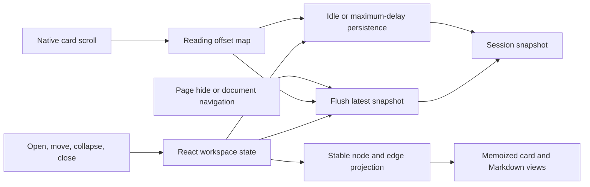

# Canvas performance contract

Status: local benchmark and architecture review. No release or deployment claim.

## Run

```sh
npm run benchmark:canvas
npm run test:canvas
```

Both commands build and serve an isolated production bundle. `ARE_CANVAS_URL` can explicitly select an existing server for functional checks; performance comparisons always use the isolated build.

The benchmark builds the production bundle, starts its own temporary loopback-only server, launches Chromium, and stops both on completion. It does not use the Vite development server, contact a model, or change the active user's browser storage. Results go to `evidence/performance/current.json`.

Use `ARE_PLAYWRIGHT_ROOT` and `ARE_CHROMIUM` for browser installation paths. The script first resolves a local Playwright package and otherwise uses this checkout's established browser-test installation. No browser download is performed.

Optional runs after building:

```sh
node scripts/benchmark-canvas.mjs --check --repeats=1
node scripts/benchmark-canvas.mjs --check --motion=normal --output=evidence/performance/motion.json
node scripts/benchmark-canvas.mjs --dist=/path/to/baseline-dist --legacy-five --scroll-only --output=evidence/performance/baseline.json
```

The `--scroll-only` option skips the subsequent article/drag checks for historical builds. It uses the same measured scroll workload. Missing instrumentation fails explicitly; a harness exception produces an ERROR report rather than a success.

Do not run comparison variants concurrently. Preserve their exact bundles or asset hashes. The JSON report includes production asset hashes, browser/Node versions, CPU, host load, viewport sizes, and the motion setting.

## Workload and gates

Each run opens 1, 3, and 5 real documentation cards at 1440 × 1000, plus 5 cards at 390 × 844. It also opens the entire reviewed guide set (currently nine cards) at both viewport sizes. The `--legacy-five` option retains the original four scenarios for historical five-guide builds. Each scenario repeats three times in fresh browser contexts. The benchmark sends 32 native wheel events with alternating directions, then allows persistence to settle.

The scroll phase requires:

- At least eight actual scroll events and a changed reading position.
- Zero application renders, card renders, and Markdown parses caused by reading.
- No canvas remount, replaced card body, removed graph node, or viewport movement.
- At most three synchronous storage writes for this bounded interaction.

It then reads the full guide, returns to the canvas, verifies the reading offset, and drags the card through 20 pointer steps. Dragging must not reparse Markdown or rerender other cards. These are workload-specific budgets; meaningful structural changes such as opening a new card are expected to render.

Frame interval p95/max, long-task counts and duration, and full-page/return latency are observations. They are not stable CI pass thresholds on a shared WSL host. Headless Chromium frame intervals are not field INP, a GPU benchmark, or a guarantee of 60 FPS on a user's device. Reduced-motion runs isolate state/rendering costs; use the normal-motion run to include the usual illustrative signals.

`?benchmark=1` enables local integer counters in the client. Without it, the counter function returns immediately. Counters record component work only, without user text or network telemetry. Storage writes are measured independently by the browser harness. The counters themselves are not a measurement of React's full commit duration.

## Initial download targets

The build enforces [performance-budget.json](performance-budget.json). Limits count JavaScript **and CSS** for each cold route, including its lazy entry and shared static dependencies, with each asset counted once.

| Route | Gzip target | Decoded target | Measured gzip after splitting |
| --- | --- | --- | --- |
| Introduction | ≤180 KiB | ≤550 KiB | 148.8 KiB |
| Documentation | ≤140 KiB | ≤450 KiB | 97.6 KiB |
| Canvas | ≤180 KiB | ≤550 KiB | 157.7 KiB |

These targets bound the initial code download and decoded payload. The previous combined bundle required 203.6 KiB gzip on every route. Targets leave headroom for reviewed additions while remaining below that baseline. They are versioned product budgets; do not raise a limit merely to silence a failing build.

Compression is a reproducible gzip-level-9 estimate, not observed server transfer. HTML, images, fonts, API responses, and later navigation are excluded. This is not a complete page-weight or load-time claim. Shared-host frame timings remain informational; the zero-rerender reading contract above remains mandatory.

`npm run build` fails if a route exceeds either limit or an expected manifest dependency is missing. `npm run test:downloads` also checks the budget logic and verifies that cold Chromium requests match the declared route dependency closure. `npm run test:canvas` includes these checks along with canvas behavior. New route-specific lazy dependencies must be added to the budget roots; the browser proof catches uncounted initial JS/CSS.

Evidence: [before](evidence/performance/download-before.json), [current route sizes and asset hashes](evidence/performance/download-current.json), and [cold-browser requests](evidence/performance/download-browser.json).

The introduction and graph now load through separate lazy page components. Workspace state and coalesced scroll persistence remain in the application owner. Loading a page displays a status message; the existing cards, viewport, and reading offsets remain in the workspace when changing routes.

## State and rendering architecture



Reading offsets do not affect graph layout and therefore do not belong on the graph render path. `workspacePersistence.ts` holds their latest values and merges them into serialized snapshots. `useWorkspacePersistence.ts` owns the browser lifecycle. Writes occur after 250 ms idle, at most after 1 second of continuous changes, and at navigation/page-hide boundaries. A storage failure keeps the working in-memory view available.

Structural workspace state remains above the canvas/article branches so changing views does not discard it. The graph preserves unaffected node objects, card data, and callbacks. Position updates do not invalidate document content. Edges depend on lens, motion, and document relationships rather than reading offsets. Markdown is memoized independently of card layout.

Programmatic viewport changes explicitly record the resulting viewport after completion. They do not rely solely on pointer-movement events. Reset intentionally creates a fresh canvas instance. Normal reading, dragging, and returning from a guide do not.

## Review findings

| Area | Finding | Disposition |
| --- | --- | --- |
| Reading state | Every scroll previously updated App and rebuilt the graph | Fixed: reading offsets bypass React render state |
| Node identity | Fresh node data and callbacks defeated card memoization | Fixed: stable actions and per-node identity reuse |
| Markdown | The same guide was reparsed throughout a scroll or drag | Fixed: isolated memoized document rendering |
| Persistence | Every scroll serialized the full workspace synchronously | Fixed: coalescing with idle/max-delay and lifecycle flushes |
| Viewport | Initial programmatic reveal was not reliably recorded through move-end events alone | Fixed: explicit completion capture; return/reload regression tests |
| Redundant events | Same-position, same-selection, and duplicate-open events still created work | Fixed: equality guards and structural sharing |
| Content loading | Introduction and graph previously loaded on every route | Fixed: lazy route components and enforced per-route JS/CSS budgets; article text remains in the shared entry |
| Landing animation | Hero's frame loop remains scheduled while paused, offscreen, or finished, though it skips work; cleanup cancels it on unmount | Open: replace idle scheduling with a wake/sleep loop and benchmark the introduction separately |
| Particle animation | Visibility, reduced motion, pause, and unmount cleanup are present | Reviewed; not a source of canvas scrolling rerenders because the introduction is unmounted |
| Search | Current nine-document text scan is small; no large-corpus performance qualification | Open: index/precompute when the public corpus expands |
| Navigation | Hash and popstate listeners can report the same route twice | Low-priority follow-up; not on the scroll hot path |
| Content security | Markdown renders through React elements, and private source links are not emitted as public routes | Preserved; this is a client performance review, not a server security audit |
| Test strategy | Prior functional checks proved behavior but did not count redundant work | Fixed: production performance regression gates plus persistence unit tests |

Research basis: [React Flow performance guidance](https://reactflow.dev/learn/advanced-use/performance) recommends stable components, callbacks, and props and avoiding broad state subscriptions. [React memo](https://react.dev/reference/react/memo) explains why newly created objects/functions defeat shallow prop comparisons. [MDN Web Storage](https://developer.mozilla.org/en-US/docs/Web/API/Web_Storage_API) documents the synchronous nature of storage operations. The measured ARE failure and fix are established by the local benchmark, not inferred solely from those recommendations.

## Open Questions

- Which supported devices and browsers should define a reproducible frame-time budget?
- What field load-time/interaction telemetry, if any, should be collected with user consent and clear retention rules?
- Should a future public corpus lazily load article bodies and build a dedicated search index?
- Which introduction animation and initial bundle-size budgets should be adopted in the next performance chapter?
