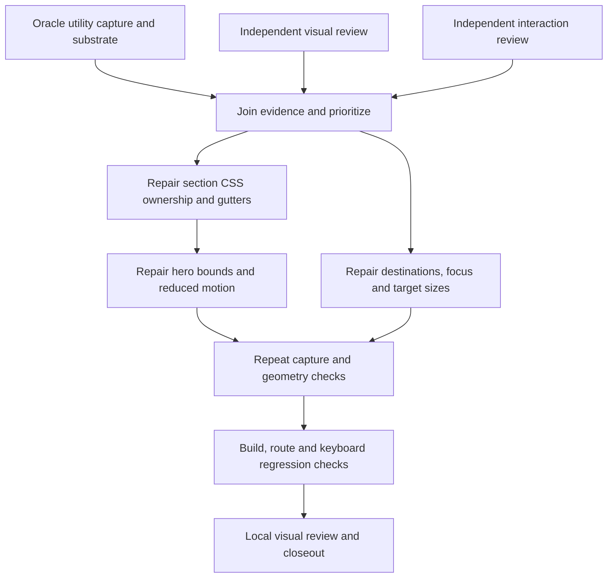

# ARE UI review and repair DAG

Date: 2026-09-18. Owner-authorized local prototype fixes. No deployment or model calls.

## Evidence substrate

TasteCheck was located through DomainSpec Core's Body War evidence references at sibling `../tastecheck`. Its `improve-existing-website` skill guides preserving identity while normalizing drift. The actual Taste Oracle `findClippedProbes`, `hashBytes`, and `hashCanonicalJson` functions run through `scripts/ui-review-substrate.mjs`. Baseline: `evidence/ui-review-baseline/substrate.json`, with 15 viewport screenshots plus DOM, style, bounds and hashes.

Baseline checks: cycle alignment FAIL; capability alignment FAIL; standalone targets ≥24px FAIL; horizontal overflow PASS. Oracle clipping output is diagnostic: a tall scrolled section legitimately exceeds a viewport. Full tri-arm blinded judge/statistical pipeline is NOT_EVALUATED: the upstream pipeline is fixed to its own fixture and requires independently declared evaluator families. Two same-family agent reviews are not presented as that quorum. No Oracle certification or taste score is invented.

## Independent reviews

Two read-only reviewers independently inspected rendered pages and source. Visual review covered1440/390/240; interaction review added768/320 and reduced motion. Both independently found the same40px sibling offset. Review findings:

| ID | Defect | Fix and acceptance |
| --- | --- | --- |
| U1 | Descendant-wide section spacing offsets nested grid siblings40px | Remove broad rule; each section owns its spacing. Cycle and capability row tops differ by ≤1px. |
| U2 | Hero art overlaps caption and clips at240px | Reserve caption outside art and bound narrow composition; inspect all settled scenes. |
| U3 | Double gutters shrink240px chat content to160px | Full-width section bands with one content gutter; at least208px available on240px. |
| U4 | Tiny nav and reset targets | Minimum44px standalone hit areas and explicit wrapping; no overflow. |
| U5 | Reduced motion hides hero visually but leaves controls tabbable | Visible static intro with equivalent actions; hidden animated hero removed from focus tree. |
| U6 | Go to docs opens canvas | Correct documentation destination, preserve separately labelled canvas action. |
| U7 | Introduction link does not return to top | Shared home action scrolls/focuses introduction even when hash is unchanged. |
| U8 | Canvas and full reader open without entry focus | Focus explanation heading, preserve close restoration; remove duplicate graph node tab stops. |
| U9 | No skip navigation | Visible-on-focus skip link goes to active content. |

## DAG

## D65 and scope

Product frontier: existing documentation prototype. Runnable work: styles, accessible route transitions, local capture/check scripts. Write ceiling: this directory. Preserve blue/holographic identity, hero scene sequence, icon-led lists, honest benchmark copy, live chat and canvas. No engine or sibling source changes. No ontology selectors required. Source lookup and read-only tool use confer no publication authority. Operational hosting, public quotas and raw benchmark recovery remain deferred to their owners.

## Open Questions

A full external-family Oracle judging protocol and human usability study are not part of these repairs. Viewport evidence is bounded, not an accessibility certification. Historical CSS outside affected active selectors remains a later cleanup opportunity.

## Completion evidence

Implemented U1–U9. Final source build passes; Vite retains a 514kB bundle-size advisory. Existing capability/navigation proof passes35 checks. Focused UI repair proof passes29 checks, including desktop/home/reader routes, eight narrow settled-scene geometry checks and their caption clearances, single chat gutters, header containment, reduced-motion static presentation, skip focus and duplicate graph tab removal. No live provider calls were used.

Baseline and final substrates preserve separate screenshots and measurements under `evidence/ui-review-baseline/` and `evidence/ui-review-final/`. The intermediate `ui-review-repaired` capture is retained: mobile header containment was improved afterward. Cycles and capability rows now align; measured standalone controls clear the24px floor (primary nav/reset targets use44px); horizontal fit passes at1440/390/240. Viewport screenshots were used to avoid sticky-header artifacts in tall element captures.

The Oracle result remains **applicable utility checks executed, full judge pipeline NOT_EVALUATED**. Independent reviewer findings were reconciled, not represented as a cross-family blinded panel. Further visual/user research remains distinct from these demonstrated repairs.
