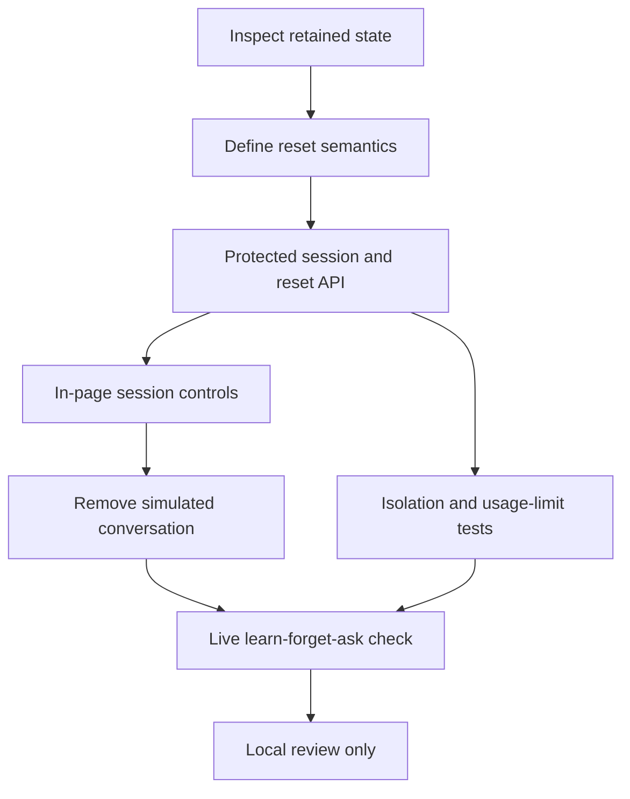

# Visitor chat, state resets, and protections

Date: 2026-09-17. Status: local owner-directed prototype; no deployment.

## Objective and construction boundary

Make the live ARE chat discoverable within the page, give each visitor fresh ARE state, and provide controls to forget language, reset routing history, or start fresh. The user's subsequent instruction explicitly keeps work local, adds protections, and removes the simulated agent conversation. This supersedes the comparison-simulation provisions of [LIVE-CHAT-PLAN.md](LIVE-CHAT-PLAN.md).

D65 fields: the current product frontier is isolated live interaction with meaningful forgetting. Runnable work is the protected session/reset API, page controls, and unit/live browser verification. The exact write ceiling is this prototype directory and ignored evidence/build output; engine and authority sources remain unchanged. The local source-verified profile and existing encrypted credential provider are prerequisites. No ontology runtime selectors are required. VPS deployment, TLS/reverse proxy setup, durable quotas and multi-instance storage remain future product-owner/host-operator work. No remote connection, service installation, public binding, or deployment configuration is performed. Public exposure review remains deferred operational residue; local tests are not release approval.

## Task DAG

## Reset semantics

Each conversation has its own ARE runtime, intent predecessor, semantic adapter/cache, ledger, messages, and preferences. The current browser implementation keeps the random session capability in same-tab `sessionStorage`, not a cookie or persistent `localStorage`, so a refresh can restore the conversation after server revalidation. Restoration is bound to a random marker in that tab's history state; hash navigation preserves the marker, and an opener-created tab with cloned storage discards the inherited capability. This is a tested opener case, not a universal duplicate-tab or browser-variant guarantee. Leaving aborts an active request; it does not currently send a deletion request. Idle sessions expire at the server-configured boundary on subsequent API activity, and the browser renders that reported duration rather than a hard-coded policy claim. Local development defaults to 30 minutes; the production entry point requires an explicit owner-selected positive integer duration. Restarting the server discards process-local state.

| Control | Language preferences | Routing history | Model transcript, intent chain, ledger |
| --- | --- | --- | --- |
| Forget language | Cleared | Retained for inspection only | Fresh |
| Reset routing history | Retained | Cleared | Fresh |
| Start fresh | Cleared | Cleared | Fresh; visible transcript also cleared |

Resets rotate conversation identity and capability. Partial resets keep earlier messages only in the browser, marked as excluded from model context. Neither model call receives that old transcript. Per-visit and shared usage allowances survive resets.

There are no learned routing rules in this adapter. Reset routing clears decision history and prior intent, not the source registry. Language forgetting changes session context, not model weights. New instructions after a reset can create new preferences normally.

## Local protections

- Encrypted secret resolution on the server; no provider key in the browser bundle.
- Loopback-only serving; exact origin and Host checks; same-origin JSON for mutations.
- A random 256-bit capability for subsequent turns, inspection, reset, and deletion; constant-time comparison and rotation on reset. Browser evidence omits capabilities.
- Closed input shapes; 12 KiB HTTP bodies, 6,000-byte messages and ten-second body deadline. Provider requests/responses cap at 32,768/262,144 bytes.
- One active turn per session, two server-wide, 32 retained sessions, 20 attempts per visit, and 30 turns per process-wide hourly window.
- A shared 100,000-token hourly allowance. Each call reserves 37,000 tokens for bounded input/output/framing. Successful calls settle to reported usage. Unknown usage on failed/cancelled dispatches consumes the reservation conservatively; reservation accounting is not actual billing. New sessions and resets cannot bypass it. Restarting the process clears it; public deployment needs a durable policy.
- At most two model calls per turn, no automatic retries, 2,048 output tokens per call, 60-second provider I/O timeout, 15-second maximum secret-resolution timeout, and 150-second turn deadline.
- Stop/reset/disconnect/shutdown abort pending work; browser generation guards reject late replies.
- Validated model classification and exact preference quotes; allowlisted diagnostic codes instead of raw errors; no simulated fallback.
- A verified `selection.no-match` router block may still receive a real model-generated, conversation-only reply. The activity and checkpoint preserve the no-route verdict and zero-tool boundary. Ambiguous selections, unavailable semantic evidence, source failures, and other gates or blocks still stop the reply; inferred intent never becomes an explicit route signal.
- Escaped React text output. No filesystem, shell, live search, application-test, or deployment tools are attached.

These protections apply to a bounded local prototype. They do not establish answer accuracy, general prompt-injection immunity, security certification, or production readiness.

## Source and evidence

[Session runtime](server/chat.mjs), [HTTP boundaries](server/http.mjs), [GLM adapter](server/glm.mjs), [visitor UI](src/LiveChat.tsx), [backend tests](server/chat.test.mjs), [live chat proof](scripts/live-chat-proof.mjs), and [live forgetting proof](scripts/visitor-reset-proof.mjs).

Final results are recorded in [README.md](README.md#visitor-state-and-chat-protections). Browser evidence remains in ignored `evidence/`; real provider usage and conservative failure reservations are separate quantities.

## Open Questions

- What durable aggregate/per-visitor budget should apply before eventual public hosting?
- Which learned routing-rule capability should be integrated later? The UI must not imply one already exists.
- Should individual preferences be removable beyond the current clear-all language control?
- Should the current same-tab refresh retention remain, and what additional browser-variant or duplicate-tab proof is needed beyond the passing opener-created-tab regression?
- What review is needed before attaching real execution tools?
